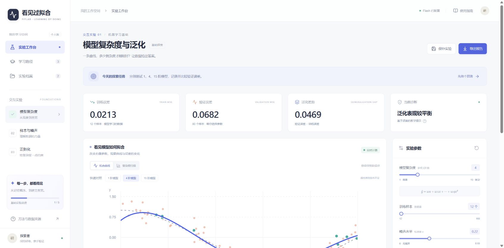

# 看见过拟合 · FitLab

交互式机器学习实验与诊断工作台。用真实计算理解模型复杂度、样本量、噪声与正则化，通过预测、实验、解释和练习形成学习闭环。

拖动滑块，观察模型怎样从捕捉规律变成拟合噪声；把不同实验放在一起比较，再让AI根据这次实验的实际指标解释现象。

从合成曲线建立直觉，再到公开数据比较模型。支持参数干预、固定条件对照、配对划分复核，以及基于真实指标的AI解释。



- [功能设计](docs/FUNCTIONAL_DESIGN.md)
- [开发计划](docs/DEVELOPMENT_PLAN.md)
- [AI开发记录](docs/ai-process/README.md)

当前为本地可运行的0.2版，提供合成实验工作台与真实数据实验台。计算、数据读取和实验记录可在本地运行，AI解释通过配置的模型API提供。实际核验范围见[验收记录](docs/VALIDATION.md)。

## 真实数据实验台

| 数据集 | 可用记录 | 特征 | 预测目标 |
|---|---:|---:|---|
| UCI Wine Quality（红葡萄酒） | 1599 | 11 | 质量评分 |
| UCI Auto MPG | 392 | 7 | 燃油经济性（mpg） |
| UCI Concrete Compressive Strength | 1030 | 8 | 抗压强度（MPa） |

三个快照均附CC BY 4.0来源、处理说明和SHA-256校验值；Auto MPG去除了6条缺失马力的记录。数据随仓库提供，应用运行时不必下载。详细来源见[data/public](data/public/README.md)。

- 模型：岭回归、决策树、60棵树的随机森林，另有均值基线供对照。
- 展示：预测对照、残差诊断、特征关系、学习曲线、模型对照、稳定性复核。
- 公平比较：相同特征记录按组划分，固定验证集合，标准化与类别编码仅拟合训练数据。
- 可检验的解释：AI收到后端重算的实际指标、适用控件，以及已执行的模型对照和配对复核。
- 测试接触记录：浏览器记住已查看的测试结果；改参和重划分后继续提示其属于探索，严格终评需独立新数据。
- 实验收藏：当前浏览器保留最近12组真实数据实验条件，可一键恢复并重算。

## 安装与启动

使用Node.js 20.9+、Python 3.13。克隆后，在项目根目录运行：

```powershell
npm.cmd ci
python -m pip install -r requirements.txt
.\scripts\start.ps1
```

打开 http://127.0.0.1:3000 。启动脚本从当前Python环境获取解释器；也可通过`FITLAB_PYTHON`环境变量、忽略的`.env.local`文件，或`-Python`参数选择已有环境。关闭运行终端或Ctrl+C可停止服务。3000和8000端口需空闲。

其他系统可分别运行`python -m uvicorn backend.main:app --host 127.0.0.1 --port 8000`与`npm run dev`。

依赖版本已锁定。安装与启动速度取决于环境和网络，可运行`python scripts/check_environment.py`核对版本。

## AI配置

复制`backend/.env.example`为`backend/.env`并设置`AI_API_KEY`。配置项：

```dotenv
AI_BASE_URL=https://api.deepseek.com/v1
AI_MODEL=deepseek-flash
AI_API_KEY=填写你自己的密钥
AI_REASONING_EFFORT=xhigh
AI_MAX_TOKENS=8192
AI_TIMEOUT=90
```

密钥保存在忽略的本地配置中。修改配置后重启后端。无API时实验、练习、记录照常运行，教练明确显示规则分析。接口故障也显示降级原因。密钥不进入前端、Git或导出报告。

DeepSeek兼容接受`xhigh`并映射为原生`high`，请求启用思考模式；应用只展示最终解释和用量，不展示推理过程。参数规则见[官方说明](https://api-docs.deepseek.com/api/create-chat-completion/)。

## 验证

```powershell
python -m pip install -r requirements-dev.txt
python -m pytest tests -q
npm.cmd run typecheck
npm.cmd run build
```

测试依赖：`requirements-dev.txt`。数值来源为独立随机流生成的合成数据，预处理只在训练集拟合，验证集供调参，测试集在点击最终评估后才揭示。改变参数使旧测试结果和解释失效。改变噪声会用同一噪声抽样缩放三组标签，改变样本量则保持验证与测试数据不变。

真实数据的配对验证可用`python scripts/validate_bench.py`复现；[原始运行记录](experiments/improvement/real-data-v1/results.json)包含63组条件与验证结果。不同数据集的RMSE单位不同，不进行跨数据集直接排名。三种子的均值与样本标准差只描述划分波动，不作为置信区间。

运行数据保存在`data/fitlab.sqlite`，不随仓库发布。学习进度保存在当前浏览器。仓库中的截图与开发验收记录是开发证据，不是学生学习效果研究数据。

报告在弹窗中预览或复制，也可点击附件链接下载。当前Chrome策略会拦截自动化附件导航，已核验的可用获取方式是在线预览/复制；标准附件接口另经HTTP验证。示例报告在`artifacts/sample-report.json`和`.md`。

## 比赛与开发记录

- 真实公开会话与工具事件：`docs/ai-process/`。用`scripts/export_ai_process.py --session <当前会话jsonl>`更新；导出仅包含本项目开始后的公开信息，排除内部推理与凭据。
- Git提交使用仓库内的自动化作者`Codex <codex@local.invalid>`，清楚标识AI生成工作；未来参赛者自己的提交使用本人身份。
- GitHub公开仓库：https://github.com/ioytgvcbtr-pixel/see-overfitting 。保留完整提交历史，主分支为main，开发在feature分支进行。
- 当前优先完善项目功能与体验。正式比赛材料准备暂缓；已有[交付清单](docs/COMPETITION_CHECKLIST.md)保留作后续参考。
