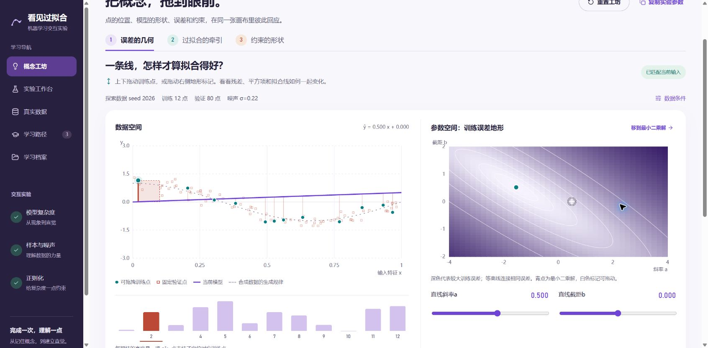
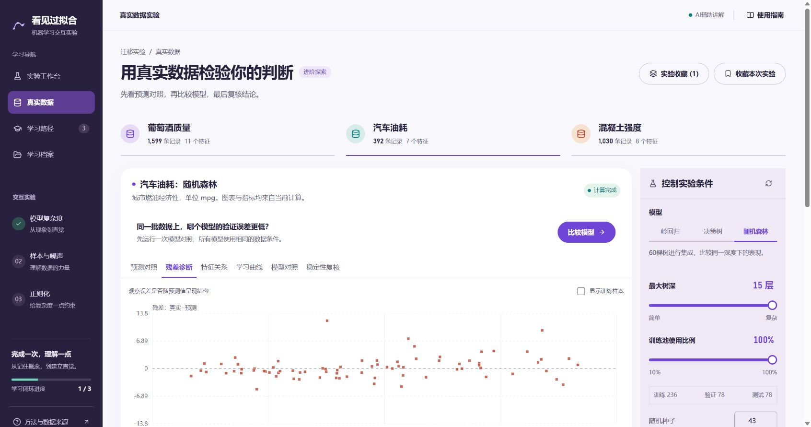

# 看见过拟合 · FitLab

交互式机器学习实验与诊断工作台。用真实计算理解模型复杂度、样本量、噪声与正则化，通过预测、实验、解释和练习形成学习闭环。

拖动训练点和参数标记，把残差、损失地形、样本牵引与正则化变成可以亲手操纵的图形；再到学习工作台完成预测、实验和迁移验证。

从合成曲线建立直觉，再到公开数据比较模型。支持参数干预、固定条件对照、配对划分复核，以及基于真实指标的AI解释。



- [功能设计](docs/FUNCTIONAL_DESIGN.md)
- [开发计划](docs/DEVELOPMENT_PLAN.md)
- [界面设计与参考依据](design-system/fitlab/MASTER.md)
- [学习闭环与可核验实验](docs/LEARNING_LOOP.md)
- [0.5逐项改进与界面方案](docs/REFINEMENT_V05.md)
- [概念工坊与前端参考](docs/CONCEPT_WORKSHOP.md)
- [AI开发记录](docs/ai-process/README.md)

当前为本地可运行的0.6版，提供概念工坊、合成学习工作台与真实数据实验台。按初学者的学习顺序组织预测、操作、证据和迁移验证；计算、数据读取和学习记录在本地运行，AI解释及实验假设通过配置的模型API提供。实际核验范围见[验收记录](docs/VALIDATION.md)。

## 把概念拖到眼前

默认进入概念工坊，三个面板共用训练条件与样本编辑：

| 面板 | 直接操作 | 联动证据 |
|---|---|---|
| 误差的几何 | 上下拖点；拖动Canvas地形中的参数标记；调节斜率和截距 | 拟合线、残差平方、逐点误差柱、训练/验证MSE与最小二乘解 |
| 过拟合的牵引 | 同一标签扰动作用于3阶参考与可调阶数模型 | 原始/编辑后曲线、共用色标的变化带、曲线变化RMS与验证误差变化 |
| 约束的形状 | 调α、模型阶数，点击正则化路径节点 | 标准化系数、系数范数、拟合曲线，以及SSE＋α‖w‖² |

React管理输入和请求，SVG负责可访问的点与曲线，Canvas 2D绘制41×41损失地形。指标、系数和等高线由Python后端实际计算；拖动限频请求，更新期间明确标出指标为最近实算。滑块和选点有键盘替代，输入可刷新恢复，参数可复制。探索不写入学习成绩，验证点不能拖动，独立测试指标不返回。

前端机制参考[TensorFlow Playground](https://playground.tensorflow.org/)、[Seeing Theory](https://seeing-theory.brown.edu/regression-analysis/index.html)与[Distill的动量解释](https://distill.pub/2017/momentum/)，图形与代码自行实现。二维教学使用React＋SVG＋Canvas，图形围绕概念和实算证据组织。

[配对样本牵引](artifacts/screenshots/concept-sensitivity-v06.jpg) · [系数与正则化路径](artifacts/screenshots/concept-regularization-v06.jpg) · [手机概念工坊](artifacts/screenshots/concept-mobile-v06.jpg)

## 科学探索馆

界面采用深紫导航、明亮画布和紫/青/橙学习阶段。曲线航线由实际学习进度驱动，可跳到已解锁区域；预测选择、指标和记录采用开放排版，绘图与参数共享连续工作区。设计依据和色值见[视觉覆盖规则](design-system/fitlab/pages/observatory.md)。

学习档案分为学习足迹、AI核验和已保存实验。支持回看或继续最近50轮学习，以及换用未使用的种子重练；旧判断和错答保留。新数据的待预测条件在提交前刷新也能恢复。

AI实验执行后可以恢复执行前条件、再回看执行后条件，原核验记录保持不变。真实数据记住当前数据集、模型、参数和展示方式；基础图表按恢复条件重新计算。报告按学习轮次从后端补齐已关联的执行证据，刷新不再依赖本页临时ID。

## 从一次对照开始

每个基础实验提供三个推荐条件：比较模型阶数、样本量或正则化强度。先选择预测和信心，提交后才显示结果；预测、理由与时间保留在本轮记录中。后端实际计算返回后才计入观察，修改固定条件需要重新预测。三组完成后，对照预测与实际最低验证误差，再换一个随机种子回答模型选择和判断依据。

迁移题由后端按新数据判分，选择与依据均正确才完成本轮。错答保留，重试更换数据；刷新恢复当前课程、条件和作答。旧版练习进度不计入新闭环。完成迁移后开放合成实验的最终测试入口。

[开放式预测入口](artifacts/screenshots/observatory-prediction-v05.jpg) · [手机预测入口](artifacts/screenshots/observatory-mobile-prediction-v05.jpg)

## 让AI建议接受实验检验

点击“生成可执行实验建议”，AI从合法单变量候选中选择一个方案，界面呈现原值、目标值、假设和方向预期。基础课还会参考后端保存的原预测与已提交迁移反馈，可围绕错误判断提出反证实验。点击“执行并核验”后，后端重算前后指标并应用到工作台；预期可能得到支持，也可能被实际结果否定。条件变化后旧方案不可执行。API或格式失败明确显示规则建议。

本次真实联调：15阶降到4阶后，验证MSE从0.153804降到0.068185，支持改善预期；混凝土树深5降到2后，验证RMSE从11.1141升到12.0097 MPa，不支持改善预期。它们只是固定条件下的开发验收实例，不代表普遍最优。

核验档案保留前后参数、指纹、指标、模型来源和执行时间。学习记录与本页执行的核验可进入功能报告。模型不会直接执行代码，也不读取测试指标；Flash保持xhigh配置。结构化输出依据[DeepSeek JSON模式说明](https://api-docs.deepseek.com/guides/json_mode/)，其候选与方向仍由本应用再次校验。

[核验机制与实际验证记录](docs/VALIDATION.md)

真实数据实验按“比较模型 → 复核结论 → 解释结果”给出下一步操作，同时保留六种自由探索视图。界面使用系统中文字体、清晰焦点与形状区分数据，无需远程字体。

## 真实数据实验台

| 数据集 | 可用记录 | 特征 | 预测目标 |
|---|---:|---:|---|
| UCI Wine Quality（红葡萄酒） | 1599 | 11 | 质量评分 |
| UCI Auto MPG | 392 | 7 | 燃油经济性（mpg） |
| UCI Concrete Compressive Strength | 1030 | 8 | 抗压强度（MPa） |

三个快照均附CC BY 4.0来源、处理说明和SHA-256校验值；Auto MPG去除了6条缺失马力的记录。数据随仓库提供，应用运行时不必下载。详细来源见[data/public](data/public/README.md)。

- 模型：岭回归、决策树、60棵树的随机森林，另有均值基线供对照。
- 展示：预测对照、残差诊断、特征关系、学习曲线、模型对照、稳定性复核。
- 公平比较：相同特征记录按组划分，固定验证集合，标准化与类别编码仅拟合训练数据。
- 可检验的解释：AI收到后端重算的实际指标、适用控件，以及已执行的模型对照和配对复核。
- 测试接触记录：浏览器记住已查看的测试结果；改参和重划分后继续提示其属于探索，严格终评需独立新数据。
- 实验收藏：当前浏览器保留最近12组真实数据实验条件，可一键恢复并重算。



[学习复盘](artifacts/screenshots/observatory-notebook-v05.jpg) · [手机实验画布](artifacts/screenshots/observatory-mobile-v05.jpg)

## 安装与启动

使用Node.js 20.9+、Python 3.13。克隆后，在项目根目录运行：

```powershell
npm.cmd ci
python -m pip install -r requirements.txt
.\scripts\start.ps1
```

打开 http://127.0.0.1:3000 。启动脚本从当前Python环境获取解释器；也可通过`FITLAB_PYTHON`环境变量、忽略的`.env.local`文件，或`-Python`参数选择已有环境。关闭运行终端或Ctrl+C可停止服务。3000和8000端口需空闲。

其他系统可分别运行`python -m uvicorn backend.main:app --host 127.0.0.1 --port 8000`与`npm run dev`。

依赖版本已锁定。安装与启动速度取决于环境和网络，可运行`python scripts/check_environment.py`核对版本。

## AI配置

复制`backend/.env.example`为`backend/.env`并设置`AI_API_KEY`。配置项：

```dotenv
AI_BASE_URL=https://api.deepseek.com/v1
AI_MODEL=deepseek-flash
AI_API_KEY=填写你自己的密钥
AI_REASONING_EFFORT=xhigh
AI_MAX_TOKENS=8192
AI_TIMEOUT=90
```

密钥保存在忽略的本地配置中。修改配置后重启后端。无API时实验、练习、记录照常运行，教练明确显示规则分析。接口故障也显示降级原因。密钥不进入前端、Git或导出报告。

DeepSeek兼容接受`xhigh`并映射为原生`high`，请求启用思考模式；应用只展示最终解释和用量，不展示推理过程。参数规则见[官方说明](https://api-docs.deepseek.com/api/create-chat-completion/)。

## 验证

```powershell
python -m pip install -r requirements-dev.txt
python -m pytest tests -q
npm.cmd run test:ui
npm.cmd run typecheck
npm.cmd run build
```

测试依赖：`requirements-dev.txt`；`test:ui`使用Node.js 22.18+的原生TypeScript支持。数值来源为独立随机流生成的合成数据，预处理只在训练集拟合，验证集供调参，测试集在点击最终评估后才揭示。改变参数使旧测试结果和解释失效。改变噪声会用同一噪声抽样缩放三组标签，改变样本量则保持验证与测试数据不变。

真实数据的配对验证可用`python scripts/validate_bench.py`复现；[原始运行记录](experiments/improvement/real-data-v1/results.json)包含63组条件与验证结果。不同数据集的RMSE单位不同，不进行跨数据集直接排名。三种子的均值与样本标准差只描述划分波动，不作为置信区间。

运行数据保存在`data/fitlab.sqlite`，不随仓库发布。学习进度保存在当前浏览器。仓库中的截图与开发验收记录是开发证据，不是学生学习效果研究数据。

报告在弹窗中预览或复制，也可点击附件链接下载。当前Chrome策略会拦截自动化附件导航，已核验的可用获取方式是在线预览/复制；标准附件接口另经HTTP验证。示例报告在`artifacts/sample-report.json`和`.md`。

## 比赛与开发记录

- 真实公开会话与工具事件：`docs/ai-process/`。用`scripts/export_ai_process.py --session <当前会话jsonl>`更新；导出仅包含本项目开始后的公开信息，排除内部推理与凭据。
- Git提交使用仓库内的自动化作者`Codex <codex@local.invalid>`，清楚标识AI生成工作；未来参赛者自己的提交使用本人身份。
- GitHub公开仓库：https://github.com/ioytgvcbtr-pixel/see-overfitting 。保留完整提交历史，主分支为main，开发在feature分支进行。
- 当前优先完善项目功能与体验。正式比赛材料准备暂缓；已有[交付清单](docs/COMPETITION_CHECKLIST.md)保留作后续参考。
