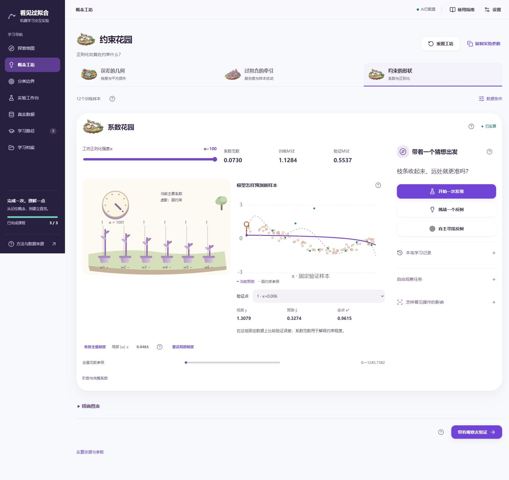
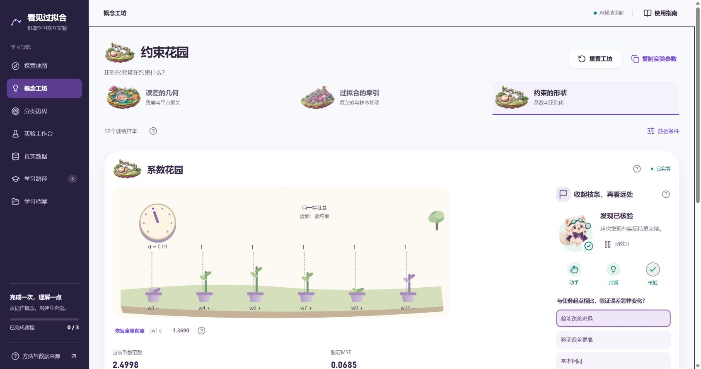
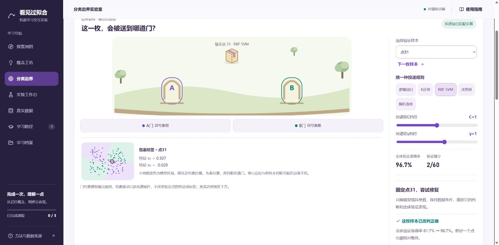
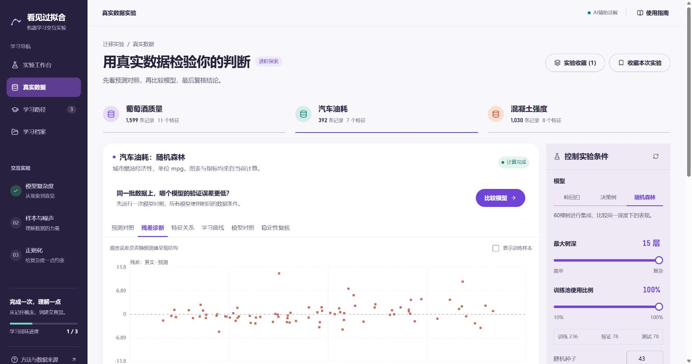

# 看见过拟合 · FitLab

交互式机器学习实验与诊断工作台。用真实计算理解模型复杂度、样本量、噪声与正则化，通过预测、实验、解释和练习形成学习闭环。

拖动训练点和参数标记，把残差、损失地形、样本牵引与正则化变成可以亲手操纵的图形；再到学习工作台完成预测、实验和迁移验证。

从合成曲线建立直觉，再到公开数据比较模型。支持参数干预、固定条件对照、配对划分复核，以及基于真实指标的AI解释。



- [功能设计](docs/FUNCTIONAL_DESIGN.md)
- [开发计划](docs/DEVELOPMENT_PLAN.md)
- [界面设计与参考依据](design-system/fitlab/MASTER.md)
- [学习闭环与可核验实验](docs/LEARNING_LOOP.md)
- [0.5逐项改进与界面方案](docs/REFINEMENT_V05.md)
- [概念工坊与前端参考](docs/CONCEPT_WORKSHOP.md)
- [逐环节复评与0.7改进](docs/REVIEW_V07.md)
- [0.7实际验收](docs/VALIDATION_V07.md)
- [0.8界面自评与参考](docs/UI_REVIEW_V08.md)
- [0.8实际验收](docs/VALIDATION_V08.md)
- [0.9场景设计与教学网站参考](docs/SCENE_DESIGN_V09.md)
- [0.9实际验收](docs/VALIDATION_V09.md)
- [0.10岛内互动设计](docs/INTERACTIVE_ISLANDS_V10.md)
- [0.10实际验收](docs/VALIDATION_V10.md)
- [0.11界面规范与后续细节](docs/UI_POLISH_V11.md)
- [0.11实际验收](docs/VALIDATION_V11.md)
- [0.12挑战续接与角色反馈](docs/LEARNING_COMPANION_V12.md)
- [0.12实际验收](docs/VALIDATION_V12.md)
- [0.13四岛学习与AI操作](docs/ISLAND_LEARNING_V13.md)
- [0.13实际验收](docs/VALIDATION_V13.md)
- [0.14启动与学习流程](docs/WORKSPACE_FLOW_V14.md)
- [0.14实际验收](docs/VALIDATION_V14.md)
- [0.14官方要求复核与严格自评](docs/REVIEW_V14.md)
- [0.15教学质量改进](docs/TEACHING_QUALITY_V15.md)
- [0.15实际验收](docs/VALIDATION_V15.md)
- [0.15官方对照评分与改进优先级](docs/REVIEW_V15.md)
- [0.16题目、因果可视化与迁移改进](docs/LEARNING_REFINEMENT_V16.md)
- [0.16实际验收](docs/VALIDATION_V16.md)
- [下一阶段规划：模力星球机器学习实验课堂](docs/MODEL_PLANET_REDESIGN.md)
- [AI开发记录](docs/ai-process/README.md)

当前为本地可运行的0.16版。新迁移题先锁定判断，再选择依据；候选和答案位置由确定性实算组织。约束花园可选择系数项、移动验证探针，联动观察预测曲线与残差，主控件和关键读数相邻。AI实验核验后可直接进入另存的新情境，保留来源与辅助标记。原始首答、失败尝试、旧题成绩和备份恢复继续保留；核心流程不依赖公网API。范围与限制见[0.16验收](docs/VALIDATION_V16.md)。

## 从打开，到下次继续

首页“开始学习”从误差湖进入第一轮；“继续”从本机学习记录找到未完成课程或岛屿；自由探索保留全部科学场景。完成迁移后可前往下一岛，未通过时可围绕原误区复练，原错答不改写。有限题库重复时会提示。

中途草稿保存输入、选点、预测理由与未提交迁移选择。浏览器有界草稿兜底，服务端校验阶段和保存顺序，恢复后重新计算；迟到草稿不能覆盖已提交答案。浏览器没有续接入口时，首页和档案仍能从SQLite找回记录与课程统计。

设置区分已配置、连接测试结果和规则模式。已有密钥留空保留，修改保存后生效；主动测试才调用模型。JSON备份排除模型配置及待答隐藏答案，先预览并复算，再合并恢复；已有同标识记录保持，导入来源可见。

[设置](artifacts/screenshots/workspace-settings-v14.jpg) · [统一档案](artifacts/screenshots/workspace-records-v14.jpg) · [AI证据](artifacts/screenshots/workspace-ai-v14.jpg) · [恢复预览](artifacts/screenshots/workspace-restore-v14.jpg) · [准确续接](artifacts/screenshots/workspace-resume-v14.jpg) · [手机](artifacts/screenshots/workspace-mobile-v14.jpg)

## 先猜一次，再让实验回答

每岛可选择“一次发现”或“反例挑战”。先提交预测与信心，再使用场景控件完成指定的单变量操作；核验后换一组数据，提交判断与依据，最后才揭示迁移结果。常规与反例在迁移时交替，首次错答保留，使用提示或AI辅助单独标明。完成后可回看原预测、信心、实验与迁移，也可恢复对应场景。

| 岛屿 | 反例关注什么 |
|---|---|
| 误差湖 | 训练MSE下降，验证MSE仍可能上升 |
| 曲线山 | 曲线被牵动得更多，验证MSE仍可能更低 |
| 约束花园 | 系数收缩，验证MSE仍可能上升 |
| 边界森林 | 救回单个错分，整体准确率仍可能下降 |

题目由后端在限定候选中实算筛选，结果不预先返回。学习过程保存在本机SQLite，浏览器仅保存记录ID；自由观察草稿继续单独保存，原三门正式课程记录保持独立。

观察核验后可以展开AI实验工具：先查看一个合法单变量方案，再执行并重算验证表现。允许结果不支持AI预期，API失败明确显示规则方案；已执行证据刷新后可回看，参数变化使旧方案失效。迁移作答期间暂停AI工具。

首次引导可收起；模型和滑块在场景旁，任务每次突出当前阶段。操作后的因果回放保留最近一次真实前后数值，角色恢复时不重播，系统减少动态效果会关闭动画。

[预测阶段](artifacts/screenshots/island-prediction-v13.jpg) · [反例复盘](artifacts/screenshots/island-counterexample-v13.jpg) · [AI核验](artifacts/screenshots/island-ai-v13.jpg) · [森林场景](artifacts/screenshots/island-forest-v13.jpg) · [手机反馈](artifacts/screenshots/island-mobile-v13.jpg)

## 回来后，接着发现

四岛的自由观察任务各保留最近一次参数、选点、作答与提示层级。离开后从首页继续，刷新时重新计算起点和当前结果，再核对判断；暂存后可以自由探索，切换案例也会暂存旧任务。浏览器不保存可信指标或成绩，续接仍需要本地计算服务。

错答后先提示去哪里看，再按需展开真实数值。原创Q版向导回应寻找证据、核验成功和继续挑战，动作可以关闭，并尊重系统减少动态效果。场景与控件上下相邻，角色独立占位；主要触控目标至少44px，按钮图标20～24px，手机无需挤着小图标操作。



[两级提示](artifacts/screenshots/companion-hint-v12.jpg) · [继续挑战](artifacts/screenshots/challenge-continue-v12.jpg) · [森林救援](artifacts/screenshots/companion-forest-v12.jpg) · [手机反馈](artifacts/screenshots/companion-mobile-v12.jpg)

两张新姿态通过内置image_gen生成并固定到项目；[素材用途与完整提示词](public/illustrations/companion-v12/README.md)保留。角色图案不表示模型结果。

## 安静的界面，按需的说明

动态读数启用tabular-nums，并使用固定网格和输出宽度。场景外圆角按内圆角加内边距计算：桌面40=20+20，手机28=16+12。主要内容按0/100/200/300ms淡入，调参时不重播；减少动态效果时直接显示。标题均衡换行，表面使用三层低透明度阴影，输入和焦点继续保持辨识。

场景读法、数据条件、比较范围和指标解释收进问号浮层，支持悬停、聚焦、点击、Esc与外部关闭。任务目标、实算/更新状态、数值和反馈直接可见。首页保留主题、岛名及操作，图像说明仍供辅助技术读取。核心观察任务和错分救援规则保持原样。

[实验界面](artifacts/screenshots/polish-concepts-v11.jpg) · [问号浮层](artifacts/screenshots/polish-help-v11.jpg) · [森林](artifacts/screenshots/polish-forest-v11.jpg) · [手机](artifacts/screenshots/polish-mobile-v11.jpg)

## 在岛内动手观察

| 场景 | 动手操作与反馈 |
|---|---|
| 误差湖 | 拖训练浮标，调船帆斜率与船身截距；浮标与模型小船共享y刻度，残差、平方项及训练/验证MSE联动。港口任务要求消除至少75%可减少的训练误差，再判断验证误差的实际方向 |
| 曲线山 | 拖同一枚训练路钉，两条道路显示固定3阶A与可调B的真实曲线；虚线保留原路，以实算RMS核验谁变化更大，允许A、B或并列 |
| 约束花园 | 转α旋钮或用滑块，观察系数枝条、范数及验证误差；当前与弱约束共享线性刻度，过小时可放大，超窗以↑说明，不把系数收缩当作验证改善 |
| 边界森林 | 先看包裹特征与真实区域小地图，再拖向类别门或按按钮投递；核对模型预测与真实类别，固定错分样本尝试换模型救援，同时核对全体验证表现 |



所有物件由代码驱动，不修改静态插画来伪造模型结果。更新中明确区分输入预览和最近实算，当前参数未匹配时暂停判分。任务起点独立请求后端，因此布置后立即调参也能完成起点计算；改变比较条件会使旧结论失效。任务可返回原实验，核验后复制含参数、指纹与实际数值的发现回执；探索草稿保存在当前浏览器，不计正式课程成绩。精确图表可以展开，原正式预测/迁移流程保留。

[浮标与残差](artifacts/screenshots/island-error-v10.jpg) · [双道路](artifacts/screenshots/island-roads-v10.jpg) · [系数花园](artifacts/screenshots/island-garden-v10.jpg) · [手机场景](artifacts/screenshots/island-mobile-v10.jpg)

## 从一个问题开始玩

误差湖的放大镜、曲线山的两条道路、约束花园的旋钮与藤蔓、边界森林的分类围栏，分别提示残差、样本扰动、正则化与分类。整个场景都是按钮，点击或Enter直接进入；悬停或聚焦时预告问题和操作。相同插画延续到概念选择器、课程封面、预测入口及玩法图卡。图片是概念比喻，实验结果由后端实际计算。

本轮参考[Duolingo官方设计文章](https://blog.duolingo.com/core-tabs-redesign/)的统一功能视觉、[Code.org/CodeAI学生入口](https://code.org/en-US/students)的插画课程和[PhET模拟目录](https://phet.colorado.edu/en/simulations/filter?subjects=math-and-statistics&type=html)的对象预览。使用内置image_gen制作四张原创微缩场景，原始透明PNG、用途与完整提示词保存在[场景素材目录](public/illustrations/world-v09/README.md)。未复制参考网站资产。

[插画概念页](artifacts/screenshots/illustrated-concepts-v09.jpg) · [课程封面](artifacts/screenshots/illustrated-course-v09.jpg) · [玩法入口](artifacts/screenshots/illustrated-play-v09.jpg) · [手机群岛](artifacts/screenshots/illustrated-mobile-v09.jpg)

| 玩法 | 操作与反馈 |
|---|---|
| 错分侦探 | 先隐藏全部错分标记，寻找空心验证点；点选或按编号检查后，按当前后端预测核验。已定位点去重、可刷新恢复，最近六个发现成为可回看的样本标本；参数变化后重新开始，揭晓后开放完整矩阵 |
| A/B边界掀幕 | 定格实算A，换模型或参数生成B，拖中线或原生滑块比较；左右区域各显示对应模型的判断与错分。只有数据指纹、坐标范围一致才启用 |
| 实验配方 | 一键进入XOR错分侦探、月牙对照或花瓣辨认；每个配方说明要发现的现象 |
| 放大画布 | 暂时收起参数区，用紧邻画布的模型选择器切换；合成点另有方向按钮，拖拽不再是唯一移动方式 |

A仅保存参数，刷新后重新请求后端复算，不信任浏览器保存的指标。当前结果与旧数据不一致时停止对照；可恢复A参数或重新定格。定位进度是本地探索记录，不计正式课程成绩。

界面参考[The Evolution of Trust](https://ncase.me/trust/)的问题叙事、[Polypad](https://polypad.amplify.com/p)的画布与周边工具层级，以及[Brilliant](https://brilliant.org/)当前公开页的共享画布和引导说明。图形与交互自行实现，现有Q版向导继续用于问题引导。

[A/B实际画面](artifacts/screenshots/curtain-compare-v08.jpg) · [侦探实际反馈](artifacts/screenshots/detective-task-v08.jpg) · [手机地图](artifacts/screenshots/explore-mobile-v08.jpg) · [手机拖幕](artifacts/screenshots/curtain-mobile-v08.jpg)

## 让分类边界现形

分类实验提供逻辑回归、K近邻、RBF SVM、决策树、60棵树随机森林，以及多数类基线。月牙、同心圆和XOR用于理解线性边界、邻域、核函数与局部过拟合；UCI [Iris](https://archive.ics.uci.edu/dataset/53/iris)及[Seeds](https://archive.ics.uci.edu/dataset/236/seeds)分别提供150条花卉、210条小麦记录。来源、CC BY 4.0许可、原始维度与CSV校验值见[分类快照](data/public/classification/README.md)。

可以拖动合成训练点，调节K、C、γ、树深、训练比例与噪声，观察边界、错分点和混淆矩阵。公开测量只读；图中类别同时用颜色、形状和文字表示。模型只使用标注的两个特征，标准化仅拟合当前训练；验证固定，独立测试封存。

先选择探索预测，再运行同条件对照；并列保留，点击模型查看边界不清除对照，改变实验条件后旧预测失效。该探索不计正式课程成绩，刷新恢复输入，可复制当前实算记录。固定seed42、噪声0.15及训练池75%的XOR例子，逻辑回归与RBF SVM的验证准确率分别为61.7%和96.7%；仅说明这次划分与参数下的二维结果。

Q版向导出现在概念标题和观察提示旁，花朵与麦穗呼应公开案例。插画通过内置image_gen生成并固定到本地，由Next Image优化显示；[完整提示词与用途](public/illustrations/README.md)保留。所有科学图形仍由代码与实算数据绘制。

[决策边界](artifacts/screenshots/classification-boundary-v07.jpg) · [预测与混淆矩阵](artifacts/screenshots/classification-evidence-v07.jpg) · [手机界面](artifacts/screenshots/classification-mobile-v07.jpg) · [概念工坊向导](artifacts/screenshots/concept-guide-v07.jpg)

## 把概念拖到眼前

从地图或导航进入概念工坊，三个面板共用训练条件与样本编辑：

| 面板 | 直接操作 | 联动证据 |
|---|---|---|
| 误差的几何 | 上下拖点；拖动Canvas地形中的参数标记；调节斜率和截距 | 拟合线、残差平方、逐点误差柱、训练/验证MSE与最小二乘解 |
| 过拟合的牵引 | 同一标签扰动作用于3阶参考与可调阶数模型 | 原始/编辑后曲线、共用色标的变化带、曲线变化RMS与验证误差变化 |
| 约束的形状 | 调α、模型阶数，点击正则化路径节点 | 标准化系数、系数范数、拟合曲线，以及SSE＋α‖w‖² |

React管理输入和请求，SVG负责可访问的点与曲线，Canvas 2D绘制41×41损失地形。指标、系数和等高线由Python后端实际计算；拖动限频请求，更新期间明确标出指标为最近实算。滑块和选点有键盘替代，输入可刷新恢复，参数可复制。探索不写入学习成绩，验证点不能拖动，独立测试指标不返回。

前端机制参考[TensorFlow Playground](https://playground.tensorflow.org/)、[Seeing Theory](https://seeing-theory.brown.edu/regression-analysis/index.html)与[Distill的动量解释](https://distill.pub/2017/momentum/)，图形与代码自行实现。二维教学使用React＋SVG＋Canvas，图形围绕概念和实算证据组织。

[配对样本牵引](artifacts/screenshots/concept-sensitivity-v06.jpg) · [系数与正则化路径](artifacts/screenshots/concept-regularization-v06.jpg) · [手机概念工坊](artifacts/screenshots/concept-mobile-v06.jpg)

## 科学探索馆

界面采用深紫导航、明亮画布和紫/青/橙学习阶段。曲线航线由实际学习进度驱动，可跳到已解锁区域；预测选择、指标和记录采用开放排版，绘图与参数共享连续工作区。设计依据和色值见[视觉覆盖规则](design-system/fitlab/pages/observatory.md)。

学习档案分为学习足迹、AI核验和已保存实验。支持回看或继续最近50轮学习，以及换用未使用的种子重练；旧判断和错答保留。新数据的待预测条件在提交前刷新也能恢复。

AI实验执行后可以恢复执行前条件、再回看执行后条件，原核验记录保持不变。真实数据记住当前数据集、模型、参数和展示方式；基础图表按恢复条件重新计算。报告按学习轮次从后端补齐已关联的执行证据，刷新不再依赖本页临时ID。

## 从一次对照开始

每个基础实验提供三个推荐条件：比较模型阶数、样本量或正则化强度。先选择预测和信心，提交后才显示结果；预测、理由与时间保留在本轮记录中。后端实际计算返回后才计入观察，修改固定条件需要重新预测。三组完成后，对照预测与实际最低验证误差，再换一个随机种子回答模型选择和判断依据。

迁移题由后端按新数据判分，选择与依据均正确才完成本轮。错答保留，重试更换数据；刷新恢复当前课程、条件和作答。旧版练习进度不计入新闭环。完成迁移后开放合成实验的最终测试入口。

[开放式预测入口](artifacts/screenshots/observatory-prediction-v05.jpg) · [手机预测入口](artifacts/screenshots/observatory-mobile-prediction-v05.jpg)

## 让AI建议接受实验检验

点击“生成可执行实验建议”，AI从合法单变量候选中选择一个方案，界面呈现原值、目标值、假设和方向预期。基础课还会参考后端保存的原预测与已提交迁移反馈，可围绕错误判断提出反证实验。点击“执行并核验”后，后端重算前后指标并应用到工作台；预期可能得到支持，也可能被实际结果否定。条件变化后旧方案不可执行。API或格式失败明确显示规则建议。

本次真实联调：15阶降到4阶后，验证MSE从0.153804降到0.068185，支持改善预期；混凝土树深5降到2后，验证RMSE从11.1141升到12.0097 MPa，不支持改善预期。它们只是固定条件下的开发验收实例，不代表普遍最优。

核验档案保留前后参数、指纹、指标、模型来源和执行时间。学习记录与本页执行的核验可进入功能报告。模型不会直接执行代码，也不读取测试指标；Flash保持xhigh配置。结构化输出依据[DeepSeek JSON模式说明](https://api-docs.deepseek.com/guides/json_mode/)，其候选与方向仍由本应用再次校验。

[核验机制与实际验证记录](docs/VALIDATION.md)

真实数据实验按“比较模型 → 复核结论 → 解释结果”给出下一步操作，同时保留六种自由探索视图。界面使用系统中文字体、清晰焦点与形状区分数据，无需远程字体。

## 真实数据实验台

| 数据集 | 可用记录 | 特征 | 预测目标 |
|---|---:|---:|---|
| UCI Wine Quality（红葡萄酒） | 1599 | 11 | 质量评分 |
| UCI Auto MPG | 392 | 7 | 燃油经济性（mpg） |
| UCI Concrete Compressive Strength | 1030 | 8 | 抗压强度（MPa） |

三个快照均附CC BY 4.0来源、处理说明和SHA-256校验值；Auto MPG去除了6条缺失马力的记录。数据随仓库提供，应用运行时不必下载。详细来源见[data/public](data/public/README.md)。

- 模型：岭回归、决策树、60棵树的随机森林，另有均值基线供对照。
- 展示：预测对照、残差诊断、特征关系、学习曲线、模型对照、稳定性复核。
- 公平比较：相同特征记录按组划分，固定验证集合，标准化与类别编码仅拟合训练数据。
- 可检验的解释：AI收到后端重算的实际指标、适用控件，以及已执行的模型对照和配对复核。
- 测试接触记录：浏览器记住已查看的测试结果；改参和重划分后继续提示其属于探索，严格终评需独立新数据。
- 实验收藏：当前浏览器保留最近12组真实数据实验条件，可一键恢复并重算。



[学习复盘](artifacts/screenshots/observatory-notebook-v05.jpg) · [手机实验画布](artifacts/screenshots/observatory-mobile-v05.jpg)

## 安装与启动

准备Python 3.13与Node.js 22.18+或24+；本次实测Python 3.13.15、Node.js 24.14.1。首次克隆后，在项目根目录运行：

```powershell
.\scripts\start.ps1 -Install
```

脚本先检查基础环境、锁定依赖和数据快照，只在需要时安装依赖。已有FitLab直接复用；端口被其他程序占用时明确提示并保持对方进程。正常启动后打开网页，默认 http://127.0.0.1:3000 。

已有环境运行`.\scripts\start.ps1`即可；优先沿用`FITLAB_PYTHON`、忽略的`.env.local`配置或`-Python`参数指定的解释器。根目录`.env.example`提供可选模板，已有配置无需覆盖。按Ctrl+C停止本次启动的服务，不停止复用实例。

参数：`-NoBrowser`仅启动服务，`-WebPort 3002 -ApiPort 8002`选择其他本机端口；`-Production`运行已完成`npm.cmd run build`的生产版；`-SmokeTest -NoBrowser`在就绪后退出并清理本次启动的进程。

其他系统可分别运行`python -m uvicorn backend.main:app --host 127.0.0.1 --port 8000`与`npm run dev`。

安装速度取决于环境和网络；`python scripts/check_environment.py`检查版本、缺失依赖、前端安装及五组公开快照，并给出修复方向，支持`--json`。本轮验证了冷启动与已有实例复用，未在另一台干净机器完成10分钟安装计时。

## AI配置

网页右上角“设置”可沿用或更新连接，密钥留空表示保留；关闭AI时配置仍保留。主动点击“测试AI连接”才会发送一次简短请求，显示最近测试结果。界面保存立即生效。

命令行也可参考`backend/.env.example`创建`backend/.env`并设置`AI_API_KEY`：

```dotenv
AI_BASE_URL=https://api.deepseek.com/v1
AI_MODEL=deepseek-flash
AI_API_KEY=填写你自己的密钥
AI_REASONING_EFFORT=xhigh
AI_MAX_TOKENS=8192
AI_TIMEOUT=90
AI_ENABLED=1
```

密钥保存在忽略的本地配置中，接口不将已保存密钥读回页面。手工修改文件后需重启后端。无API或选择规则模式时，实验、练习、记录照常运行；接口故障显示本次降级原因。模型配置不进入学习备份、Git或实验报告。

DeepSeek兼容接受`xhigh`并映射为原生`high`，请求启用思考模式；应用只展示最终解释和用量，不展示推理过程。参数规则见[官方说明](https://api-docs.deepseek.com/api/create-chat-completion/)。

## 验证

```powershell
python -m pip install -r requirements-dev.txt
python -m pytest tests -q
npm.cmd run test:ui
npm.cmd run typecheck
npm.cmd run build
```

测试依赖：`requirements-dev.txt`；`test:ui`使用Node.js 22.18+的原生TypeScript支持。数值来源为独立随机流生成的合成数据，预处理只在训练集拟合，验证集供调参，测试集在点击最终评估后才揭示。改变参数使旧测试结果和解释失效。改变噪声会用同一噪声抽样缩放三组标签，改变样本量则保持验证与测试数据不变。

真实数据的配对验证可用`python scripts/validate_bench.py`复现；[原始运行记录](experiments/improvement/real-data-v1/results.json)包含63组条件与验证结果。不同数据集的RMSE单位不同，不进行跨数据集直接排名。三种子的均值与样本标准差只描述划分波动，不作为置信区间。

运行数据和首答保存在本机`data/fitlab.sqlite`，不随仓库发布；浏览器保存输入及未同步草稿，首页和档案从数据库重建入口与课程统计。设置页可下载、预览或复制学习备份，恢复前校验/复算，已有同标识记录不覆盖。当前不提供跨设备自动同步。截图与验收记录是开发证据，不是学生学习效果研究数据。

报告在弹窗中预览或复制，也可点击附件链接下载。当前Chrome策略会拦截自动化附件导航，已核验的可用获取方式是在线预览/复制；标准附件接口另经HTTP验证。示例报告在`artifacts/sample-report.json`和`.md`。

## 比赛与开发记录

- 真实公开会话与工具事件：`docs/ai-process/`。用`scripts/export_ai_process.py --session <当前会话jsonl>`更新；导出仅包含本项目开始后的公开信息，排除内部推理与凭据。
- Git提交使用仓库内的自动化作者`Codex <codex@local.invalid>`，清楚标识AI生成工作；未来参赛者自己的提交使用本人身份。
- GitHub公开仓库：https://github.com/ioytgvcbtr-pixel/see-overfitting 。保留完整提交历史，主分支为main，开发在feature分支进行。
- 当前优先完善项目功能与体验。正式比赛材料准备暂缓；已有[交付清单](docs/COMPETITION_CHECKLIST.md)保留作后续参考。
