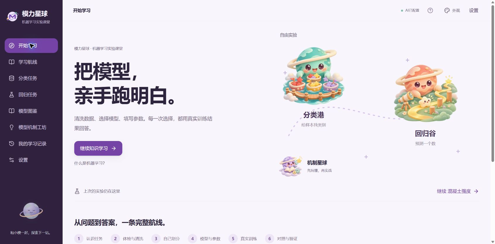

# 模力星球 · 机器学习实验课堂

让每次选择，都看见结果。

面向大学生与研究生的交互式机器学习课堂。学生自己决定输入列、清洗方法、训练/验证/测试比例、模型与核心参数，再用真实计算核对这些决定的影响。



机制探索、真实数据实验与学习档案共享同一课堂框架。6套配色可跟随课程或按个人喜好固定；Q版星球、星环和课题场景对应分类、回归和机制学习。

## 小模陪伴与设置

“小模”是一颗有表情的学习星球。球体、星环与书签卫星协调运动，可轻触、投喂星光、让卫星绕行。点开可询问概念，或结合当前课题/已完成实验摘要解读；在线DeepSeek与本地提示明确区分。支持新会话、最近记录恢复和上下文/保存开关，聊天不授予学习完成。

设置独立于机制学习。只接入DeepSeek官方API，密钥只写不回显；思考深度可自选none/low/high/max，原xhigh兼容值保留并对应high。还可调等待、预算、字号、配色和宠物动作。

## 从知识到实验

[当前验收记录](docs/VALIDATION.md) · [完整Windows检查](https://github.com/ioytgvcbtr-pixel/see-overfitting/actions/runs/44127405104)：1.9.1功能快照通过207项后端、55项前端逻辑、31项浏览器检查，以及全新环境安装、类型、生产构建和启动验证。

“学习航线”包含6章18课：认识机器学习、准备数据、模型家族、证据评估、大模型与前沿应用。每课配概念图、小检查、官方资料与练习入口。已读、首次判断和复练分别保存；一课一格，全部完成后绿色满格。

“我的学习记录”统一展示内容、配置变化、真实运行与机制足迹，支持续接和备份。四个机制站使用独立进度，不混用基础课程成绩。

## 重新开始与恢复学习

在“我的学习记录”或“设置”的“学习档案”中操作：

- **导出全部学习记录**：下载一份JSON，保存课程进度与首答、机制探索、模型实训、操作记录和本机学习草稿。
- **导入学习档案**：选择之前导出的JSON，核对课题、探索站和实验数量后确认恢复。导入会替换当前学习档案，先自动备份当前状态。
- **重置学习进度**：默认只重置课程与四站进度，保留模型实训；选择“全部学习记录”可一并清空实验与学习草稿。
- **撤销上次重置或导入**：恢复最近一次操作前自动保存的档案。长期保存请另行导出JSON。

恢复会重新核验知识首答，模型记录打开后重新计算指标。API密钥、聊天和外观设置不包含在学习档案中；重置保留已有API设置与科学测试接触历史。新一轮学习需要主动确认重置，刷新或重启不会自动清空。

## 一堂实验的完整航线

认识任务 → 数据体检 → 清洗方案 → 划分数据 → 模型参数 → 训练验证 → 对照解释 → 测试迁移。

- 核心数值初始留白；范围与含义通过问号查看。主动采用示例会保留辅助标记。
- 17个真实训练模型：7个分类、10个回归，涵盖线性、概率、邻近、核、树与集成家族。
- 10份公开快照与1份多标签教学合成数据。Auto MPG原始缺失版与清理版分别保存；Energy明确标为物理仿真。
- 数值填补、类别编码、缩放、截尾、训练行筛选与多项式变换，均在当前实际训练子集内拟合。
- 自填三份比例与种子，支持分组随机、近似分层和有时间列数据的顺序划分。重复实体不跨集合。
- 分类混淆矩阵、ROC/PR与阈值；回归预测对照、残差；多目标分别核对指标。
- 系数贡献、真实邻居、树路径、森林单树输出、高斯密度和提升阶段图。二维条件切片可选择坐标，其余输入固定值明确展示。
- 定格A、训练B，核对评估样本身份和全部变更。学习曲线、参数扫描、三次稳定性复核均实际拟合。
- AI解释配置、提出合法单项操作，一键实际执行，再进入新情境先判断后选依据。按已保存的思考深度调用；失败如实切换规则方案。
- 测试接触记录按来源持久化。重新划分、导入备份或已接触过的数据不会伪装成新的独立评估。
- 模型实训使用精选内置课例。实验报告、配置、首答与复算分别保存。

## 模型与数据

分类：逻辑回归、GaussianNB、KNN、RBF SVM、决策树、随机森林、梯度提升。

回归：线性回归、Ridge、KNN、RBF SVR、决策树、随机森林、Lasso、ElasticNet、梯度提升、Poisson计数回归。另有训练均值/多数类基线。

内置课例：企鹅物种、票据特征、Iris、Seeds、混凝土强度、葡萄酒评分、Auto MPG两个版本、建筑双目标负荷、共享单车日需求，以及多标签合成样本。支持多目标回归、多标签分类和时间顺序评估；不是把所有表格自动认作适合所有模型。

来源、许可和校验值见[data/planet](data/planet/README.md)与[data/public](data/public/manifest.json)。公开快照固定到仓库，核心训练不依赖公网下载。

## 本地启动

运行要求：Python 3.13、Node.js 24与npm。安装锁定依赖后启动：

```powershell
./scripts/start.ps1 -Install
```

脚本优先读取环境变量`FITLAB_PYTHON`，或忽略的`.env.local`中的同名配置。网页与API默认仅绑定本机，地址为<http://127.0.0.1:3000>。

生产模式：

```powershell
npm run build
./scripts/start.ps1 -Production
```

API在网页“设置”中配置；留空密钥会保留已有配置。配置和本机数据库不进入Git。无API时可完成全部数值实验与规则教练流程。可用`-WebPort`、`-ApiPort`切换端口；端口冲突不会关闭其他程序。

## 学习档案与计算约定

从首页进入统一课堂。机制工坊包含四站探索与三组对照实验，所有课程学习、实验操作和核验证据汇入“我的学习记录”。学习数据通过完整JSON档案导出和恢复。保存的历史书签会进入当前对应页面；既有首答、实验及计算协议继续保留，恢复时核对答案或重算指标。

课堂计算上限为5000行、50个输入特征、展开后500列、单任务约30秒。排队、取消、超时和不收敛如实展示。多次种子的标准差是描述性统计，不作为置信区间；条件切片不冒充全部高维决策边界。

## 项目目录

| 目录 | 当前用途 |
|---|---|
| src | 网页页面、交互组件与样式 |
| backend | 数值计算、课程、学习档案和DeepSeek接口 |
| data | 内置数据快照、来源许可和本机学习数据库 |
| public | 当前品牌标识与Q版星球插画 |
| scripts | 启动、环境检查、数据更新与开发记录导出 |
| tests | 后端、前端逻辑及浏览器回归 |
| docs | 当前验收与完整AI开发过程 |
| artifacts | 当前界面截图及本机运行产物 |

当前目录只维护现行项目；历史版本与阶段性资料可通过Git记录回看。

## 验证与开发记录

- [当前验收](docs/VALIDATION.md)
- [当前素材与生成提示词](public/illustrations/planet-v18/README.md)
- [AI开发过程与Prompt链](docs/ai-process/README.md)

开发检查：`python -m pytest -q`、`npm run typecheck`、`npm run test:ui`、`npm run build`。Windows CI在新环境安装依赖，并执行课程、机制与实训的浏览器回归。Git记录真实迭代，AI记录保留公开指令、回应和工具反馈并脱敏；不导出内部推理或凭据。
