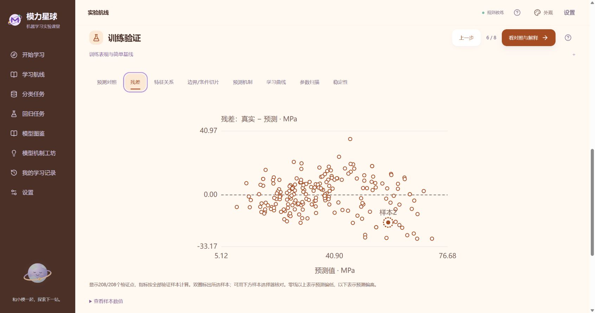
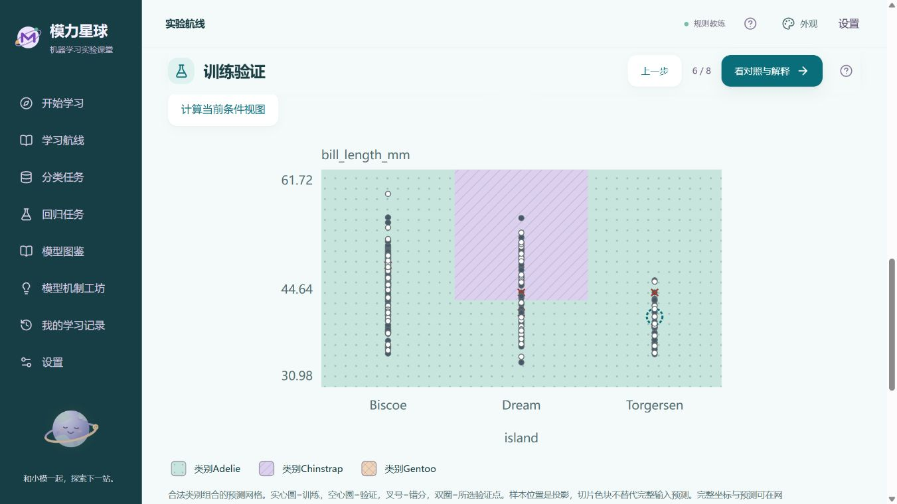

# 模力星球1.7.1：最终内容、交互与视觉复核

2026-11-17。本轮围绕学生读懂结果、连续操作与短屏阅读进行收敛，依据Modern Web Guidance的tabs、accessibility和color指南改进现有作品。数值后端、数据快照、知识题稳定ID和已有首答保持；开发提交与AI过程继续记录。

## 发现与落实

| 方面 | 原问题 | 本轮处理 |
|---|---|---|
| 内容质量 | 残差零线可能落在显示范围外，邻近刻度难对应 | 残差坐标包含零并明确标0，解释真实减预测以及偏高/偏低含义 |
| 内容质量 | 缺失曲线点被过滤后直接跨接 | 保留断点；扫描按参数数值排序；独立种子结果只画点，避免暗示连续趋势 |
| 内容质量 | 部分图没有充分的坐标、单位、分类编码说明 | 补坐标与单位、类别图例与纹理、切片纵轴刻度，保留投影/固定条件的解释 |
| 内容质量 | 单次系数场景也声称存在A虚线 | 根据实际是否有定格A显示对应图例 |
| 交互体验 | 结果标签只有ARIA外观，没有完整键盘行为和面板关系 | 命名tablist/tabpanel，方向键移动，Enter/Space明确激活；初始与后续选中状态一致 |
| 交互体验 | 切换视图丢失已计算曲线 | 各视图保留本次运行的计算结果；输入候选值变化后清除对应旧扫描，防止混用 |
| 交互体验 | 难以精确核对图中的数值和选中对象 | 所选样本双圈/文字高亮，散点、曲线、切片均有按需展开的语义数值表 |
| 交互体验 | 知识检查是分散的切换按钮 | 改为原生单选与显式表单，缺答定位、方向键和浏览器校验可用，选项变化不自动提交 |
| 前端美观 | 标签在窄屏多行堆叠、指标基线不同 | 结果标签单行横向浏览，选中下划线不改尺寸；三项指标数值基线一致 |
| 前端美观 | 手机图表缩小后刻度太细 | 图内保留最小阅读宽度，必要时只在图内横向浏览，图例和说明继续正常换行 |

浏览器标题也随课题、模型和任务更新，便于从多个标签页辨认学习位置。保留六套场景配色、柔和阴影、等宽数字和星球向导，未增加新的装饰卡片堆叠。

## 现代网页规范落地

结果标签使用原生focusgroup；仅在浏览器缺少支持时加载锁定版本的微软回退。工具栏共用这一路径，避免在同一个组件安装重复的方向键系统。按实际安装包接口启用动态节点观察，不把旧示例中无参数的函数调用直接照搬。

隐藏结果面板保留为until-found，浏览器查找命中时通过beforematch同步当前标签；样式放在内部内容层，隐藏面板没有多余卡片背景或间距。当前激活面板具有名称和可进入的焦点位置，移动端保持一排标签。

当前标签用下划线和背景区分；曲线同时使用线型和点形；分类切片增加纹理和文字图例；所选样本以双圈和标签呈现。高对比模式为选中下划线和焦点保留系统色描边，不只依赖柔和阴影。所有数值表只展开公开验证或已计算的切片数据，不暴露封存测试。

## 实际验收

本地51项逻辑、12项知识/迁移后端检查、类型检查与生产构建通过。[最终42eb535完整Windows回归](https://github.com/ioytgvcbtr-pixel/see-overfitting/actions/runs/44047474173)通过202后端、51逻辑、25浏览器检查，含新环境安装、类型与生产构建；[142975d](https://github.com/ioytgvcbtr-pixel/see-overfitting/actions/runs/44045799101)和[b510a6c](https://github.com/ioytgvcbtr-pixel/see-overfitting/actions/runs/44046205588)亦通过；没有用本地浏览器自动化脚本代替Chrome实机观察。

Chrome隔离QA走通：知识题缺答提交会定位原生单选；方向键选择后没有自动发送；正确答案提交仍保存原ID。回归Ridge训练后，方向键可把焦点移到残差标签，而当前视图保持原样，按Enter后才激活；选择样本18后图中双圈同步。

学习曲线实际RMSE读数如下，切到预测对照再返回仍保留，未重新启动学习曲线任务：

| 训练池比例 | 训练RMSE | 验证RMSE |
|---:|---:|---:|
| 10% | 10.657718 | 11.827274 |
| 25% | 10.356257 | 11.374200 |
| 50% | 10.148680 | 11.399248 |
| 75% | 10.250115 | 11.091340 |
| 100% | 10.181306 | 11.176189 |

这组值来自混凝土课例的实际计算，不是预设演示动画。单独回看图中样本2时，真实40.2695、预测57.9141、残差-17.6446 MPa，与图中零线以下的方向一致。

企鹅切片使用island与bill_length_mm，展示真实类别Adelie/Chinstrap/Gentoo图例。完整条件网格为10行、3个岛屿类别列；数值表具有独立行列标题，样本的完整输入预测和固定条件色块保持区分。

[实际手机测量](../artifacts/validation/final-quality-v171/layout.json)：390×844和320×667均无页面横向溢出；分类轴文字落地约12.94px；各视口三项指标数值具有相同Y坐标，六个分类结果标签保持同一排。最末标签可用键盘到达，激活后显示对应操作。

## 问题与修正记录

首轮完整回归202后端/51逻辑通过、浏览器24过1失败。失败是新断言将水平SVG线的零高度包围盒当作隐藏，实机零线和真实坐标正确；修订为检查父图可见、零线坐标处于绘图区及有效描边，保留失败日志和后续通过证据。

Chrome只读检查中，受限脚本没有parseFloat全局，改用可用的数值转换；快速连续滚动标签后一次自动点击命中过时位置，读取当前状态并用方向键/Enter复核。没有把错误视图当作目标画面。

## 当前判断

本轮修复了会影响学生读图含义、操作连贯性和界面对齐的具体问题。已检查范围内，没有保留阻断完整学习或真实实验主流程的问题。现阶段适合冻结产品功能，进入提交准备。

后续可选提升集中在内容深度：部分高级模型仍偏通用读数；前沿课仍以入门概念为主；部分原始英文列名可进一步增加面向初学者的解释。这些属于后续教学扩展，不增加本轮必做研发项。学生试用、视频和PDF未作为本轮开发完成的门槛，也未在本轮制作。

主服务最终确认为1.7.1，保留DeepSeek Flash、用户已存high与密钥配置；本轮没有新增付费问答。Chrome视口恢复并保留正式首页；隔离3002/8002已停止，主3000/8000继续运行。
