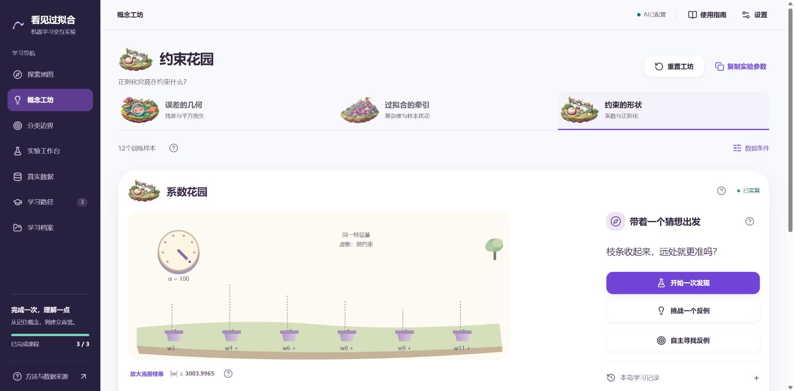

# 0.15官方对照复评与改进优先级

评审日期：2026-11-16；作品快照：`7431ff7`。本轮核读当前源码、实际浏览Chrome、定向复算三个种子的模型选择题；128项Python、34项前端逻辑和2条Windows浏览器回归采用0.15已有通过记录，未冒称本轮全量重跑。主工作区保持原3/3，交互检查使用隔离数据库与规则模式，没有再次调用付费AI。

## 官方基线

[AI创新应用挑战赛原题](https://www.boxuegu.com/matchTrack/detail/?id=10039)第5方向强调把复杂概念转成可直接操作的可视化。当前React/SVG/Canvas、滑块、训练点与旋钮符合方向；技术栈不强制，Three.js或3D不是补齐条件。AI协同开发过程是赛项核心，应用内部接入大模型不是该方向的独立硬性门槛。

本轮严格采用官方五项权重：过程25、有效性25、创新与意图控制20、工程15、体验15。学生试用不作为必做交付，也不因缺少试用扣分。

官方必交仍包括可访问仓库、细粒度提交、至少3条完整真实Prompt链、10分钟复现指南及环境模板、5–8分钟1080p MP4（至少2分钟真实AI协同过程）、不超过30页技术PDF。[最新通知](https://www.boxuegu.com/matchNotice/)确认作品赛省赛截止2026-11-18 15:00。视频/PDF依现有授权继续暂缓制作；完整送审包状态与下面的作品开发评分分开判断，没有官方依据的固定扣分不作编造。

## 严格开发预评分：87/100

| 官方维度 | 满分 | 本次评分 | 依据与剩余差距 |
|---|---:|---:|---|
| 过程可复现性与演进链路 | 25 | 23 | 连续真实Git、18条迭代索引、脱敏会话、依赖锁、Windows新工作区安装/构建/就绪77.407秒。核心Prompt链虽已记录，三条代表链的快速定位与回放仍可更清楚。 |
| 解题有效性与实用价值 | 25 | 21 | 四岛、首答保留、自主反例、迁移、可执行AI、备份形成可运行产品。模型选择的位置偏置、依据提前给出获胜模型，以及系数到预测误差的解释不足，限制教学质量。 |
| 方法创新性与意图控制 | 20 | 17 | 待检验错因→合法单变量方案→实算支持/不支持，已有真实在线反例。AI核验后进入专门新情境的路径仍不直接，跨图形表征的解释交互还浅。 |
| 工程质量与架构设计 | 15 | 14 | 数据划分/训练预处理/测试封存、导入重算、CI及两条浏览器回归较扎实。页面状态、恢复、渲染仍有较大组件，现有回归未检查答案位置平衡等内容属性。 |
| 用户体验与产品精细度 | 15 | 12 | 原创岛屿、键盘操作、数字稳定、可恢复进度、轻量帮助已具完整风格。默认系数动态范围、首屏操作区及分类重复控件仍影响体验。 |
| 合计 | 100 | **87** | 完整且有辨识度的竞赛作品；仍有具体质量缺口，不判定为稳定90+。 |

这是假定评委能访问现有作品与开发证据的预评，合理波动约±3分，不是最终送审分数或奖项承诺。评分不以额外研究活动作为门槛。

## 内容质量：优先修复题目与概念因果

### C1：模型选择三组数据都以B为正确答案

按当前固定候选A=α0.0001、B=α0.1、C=α100复算：

| seed | A验证MSE | B验证MSE | C验证MSE | 最优 |
|---|---:|---:|---:|---|
| 2026 | 0.075807 | 0.062583 | 0.447212 | B |
| 314 | 0.207695 | 0.125146 | 0.466008 | B |
| 2718 | 0.257271 | 0.090049 | 0.398926 | B |

原始[定向复算](../artifacts/validation/v15-review/question-audit.json)来自数值接口。`backend/pedagogy.py`的正确依据还会在作答前出现“模型B…最低”。数值本身正确，但记住位置或照抄依据就能完成方向选择；这属于题目判别力问题。

改进：先锁定模型/方向判断，再呈现依据选择或解释；选项位置按确定性种子平衡，题例覆盖不同最优约束强度。所有题例由实算筛选，保留平局处理，禁止为平衡答案编造数值。验收检查标签位置、实际获胜参数及理由是否提前泄露选择；首次选择仍不可回写。

### C2：范数收缩后的“为什么”仍偏文字化

自主反例可以证明范数下降不保证验证改善，但高α同时增加训练与验证误差时，应进一步讲清模型过于简单的机制。曲线山的单次扰动RMS反映敏感性；森林中线性模型对XOR的困难反映表达能力，这些不能自动等同于过拟合。

改进：围绕同一问题连接系数枝条、真实拟合曲线、一个验证点的观测/预测/残差和总验证误差。选中一根枝条可高亮对应多项式项对曲线的贡献，合计必须回到后端真实预测。结论区区分欠拟合、当前更合适的拟合和泛化差距，不把模型名称或单次RMS作为诊断充分条件。

### C3：公开数据需要更完整的课程案例

已有三类合成分类几何和五个公开数据快照。建议给现有案例补明确问题与固定条件，例如Concrete上只改树深，比较训练与验证RMSE是否分离；按本次数据实际结果解释，不预设“深树必然更差”。从合成曲线进入真实数据的入口应携带学习目标，并清楚保留目标单位和数据划分。

## 可视化：默认可读性优先

### V1：弱约束参照把当前枝条压到接近零像素

当前主应用α=100、系数范数0.0424，全量刻度上限约3003.9965，主图表现为几乎空的花盆。`ConceptIsland.tsx`用当前系数绝对值除以该上限再乘100映射高度；实际数值有变化，图像却难以辨认。已有放大按钮，但核心解释依赖额外发现它。

改进：保留明确的全量参照，并默认提供当前局部放大/双尺度窗口。比较时锁定量纲与基准；重设刻度必须有可见提示。不能用静默独立归一化把所有α下枝条都画得一样高。验收范围覆盖8个α档位、三个种子、不同阶数和极小非零系数。

### V2：主画布缺少从模型到误差的连续视觉证据

花园大画面主要画系数，预测曲线位于折叠的精确图表，当前依赖数字表承接关键结论。建议主画布同时可见简洁真实曲线与验证残差；拖α时让系数收缩、曲线变化和误差变化按实际计算联动。柱图补简洁刻度与差值，明确“定格题目观测”与当前自由参数读数。现有配色与Q版风格保留，把角色用在引导和结果反馈。

## 交互体验：让下一步更容易发现

### U1：关键操作低于首屏

本机1707×842浏览器视口，花园验证MSE读数上缘约849px，α滑块约1041px。首屏看到了场景和学习按钮，却没有看到关键实验参数。该问题与控件是否达到44px不同。

改进：压缩重复页头/概念导航的纵向占用，将主要滑块、训练/验证关键读数与场景放入同一任务区域；短屏采用紧凑布局，窄屏按目标→场景→主控件→判断的顺序排列。帮助保留为可键盘打开的悬浮入口，不隐藏操作所需信息。

### U2：分类存在两套模型入口，基础课与四岛路径并行

森林投递站及下方精确模型面板均有五模型入口，页面较长。三门基础课、四岛、自由探索和真实数据分别可用，但第一次使用时需要自行拼接路线。

改进：学习视图保留一套主控件，科学视图展开完整边界和参数；统一推荐路线，保留自由跳转。课程与岛屿统计继续如实区分，以明确的里程碑解释当前进度，不能把访问页面当完成。

本轮实际用键盘定格逻辑回归A、切RBF SVM为B，验证准确率90.0%→100.0%，滑幕50%→51%，说明对照机制有效。初次语义点击没有完成模式切换，读取状态后键盘入口有效；本轮没有据此推断所有鼠标操作故障。

### U3：AI实验后的下一步要成为显式路线

当前AI结果能核验支持/不支持并恢复参数，但后续独立新题依赖既有复练或新建练习入口。建议在结果后提供“带着这个结果再验证”，创建新的、能区分该误区的情境，并保留原题首答和辅助标记。等待阶段只显示服务端可确认的状态；不显示模型私有推理，也不编造完成百分比。

## 下一轮实施顺序与验收

| 顺序 | 改进 | 完成标准 |
|---|---|---|
| P0-1 | 修复题目位置偏置与提前答案线索 | 多情境实算覆盖，先锁判断后给依据，首答/平局/备份仍正确 |
| P0-2 | 花园双尺度及曲线/误差联动 | 常用与极端α均可读；图像可说明范数变小为何仍可能变差 |
| P0-3 | 短屏主控件布局 | 1366×768、1440×900、390×844的首次操作无需寻找远处控件，保持留白与键盘可达 |
| P1-1 | AI结果到针对性新迁移 | 实际结果、待检验线索和新任务关联，原成绩不改写 |
| P1-2 | 分类控件与学习路径收拢 | 学习视图一套主控件，可明确进入科学细节与下一站 |
| P1-3 | 现有公开数据的一个完整案例 | 明确假设、控制变量、真实指标、反例/解释，单位与划分可核对 |

本轮保存评审与范围校正，不修改产品功能或制作视频/PDF。图表技能检索未得到匹配的柱形刻度条目，未采用返回的雷达/预测带建议；可视化结论依据当前源码、真实屏幕与数值核对。

