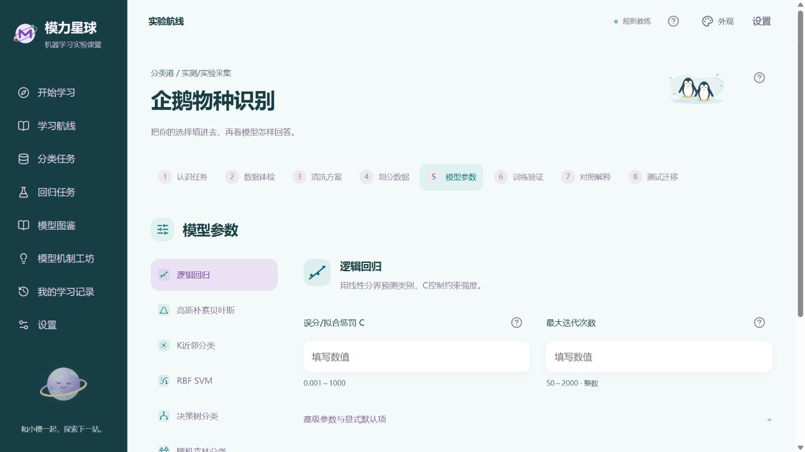

# 模力星球1.4官方对照严格评审

评审日期：2026-11-17。产品1.4.0，代码快照2f983c0。结论：**产品与已有开发证据预评88/100，具备冲90分的基础，尚不足以判为稳定90分以上。** 这是独立自评，不是官方成绩或奖级预测。

## 官方依据与评审范围

本轮在Chrome重新核读[官方赛道](https://www.boxuegu.com/matchTrack/detail/?id=10039)和[最新通知](https://www.boxuegu.com/matchNotice/)。普通网页提取未取得赛题正文，采用实际浏览器核读，没有将第三方赛事介绍当成规则。

项目对应第5推荐方向：用可操作的视觉表达帮助理解复杂概念。现有React/SVG/Canvas、滑块、拖拽和真实模型计算符合方向。官网不强制使用Three.js，也没有要求学生试用；本评审不因缺少学生试用扣分。研究生应选择研究生组。

官方同时重视AI辅助开发的意图表达、演进记录与可复现性。须保留细粒度仓库历史、至少3条核心Prompt完整链、环境模板及10分钟复现指南；另有5—8分钟1080p MP4（至少2分钟AI协同过程）和不超过30页PDF要求。视频/PDF依用户安排暂缓，本次不将其视为已完成，也不虚构缺项的固定扣分。当前产品分不能直接等同完整送审分。

11月11日时间安排及11月3日提交通道通知均明确作品赛省赛截止为**2026-11-18 15:00（北京时间）**。本轮未进入个人中心核实最终提交状态。

本轮新增证据：当前18题的确定性内容审计；Chrome首页、分类课例、新建企鹅实验、逻辑回归参数页、注意力课和1366×768短屏检查。结果分析/AI实验/迁移等能力结合当前源码及既有验收，不冒称本轮重新走完所有数据和模型。最新Windows运行[43908699392](https://github.com/ioytgvcbtr-pixel/see-overfitting/actions/runs/43908699392)已通过；沿用190后端/44前端逻辑/16浏览器的功能验证，未重复全量测试或再次调用付费模型。

## 按官方权重评分

| 维度（简称） | 满分 | 自评 | 得分依据与扣分原因 |
|---|---:|---:|---|
| 开发过程与复现 | 25 | 23 | 137次真实提交、26条迭代索引、脱敏对话/工具记录、锁定依赖和新Windows安装启动证据齐全；代表性Prompt链的快速回放与当前版本文档导航仍可提炼。 |
| 有效性与实用性 | 25 | 21 | 分类/回归完整流程、17模型、11课例、真实预处理/划分/对照、四岛和学习记录构成可用产品；新知识检查有明显措辞线索，前沿课与实践衔接较浅，初学者仍需自行组合路径。 |
| 创新与意图控制 | 20 | 17 | AI被合法动作、固定证据和实算核验约束，反例与迁移、首答保护有辨识度；目前知识图、实训表单、机制场景、AI聊天之间的对应仍不充分，创新尚未形成贯穿全程的交互语言。 |
| 工程实现 | 15 | 14 | 训练内拟合、集合身份、独立测试封存、异步取消/超时、备份重算、CI较扎实；新旧学习协议和多份异步快照状态并存，后续维护仍需要清楚的状态边界。 |
| 体验与精细度 | 15 | 13 | 主题配色、Q版角色、同高字段、数字稳定、44px操作、键盘与减少动效已有质量；首屏入口竞争、短屏下一步位置、跨页面视觉一致性及参数与画面的距离仍有改进空间。 |
| 合计 | 100 | **88** | 成熟度较高的竞赛作品，尚有可定位的内容与体验差距。 |

功能扩展增加了内容范围，同时提高了课程深度、题目质量与视觉统一性的要求。测试通过支持工程可靠性，教学内容需要独立审查。模型、插画或测试的数量没有对应的官方自动加分公式。

## 直接影响90分的四个缺口

### 1. 知识检查存在可利用的答案措辞

[确定性审计](../artifacts/validation/strict-review-v14/knowledge-audit.json)覆盖当前18道知识检查，不混入已经修订过的机制挑战题库。18道正确选项位置为首位9、第二位6、第三位3；更关键的是，**16道正确选项为唯一最长选项**。对这个固定题库，简单选择最长项就能命中16题。这是题库线索审计，不是学生行为或学习效果测量。

部分错误项使用明显绝对化或与教学目标无关的说法，正确项则更完整、更谨慎。题目虽然在知识上正确，却不能充分区分理解与猜测。

建议按真实误区重写干扰项：混淆C与α的约束方向、把重新划分误当作受控对照、混淆编码后的类别与连续数值等。选项在语法、长度和限定条件上可比；长度审计只做提示，最终仍按科学含义人工核读。增加图示判断、配置比较和先预测后解释，保留历史首答与题目版本，不能把修改后的选项身份直接覆盖旧答案。

### 2. 课程广度超过了交互深度

18课中13课提供实践入口；没有入口的5课为注意力、预训练与迁移、提示/RAG/微调、多模态、真实应用前的可靠性。当前注意力课实机呈现一张四阶段SVG概念图，图内控件数为0。短文字适合入门，但前沿内容目前还不足以成为该方向的代表交互。

优先做一个小而完整的注意力实验：使用明确标为教学构造的少量Q/K/V，点击输入单元或调整数值，真实计算点积、softmax和加权输出，联动连线与热力图；给一个遮蔽/温度变化的新情境先判断。无需训练大型Transformer，不能将示例权重宣传成真实模型的解释。

传统ML已有真实邻居、树路径、系数与密度，优先复用。当前图鉴的机制入口主要按分类/回归跳转，尚未逐模型对应；KNN、树或Ridge应进入对应已实现机制，并保留原课例/运行上下文，缺少的机制明确说明。

### 3. 学生仍需在多个入口之间组织自己的课

首页目前同时出现知识继续、实验继续、机制体验与分类/回归场景入口。实践返回已改善，但第一堂课仍需理解知识、机制、真实任务三种模式；课例卡主要提供任务类型和数据量，未突出这堂课要检验的概念与先修要求。

建议建立两条清楚的入口意图：**继续当前学习**、**自由实验**。新手主路线选一堂分类课与一堂回归课，用一组固定、公开的实验条件完成“预测→改变一个决定→实际对照→解释→新情境”。学生数值保持留白；给定条件或示例由学生主动确认采用并保留辅助标记。自由模式保留全部模型与设置。

课例用一句问题区分，例如“改变邻居数量，会让哪些验证点换类别？”、“树更深后，训练与验证差距怎样变化？”。固定条件、当前可改变量和观察目标比额外装饰标签更有帮助。知识18格、机制4格和原基础记录继续独立。

### 4. 视觉表达尚未形成完整的一套语言

首页场景仍有猫咪宇航员，小模已是柔和SVG星球；与线条课例图、旧机制场景共同出现时，材质、比例与角色身份不完全统一。当前主题已经亲切，但仍有模块分别设计的痕迹。

逻辑回归参数页实机两项输入顶部均580px、高52px，无页面横向溢出，对齐正确。1366×768短屏中“去训练”顶部约922px，主要参数之前约有580px页头/导航/选择区。问题是下一步可达性与空间分配，并非控件相互重叠。用短屏紧凑页头与占位的粘性底部操作区改善，不能用遮挡图表的悬浮按钮解决。

## 参考研究与适配方式

| 一手参考 | 本轮核对到的做法 | 适配到模力星球 |
|---|---|---|
| [Duolingo核心页改版](https://blog.duolingo.com/core-tabs-redesign/) | 统一标题、字体层级与间距，用空白组织内容；插画需服务页面目的 | 建立页面级/章节级/图表级三级标题；背景随场景变，组件材质和位置规则一致；Q版星球用于入口、引导和完成反馈 |
| [TensorFlow Playground](https://playground.tensorflow.org/) | 数据、特征、模型内部表示和输出相邻，参数能与结果建立对应 | 把已有真实邻居/路径/系数放到当前参数任务附近，训练后对照两次真实快照，明确草稿与已训练结果 |
| [Seeing Theory回归章节](https://seeing-theory.brown.edu/regression-analysis/index.html) | 页面说明可拖样本观察OLS线、点统计列查看对应含义；站点已归档 | 保留可直接操作的主画布，把被操作对象与指标高亮联系起来；借鉴交互原则，保持本项目视觉风格 |
| [Brilliant当前产品](https://brilliant.org/) | 共享交互画布、逐步引导、提示与下一步学习建议 | 小模指向当前图表或未完成操作，先给短提示；记录页面从事件列表进一步提供有依据的复习入口 |

以上为设计借鉴和本项目适配推断，未复制素材，也未将其他产品的宣传效果当成本站效果。

## 下一轮实施优先级与验收

| 优先级 | 改进 | 可验收结果 |
|---|---|---|
| P0-1 | 修订18课知识检查 | 每题覆盖可信误区；长度/绝对词启发式不再高命中；新旧题目与首答可追溯；多题型至少覆盖两堂代表课 |
| P0-2 | 两堂代表课与准确的机制跳转 | 分类和回归各完成一条从知识到真实实验再到迁移的路线；无需重新搜索入口；数字由学生填写或显式采用示例 |
| P0-3 | 参数—模型—结果相邻的实验桌 | 首屏明确当前操作和对应主图；只有真实训练完成后更新实算结果，切换草稿保留状态提示；短屏下一步无需长距离寻找 |
| P1-1 | 完整注意力小实验 | 每次交互由明确计算更新权重/连线/输出；可键盘操作，有一个反直觉新情境；清楚标示教学构造 |
| P1-2 | 统一太空视觉系统 | 星球向导为唯一主要角色；入口场景、课例图与空状态统一笔触/光照/比例；保留6套配色与固定训练/验证/测试语义 |
| P1-3 | 小模页面引导与复习入口 | 用服务器允许的课题/运行和现有首答生成定位建议，点击可定位到实际图表/控件；不代答、不将聊天算作完成；原取消/重试继续保留 |

建议视觉方向为“星球实验桌”：暖白大画布、统一的柔和星体、少量高对比操作色；图表和当前实验变量占视觉中心。数值继续tabular-nums，圆角/柔和阴影与减少动效规则保留。装饰不重复出现在每个字段，小模在需要帮助和得到结果时出现反馈。桌面参数与画面相邻，手机按任务→主画布→核心控件→下一步排列。

完成P0后应重新评估有效性、创新和体验三项；若教学检查、两条代表路线和真实因果联动均达标，可向91—93分的目标打磨，新增功能不能提前记为已得分。后续依据实际验收再评分，不把学生试用列为必须完成项。

本轮产出评审、真实截图与审计数据；现有产品功能保持该快照，主服务继续运行，隔离QA检查后关闭。继续保留Git与脱敏AI记录。
