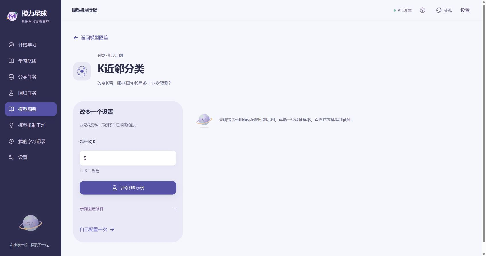

# 模力星球1.5官方对照严格复评

2026-11-17，产品1.5.0，快照29c95b2（功能e1f1202）。结论：**严格预评89/100，接近90，尚不足以认定稳定90分以上。** 本轮评作品与已有开发证据，不准备或假定完成提交材料，不因没有学生试用扣分。

## 规则与证据

Chrome重新核读[官方赛道](https://www.boxuegu.com/matchTrack/detail/?id=10039)评分表，仍采用过程25、实用性25、创新与意图控制20、工程15、体验15。项目符合第5推荐方向。Three.js、全程3D或增加模型数量都不是独立加分门槛。

本轮新增题目序列审计、模型上下文与绘图源码复核、KNN机制页未训练状态的Chrome检查；沿用已通过的193后端/46逻辑/18浏览器验收，没有重复全量测试或调用付费AI。评分为自评，官网只规定维度与权重，具体分值不是官方细分扣分表。

## 五项评分

| 维度简称 | 满分 | 1.4 | 1.5 | 严格判断 |
|---|---:|---:|---:|---|
| 开发过程与复现 | 25 | 23 | 23 | 连续Git、28条迭代索引、脱敏会话/工具、依赖锁和新Windows复现证据扎实；代表链回放与当前版本文档定位仍可提炼。 |
| 有效性与实用性 | 25 | 21 | 22 | 情境题、17个准确入口、旧题历史兼容和短屏可达性均有改进；新版位置周期仍可猜题，知识检查与迁移不均衡。 |
| 创新与意图控制 | 20 | 17 | 17 | 合法AI动作、实算支持/不支持、反例与迁移保持优势；本轮主要改善覆盖和使用流程，机制示例到AI证据讲解仍断开。 |
| 工程质量 | 15 | 14 | 14 | 数值协议、集合身份/封存、版本恢复、取消和自动回归较强；检查只约束分布而未约束周期，说明内容属性测试还不完整。 |
| 体验与精细度 | 15 | 13 | 13 | 首页单主动作、按钮首屏、手机定位、48px操作值得肯定；参数操作语义、首屏图示和视觉材质仍有具体差距。 |
| 合计 | 100 | 88 | **89** | 功能修复带来确定收益，剩余问题仍限制稳定90+。 |

体验维度维持13并非否认按钮改进：目前已经消除明显的寻找负担，但距离该维度接近满分，还需要更直观的操作、画面和结果对应。工程测试通过不能直接证明题目判别力或课堂表达质量。

## 内容质量：长度线索修复，顺序线索新增

[本轮独立审计](../artifacts/validation/strict-review-v15/content-audit.json)确认正确项长度档位各6题、位置各6题；同时按学习航线排序得到：

`1,2,3,1,2,3,1,2,3,1,2,3,1,2,3,1,2,3`

按课程序号循环选择第1/2/3项，命中18/18。这是固定题集的确定性规则命中，不是学生猜题行为测量。上一轮仅验收位置直方图，没有验收序列，属于实现与验证遗漏；应修正“均衡即没有位置线索”的判断。

P0：把展示位置做稳定、无明显周期的分配，保留题目/选项ID和首答版本；刷新不要反复变位。增加针对连续周期、固定课序规则和长度规则的独立检查，不只检查总数。题库仍需按含义核读，不能为了反制一条启发式牺牲表达自然度。

情境化干扰项已经明显优于无关选项，但每课仍主要一题，错后复练是同一道题。应优先给分类和回归代表课补不同图景的预测、读图和解释任务。现有四岛具有迁移闭环；18课和新机制示例的教学深度尚不等同。仍有5课没有实践入口，前沿图主要静态示意；可选一个注意力计算小实验增强深度，不能把它列为官方强制项。

## 交互：能操作，还需让操作更符合概念

1. **机制示例的直接操纵偏弱。** KNN页未训练时只有一个数值框、训练按钮和提示，右侧没有机制图；训练后真实邻居主要以表格展示。可补模型特定的初始示意，再将K值、实际邻居与投票同步高亮。二维投影需明确不是完整特征空间的距离，数值仍由后端计算。
2. **大跨度参数不适合统一线性滑块。** 当前正式实验训练后的滑块统一按数值区间等分。α从0.000001到1000，γ跨多个数量级，常用小值会挤在一端。建议α/γ用对数滑块加精确输入，K/树深用整数步进，比例用分段分配；正式输入仍留白，填写后才开启相应辅助。
3. **机制页小模未获得该页实算快照。** 当前前端将model-mechanism映射成models，只有workbench传run_id。机制页的小模因此缺少当前模型/样本/γ及结果，不能据此承诺针对本次变化讲解。建议传服务端核验的运行标识与草稿变化状态，复用既有只读证据约束；不从客户端接收自报指标。
4. **前后差异需要显式呈现。** 旧结果提示正确，但机制页没有就地定格A与B。系数条按当前最大值归一化，适合看单次相对大小，不便观察两次整体收缩。可复用工作台已有对照能力，增加固定样本、同尺度A/B和实际增减摘要；不能让独立缩放掩盖变化。

## 美观：已有完整风格，缺的是跨页统一与图形的信息作用

首页、配色、数值稳定、留白和手机按钮已经达到较好完成度；当前问题不再是简单的控件拥挤。

- 首页3D猫咪宇航员场景、柔和SVG星球、线条数据图与旧机制微缩插画的材质、比例和光照仍有差异。建议以学习星球为主要角色，统一场景笔触和光照，功能图继续保持清晰，不给每个字段追加装饰。
- 新机制页首屏右侧只有一句提示。空白已经足够，但需要一幅帮助学生理解当前模型的图；留白应围绕核心对象，而不只是空着大块证据区域。
- 17模型采用相似的输入框/表格框架，家族差异更多靠文字。邻居圈、树的分裂、核影响范围和系数枝条可形成不同的可操作对象，同时共享标题、按钮和数字规范。
- 动效重点放在真实状态变化后的高亮和对应关系：哪个邻居新增、哪个路径改变、哪个系数或误差变化。小模待机与场景装饰不能代替这些解释。

## 建议顺序

| 顺序 | 最有价值的下一步 | 验收要点 |
|---|---|---|
| P0 | 修复正确项1/2/3循环 | 固定课序启发式不再18/18；身份、旧首答、备份、刷新稳定性保持 |
| P1 | 机制页AI与本页运行相连 | 可准确说出本次模型/参数/样本和真实变化；草稿不冒充新结果 |
| P1 | 选KNN与Ridge打磨可直接操作的代表课 | 同页预测、实算、前后对照、新情境；复用已有数据与数值服务 |
| P1 | 按参数含义设计控件 | 对数/整数/比例各自合理；小值可选，键盘可用，未训练状态明确 |
| P2 | 统一角色和图形语言 | 关键画面有教学作用，跨页材质一致，保持留白与减少动效 |

先完成P0，再以同页AI证据和两堂代表课增强交互，有条件向91—93目标打磨；具体分数需在实际验收后重评。本轮只记录复评和建议，未修改产品功能或准备提交材料。
