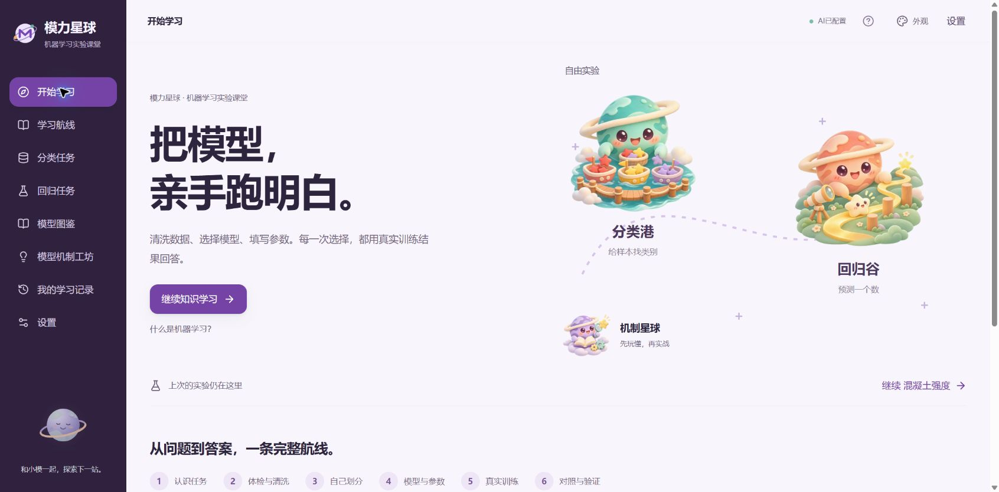

# 模力星球1.8：Q版星球插画换装验收

2026-11-17。按用户截图与明确要求，使用内置image_gen重新生成并接入7张固定插画。统一为带奶油星环、明亮表情与圆手的柔软立体Q版星球；每张通过具体场景道具表达课题，不再依赖几何符号拼接。网站运行使用冻结素材，原始RGBA PNG与透明通道保持原样。

## 主题与覆盖范围

| 插画 | 场景表达 | 接入位置 |
|---|---|---|
| 分类港 | 把不同颜色的星星送进三艘小船 | 首页入口、分类任务标题、近邻课开场 |
| 回归谷 | 连续金色路径、测量柱与望远镜 | 首页入口、回归任务标题、线性课开场 |
| 机制星球 | 书本、放大镜、齿轮与拼图星星 | 首页卫星、学习航线、工坊标题、玩法提示 |
| 误差湖 | 星星与落点之间的距离、湖泊和救生圈 | 四站入口、岛内标题、课程封面 |
| 曲线山 | 平滑与曲折的两条路径 | 四站入口、岛内标题、课程封面 |
| 约束花园 | 苗株、引导带和浇水壶 | 四站入口、岛内标题、课程封面 |
| 边界森林 | 分叉路径、不同颜色的样本星星 | 四站入口、分类岛内标题与玩法封面 |

插画仅表达主题。真实曲线、滑块、拖拽对象、类别投票、数值和学习完成状态继续来自原有交互与计算。网页按钮名称保留可访问的文字，装饰图使用空alt且不可拖动。

[四站实际画面](../artifacts/screenshots/chibi-stations-v18.jpg) · [7张素材与完整提示词](../public/illustrations/planet-v18/README.md) · [原图尺寸、透明通道与SHA256](../artifacts/validation/chibi-v18/assets.json)

## 布局与加载

首页入口采用流式两列，并为机制卫星保留独立一行。插画保留完整星环与道具，使用contain适配；标题放在图框之外，四站数字角标使用独立样式，避免误命中新图片容器。手机保持足够图文间距，入口命中区域互不覆盖。

按Modern Web Guidance的optimize-image-priority与deliver-optimized-decorative-images检查加载路径，并核对安装版本Next/Image文档。首屏两张主图为eager/high，普通次要素材延迟加载；图片以原生img输出并提供sizes/srcset，可被预加载扫描器发现。图框预留尺寸，图片到达不改变入口占位；保留减少动态设置，避免图片与外层同时位移或重复阴影。

[交付测量](../artifacts/validation/chibi-v18/delivery.json)：384px、quality75的分类图在接受WebP的请求下为31,202字节，原始PNG为1,751,973字节。该值是指定候选尺寸的实际输出，不代表所有设备都选同一尺寸，也不作为网页LCP时延基准。

## 验收结果

- 7份PNG均为1254×1254 RGBA，透明范围0—255，原文件未经过程序抠图或改画。
- 本地51项逻辑、类型检查和生产构建通过。
- [完整Windows回归d29f3d3](https://github.com/ioytgvcbtr-pixel/see-overfitting/actions/runs/44059992531)通过202项后端、51项逻辑、26项浏览器检查，包含新增真实图片加载、sizes/加载优先级、四档入口不重叠、四站素材加载和导航。
- [Chrome四档观察](../artifacts/validation/chibi-v18/layout.json)：1366×768、1024×768、390×844、320×667下三处首页入口不重叠，所有入口图片加载完成，无页面横向溢出。
- 四个探索站图片均成功加载，图框与标题之间有明确间距；320px打开误差湖后，新标题图加载成功，8个原有滑块仍正常显示，无横向溢出。[岛内运行记录](../artifacts/validation/chibi-v18/runtime.json)
- Chrome恢复正常视口并保留正式首页。主服务为1.8.0，DeepSeek配置和用户已存high保持；原实验与学习记录未重置，隔离验收未代答主档案。

原版图案与旧素材保留在Git历史/历史目录。生成过程及完整Prompt继续保存，不声明工具未返回的具体模型版本，也不把插画生成结果当作科学计算。此次仅改进作品视觉与图像交付，没有制作比赛视频或PDF。
