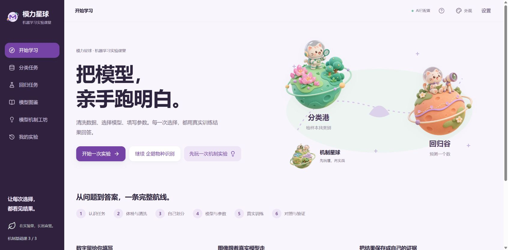

# 模力星球1.1统一课堂实际验收

日期：2026-11-16。对应代码提交c768596，当前主服务1.1.0。改进设计见[统一课堂方案](CLASSROOM_FUSION_V11.md)。

## 用户要求与落地结果

| 要求 | 实际实现 |
|---|---|
| 机制工坊与新版融合 | 机制工坊进入一级导航；共享品牌、侧栏、顶部栏、设置与配色。没有iframe、双侧栏或嵌套main；旧`/mechanisms`地址也渲染统一课堂 |
| 多套合适的颜色 | 鸢尾紫、海湾青、杏子橙、晴空蓝、森林绿、星空靛6套。自动跟随课程，也可固定个人选择，刷新保持；数据角色/类别语义配色保持 |
| 矩形选项对齐 | 帮助与标签同一44px槽位，输入/选择器统一52px。桌面卡片标题/目标槽位和底部动作基线统一；手机单列减少空白高度 |
| 丰富图案与元素 | 内置imagegen生成并固定3张Q版圆球星体、轨道环、猫咪宇航员插画；课例增加轨道与数据主题SVG，八步流程增加工具图标 |
| 贴合模力星球主题 | 分类星球的样本群落、回归星球的曲线与观测、机制星球的湖/山/花园/森林对应课程；首页与各入口共享画风 |
| 从学生使用出发 | 机制后可直接选真实任务、图鉴可先看机制；跨模块草稿保留，刷新/后退定位原模块。帮助按钮与字段标签分离，键盘可用 |

核心学习协议、空白参数、真实计算和模型/数据范围沿用1.0。原3/3机制基础课成绩与Flash xhigh配置保留。没有准备比赛视频或提交PDF。

## 实际操作与布局

Chrome独立QA数据库中核对：企鹅任务填写61后进入机制工坊、返回首页继续任务，仍为61；模块切换没有引入独立界面。平板768px、手机390px无页面横向溢出，17模型图鉴可以浏览；手机回归入口没有小于40px的可见按钮。1366×768的花园主滑块底边约639px，仍在首屏内。

划分页同一行训练/验证控件顶边均约493.89px、高52px；第二行测试/种子同样对齐。分类课例首排三张卡片动作顶边均约669.36px，下一排同样共用基线。以上是对应QA视口的实际测量，不当作所有屏幕固定坐标。

6套颜色对正文/次要文字与背景、白色主按钮文字与主色进行对比度检查，均至少4.5。实际图表不随个人主题改换训练/验证或类别的含义。

[融合后的机制星球](../artifacts/screenshots/classroom-mechanisms-v11.jpg) · [手机回归课堂](../artifacts/screenshots/classroom-mobile-v11.jpg) · [3张Q版插画与提示词](../public/illustrations/planet-v11/README.md)。固定PNG保持透明通道，网页通过Next/Image按显示大小加载。

## 自动回归

最终[Windows运行43853071421](https://github.com/ioytgvcbtr-pixel/see-overfitting/actions/runs/43853071421)全部通过：176项后端、37项前端逻辑、9项浏览器检查，以及类型检查和生产构建。

新增检查覆盖旧链接/新任务链接不冲突、场景与固定配色、6套配色可读性、同一文档切换保留草稿、刷新直接恢复已锁首答、输入顶边与卡片动作对齐、全部配色无页面溢出。原四岛反例、首答、AI后迁移及手机花园回归继续通过。

首次浏览器回归有7通过/1失败：旧用例预期刷新返回首页后点击继续，新版已经按地址原位恢复。修订为直接检查原步骤与已锁首答后通过，再补卡片对齐检查。没有通过延长超时掩盖行为差异。

本轮只调整前端组织、视觉与导航；后端版本标记更新为1.1.0。所有实验仍由真实数值API计算。主服务继续运行，QA服务在验收后关闭；浏览器测试视口已重置。
