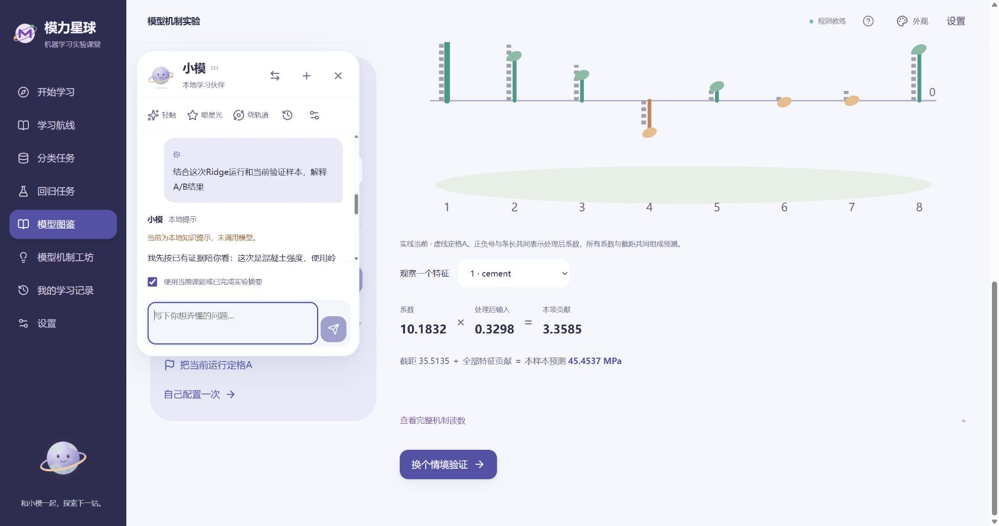
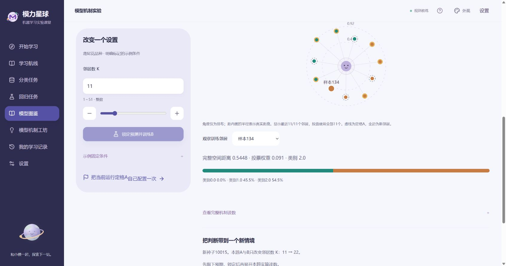
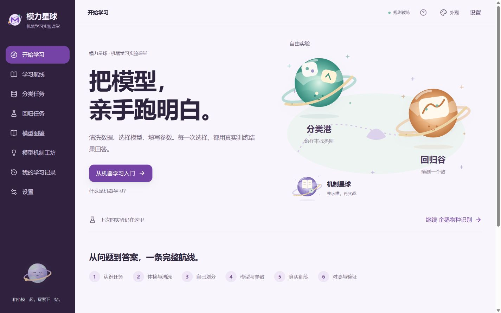

# 模力星球1.6：悬浮小模与代表课验收

> 2026-11-17更正：1.7开发追查发现旧挑战工作进程未使用接口锁定划分，原封存检查未覆盖实际拟合身份。旧数值仍是当时真实计算；测试独立性须按历史接触追溯结果阅读。本报告保留原审查经过，修复与复核见后续1.7验收。

2026-11-17，运行1.6.0，最终功能代码0c6f081。本轮按用户要求先修复小模挤压内容，再落实题目顺序、同页AI证据、两堂代表课、参数操作和入口视觉。继续Git与脱敏AI记录，不准备比赛提交材料。

## 小模独立悬浮

移除问答打开时给主内容预留390—410px的右内边距，以及首页/任务/设置强制改列、隐藏预览的规则。问答独立固定定位，打开和关闭不再改变内容列宽。默认520px紧凑阅读，双击标题或回车可切换660px展开阅读；高度仍受视口约束。支持标题拖动、方向键移动、左右移位、关闭与Escape；移动限制在可见区域。

手机使用覆盖层，保留关闭/输入，隔离背景焦点和滚动。桌面及平板保持背景可操作，可把浮窗移到适合当前操作的位置。

| 实际Chrome视口 | 打开前后观察 |
|---|---|
| 1707×898 | 主内容1476px→1476px；首页两列617.396/754.604px不变；机制两列387.427/968.573px不变 |
| 1024×768 | 主内容约792.67px→792.67px，机制两列235/461.667px不变，无横向溢出 |
| 390×844 | 浮层左8px、右382px、高764px；背景inert，输入区可见，无横向溢出 |

[布局观察数据](../artifacts/validation/floating-lessons-v16/layout-observations.json)。自动回归另覆盖1440/1024宽度的首页、分类、设置、模型机制页面，检查打开前后宽度和列数、左右移动、键盘移动及展开不挤压内容。

## 题目展示去周期

将按课序1/2/3循环改为按稳定散列排序分配展示位置。18题位置各6题，正确项长/中/短各6题仍保持；原课序循环规则从18/18降为6/18。新增1—6周期检查，不能仅凭总量均衡通过验收。

只改显示顺序，选项ID、正确答案身份、题目版本及原首答不变。刷新稳定，已有学习格子和备份继续兼容。这是固定题集审计，不是学生行为或学习效果测量。[独立审计](../artifacts/validation/floating-lessons-v16/knowledge-order.json)。

## 同页AI证据

机制页向服务端提供模型标识、完成运行标识、所选验证样本标识及定格A标识。服务端核对模型/数据身份，从真实运行及检查缓存提取参数、训练/验证指标、样本预测/观测和有限机制摘要。客户端不能自报指标；原始输入行、训练行清单和封存测试不发送。关闭共享后不提供这些上下文。

未训练只介绍当前模型；已训练按完成快照回答；草稿变更明确标记待重训。定格A还核对评估身份，防止把不同群体归因为单个参数。保留当前版本知识检查的代答保护。

Chrome隔离QA切到KNN错分验证样本72，小模准确引用K=11、预测2/观测1、验证误差及定格A；Ridge探针381引用同一模型和运行。QA为本地提示模式，明确显示未调用模型；在线请求体由模拟传输测试核对，未新调用付费问答。参数名称在本地提示中使用人类可读标签。

## KNN与Ridge代表课

流程为准备A→留下B的预期→实算对照→新情境。预测随B运行在计算前写入不可变快照；服务端仅在来源A匹配、单项变化和评估身份相同的情况下核验，不接收前端自报通过。预测不符也保留，不自动改成成功。

| QA例子 | A | B | 真实验证结果 |
|---|---|---|---|
| Iris KNN | K=5 | K=11 | 错误率0.0344828→0.0689655，未支持“降低”的预测 |
| Concrete Ridge | α=1 | α=10 | RMSE11.1761886→11.2760392 MPa，未支持“降低”的预测 |

[真实成对观察](../artifacts/validation/floating-lessons-v16/paired-observations.json)。固定种子42及相同评估身份，只说明当前条件，不推广为普遍参数规律。

KNN展示实际邻居的距离轨道、完整投票和A的虚线参照，新增邻居点亮；角度只排布，距内圈的半径表示完整处理空间距离，明确不冒充二维特征距离。最多画12个点，投票仍用全部邻居，完整读数可展开。错分点快捷入口与定格A使用同一验证探针。

Ridge显示同一零点/刻度下的正负系数与A虚线，选择特征后联动处理后输入、系数及本点线性贡献，再回到全部项加截距的真实预测。QA第4项为−4.4317×−1.6782=7.4374，说明系数符号与单点贡献需分别阅读；不把预测贡献当作因果效应。

[完整KNN课例](../artifacts/screenshots/knn-lesson-v16.jpg) · [Ridge实际画面](../artifacts/screenshots/ridge-lesson-v16.jpg)

新情境在判断前隐藏读数与依据，锁定后再揭示实算并选择依据；列表和备份也不提前输出被隐藏的观测。继续沿用首答不可回写、备份重算与原测试群体封存。再次练习使用同一来源尚未使用的种子；每来源最多20个情境，避免只换记录ID重复原题。

Chrome完整走完KNN迁移：新种子10015、K11→22，作答前无读数，锁定A更低后揭示两组均0.0345，核验保留错误首答。Ridge对照、系数和诊断探针实际检查；自动浏览器覆盖两堂课完整闭环及刷新恢复。机制练习不增加知识18格或四岛完成格，不冒充独立学生试用。

## 参数与视觉

α、γ、C及方差平滑等正值大跨度参数采用对数刻度与精确输入，K/树深等整数参数采用步进与滑块。正式实验数字保持留白，合法填写并满足原阶段条件后才显示辅助；滑动改草稿，实算结果只在真实训练完成后更新。

首页、学习航线、任务页和四站入口统一为代码原生柔和星球图案，沿用6套配色和小模材质。模型训练前有明确标为结构示意的画面，训练后替换成实算。图形负责说明模型，未增加运行时生图依赖。数值等宽、软阴影、触控目标和减少动效继续保留，平板/手机图中文字单独检查。

[手机浮层](../artifacts/screenshots/mobile-coach-v16.jpg)

## 完整验收

[最终0c6f081的Windows运行44022832718](https://github.com/ioytgvcbtr-pixel/see-overfitting/actions/runs/44022832718)全部通过：**196项后端、48项前端逻辑、21项浏览器**，以及类型、生产构建和新环境启动。40a21a4、7fd1861、b07591a的完整运行也通过；最终结果以前述链接为准。

新增回归包括：顺序周期、对数小值、浮窗边界、全部页面开关宽度/列数、移动与展开、同页样本/参照身份、关闭共享、预测冻结、迁移初始保密/唯一种子/备份，以及两课闭环。原数据处理、17模型、旧题历史、封存测试与导入重算仍通过。旧测试客户端弃用提示仍在，不扩展为无关依赖迁移。

主服务1.6运行，Chrome保留主项目首页。已有密钥和Flash及当前保存的high深度保留；未替主档案作答，QA库与端口独立，检查结束后已停止。临时视口恢复。截图与数字来自真实开发验收，不是设计稿或学生效果研究。

过程锚点：6f0288f（题序），2b24d8b（快照教练），4775f00（预测/迁移），40a21a4（浮层/场景），7fd1861（诊断探针），b07591a（阅读/动作留白），0c6f081（跨尺寸标注）。
