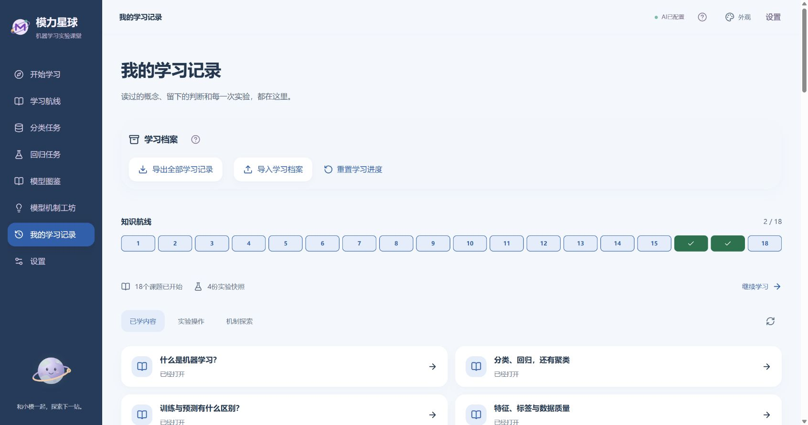

# 模力星球1.9：学习档案与最终检查

2026-11-17。用户要求检查全项目，并增加学习进度重置、记录导出和导入恢复。已完成实现与验收，正式网页保留当前档案，测试重置仅在隔离QA进行。

## 学生使用流程

“我的学习记录”和“设置”均有“学习档案”入口。先导出JSON留存，再按需要重置；下次选择该文件，查看校验后的完成课题、探索站和模型实训数量，确认后恢复。操作完成自动回到学习记录。

| 操作 | 范围与行为 |
|---|---|
| 导出全部学习记录 | 课程进度与首答、四站及基础课程、模型实训、操作时间线和白名单学习草稿 |
| 课程与四站进度重置 | 归零已读、首答、完成标识及相关学习事件；保留模型实训 |
| 全部学习记录重置 | 同时清空模型实验、操作记录与学习草稿 |
| 导入 | 完整校验后替换当前学习状态；模型指标打开后实际复算 |
| 撤销上次重置或导入 | 恢复最近一次操作前自动保存的档案；撤销本身也先备份当前状态 |

自动备份位于忽略的本机运行目录，撤销只指向最近一次操作；需要长期或换设备保存时使用下载的JSON。API密钥、问答聊天和外观不进入学习档案，重置也不修改这些设置。已有科学测试接触历史始终保留，重新学习不代表重新获得未见过的测试集。

完整档案版本为`modelplanet-learning-archive` v1，上限32MB。旧版分项备份仍在原入口恢复。刷新和服务重启保留学习进度，重新开始由学生主动确认。

## 正确性与交互

复用现有三类备份的校验器，在私有临时SQLite副本中核验整份档案，成功后才原子更新正式学习表。不采信文件中的正确标记与实验指标；保留原首答，重建可核验进度，模型实验恢复为待复算。保存、排队或计算未完成时拒绝档案切换，避免迟到写入污染恢复后的状态。

浏览器只收集明确白名单内的学习草稿。切换前同步待保存事件，切换后清理相应缓存和待发队列；已打开页面通过档案代际变化同步刷新。首次升级不会主动重置已有记录。

确认框采用原生`dialog.showModal()`，取消获得初始焦点，Esc取消并回到原按钮。忙碌阶段显示具体状态并阻止重复提交；对话框及背板限制滚动，不锁定根页面滚动条。导入严格解码UTF-8，先预览再确认。

全项目收尾检查另修复两处实际缺陷：切课后的迟到已读/作答响应可能污染新课状态；切换模型运行后的迟到迁移缓存可能挂到新运行。现在检查请求版本与内容身份，并贯穿原取消信号；缺失缓存也不会产生未处理异常。

## 自动化验证

[最终功能提交d06397d的Windows完整检查](https://github.com/ioytgvcbtr-pixel/see-overfitting/actions/runs/44086349466)全部通过：206项Python、54项前端逻辑、29项浏览器，以及类型检查、生产构建和新Windows环境启动。本地206/54、类型与生产构建亦通过。

新增覆盖完整导出→重置→导入→撤销、首答不变、模型复算一致、无效文件原子拒绝、伪造正确标记重判、忙碌保护、存储白名单、API配置与测试接触历史保留，以及两种迟到响应。浏览器回归实际下载并解析JSON，完成真实模型训练，随后从下载文件恢复实验与课程记录。

首轮运行44084963249为28项浏览器通过、1项失败：React的autoFocus在隐藏对话框挂载时执行，打开后取消未获得焦点。修正为showModal前设置原生autofocus属性，最终29项全过。后端首轮3个忙碌断言暴露已完成工作进程尚在收尾的窗口，增加有界等待资源释放后通过。一次本地构建遇到Node原生证书初始化崩溃，普通重试后成功，未修改TLS校验。

## Chrome实机验收

隔离档案完成一课，保存正确首答及三条学习足迹。默认重置后1/18→0/18；撤销后恢复1/18。全部重置再次归零，文件选择器导入同QA后端生成的完整JSON，预览显示1/18、0/4、0份实训，确认后恢复1/18及原首答、足迹。

本次浏览器控制没有回传Blob下载事件：界面成功提示已出现，但手工下载落盘未由该事件确认。因此手工导入使用同一QA档案的API导出文件；实际下载文件解析与恢复的证据来自上述独立Windows浏览器回归。尝试查看浏览器内部下载页被工具URL策略拒绝后停止，没有绕过策略。

桌面取消初始焦点正确，Esc后焦点回到“重置学习进度”。320×667验收中，含滚动条的根内容宽305px、scrollWidth同为305px，无页面横溢；重置框约266.67×580.76px，导入框约266.67×616.02px，均保留左右与上下空间，初始焦点仍为取消。一次视口变化后立即点击命中过时布局，重新读取页面再定位后完成验收，没有将误入页面记作成功。

[窄屏重置确认](../artifacts/screenshots/archive-reset-mobile-v19.jpg) · [窄屏导入预览](../artifacts/screenshots/archive-import-mobile-v19.jpg)

验收结束恢复正常浏览器尺寸，Chrome保留正式学习记录页面。正式服务1.9.0；升级前后五类原记录数量均相同：18条课程状态、22条学习事件、2份模型运行、4份基础课程记录、10份四站记录。DeepSeek仍为Flash、用户已存high及已配置密钥，未新增付费问答，未重置用户原档案。

该轮完成产品功能、实际检查、Git与脱敏AI过程记录。比赛视频、PDF等提交材料继续暂缓。
