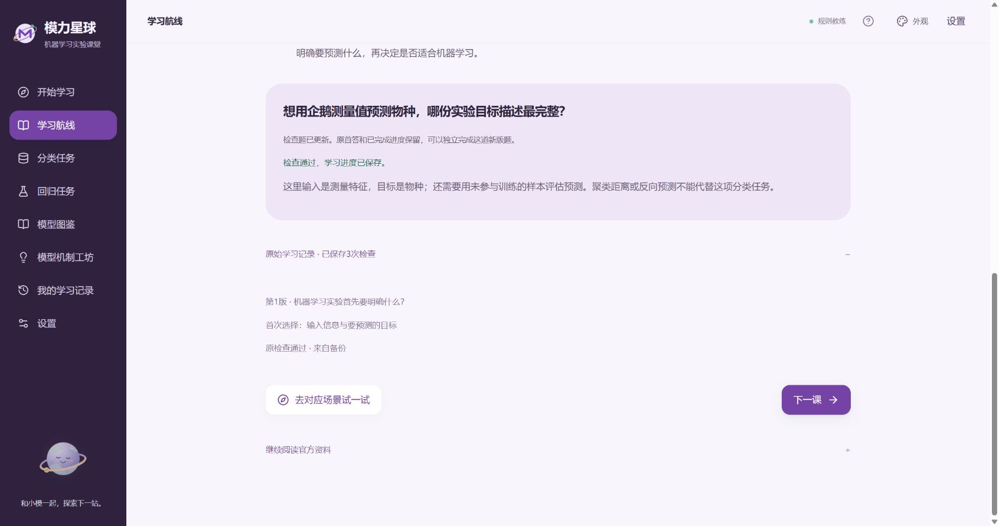
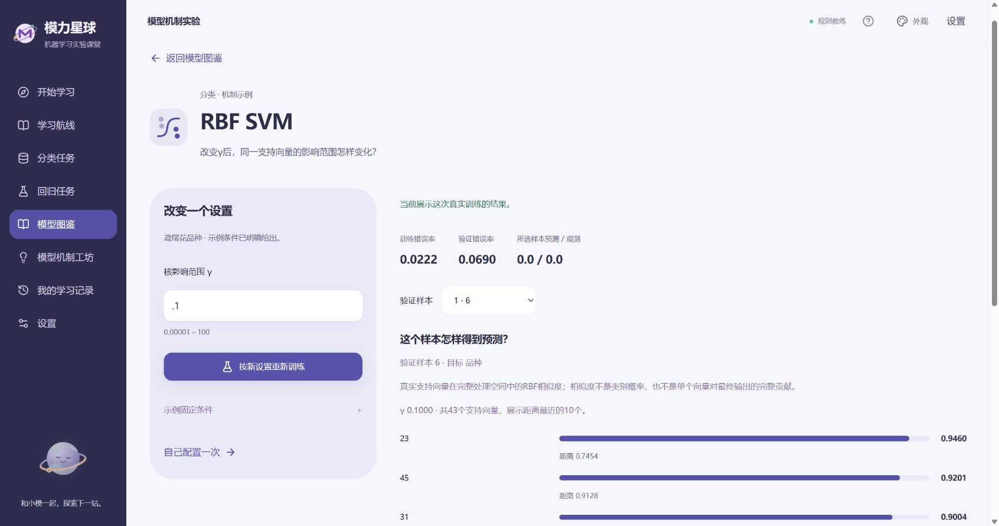
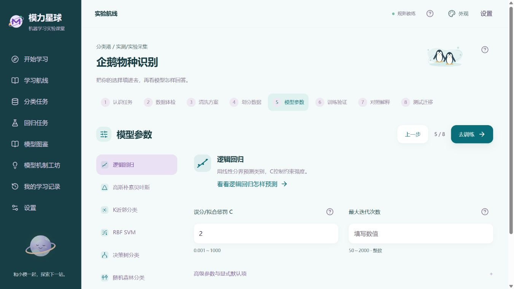
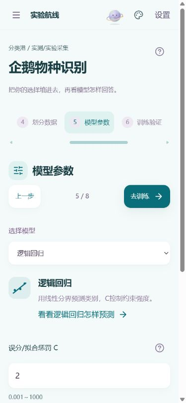
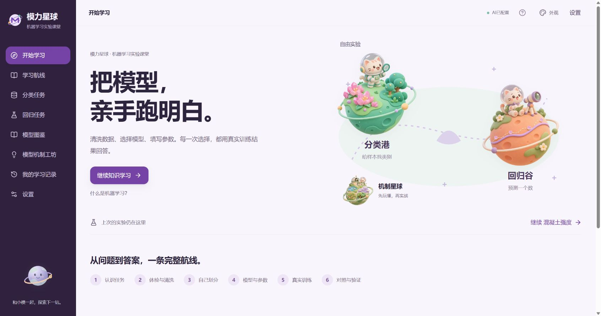

# 模力星球1.5三项优化与完整验收

本轮落实知识检查、逐模型机制入口、短屏操作与首页层级。版本1.5.0，保留学习档案与AI配置，继续真实Git与脱敏AI过程；未准备参赛视频、PDF或其他提交材料。

## 知识检查

18道题改为具体情境，干扰项来自目标泄漏、划分角色、处理空间、集成范围、验证归因、提示与微调等误区。原来按最长项可命中16题；当前正确项的最长、中等、最短各6题，首、中、末位置各6题。[逐题审计](../artifacts/validation/learning-polish-v15/knowledge-audit.json)记录长度与位置。这消除了固定题集的明显线索，不等同于学习效果测量。

第一版问题、选项、评分和解释保留。第二版使用新选项标识，作答记录题目版本。旧完成继续保留，原始首答显示原问题与原选择，新题复练独立追加。备份按对应版本重算，不能相信导入文件自报成绩；过期新提交提示重新打开，原请求幂等重放仍返回原记录。小模按当前题目版本判断是否已答，旧首答不解除新版代答保护。

Chrome隔离QA导入明确标记为备份的第一版通过记录。新版先答错、再复练通过，原第一版问题/首答/完成状态不变，检查次数为3，没有重复增加知识格子；未写入主档案。

## 17个模型对应自己的机制

图鉴和参数页按模型标识进入专属实验地址，刷新保持模型身份。使用现有数值后端主动训练并选择验证样本，机制类型如下。

| 家族 | 实算证据 |
|---|---|
| 逻辑/线性/Ridge/Lasso/ElasticNet/Poisson | 系数、本点贡献、截距与链接含义 |
| 分类/回归KNN | 完整处理空间的实际邻居、距离、权重与目标 |
| RBF SVM/SVR | 实际支持向量、距离和RBF相似度 |
| 分类/回归树 | 真实节点与当前样本路径 |
| 分类/回归森林 | 部分单树输出，最终预测仍由完整集成计算 |
| GaussianNB | 训练按类估计的高斯密度 |
| 分类/回归梯度提升 | 已训练集成的实际阶段输出 |

分类示例用Iris，普通回归用Concrete，Poisson用单车计数。数据、请求划分比例、种子及其他固定条件公开并标记辅助，学生主动点击后才训练，不增加知识完成。正式实验数字继续留白；独立测试封存。修改设置后旧结果保留并提示尚未重训，最近机制实算可刷新恢复，返回原实验保留已有填写。回归RMSE带目标单位，训练警告保留。

核相似度用实际gamma及支持向量计算exp(-γ·距离²)，不当作类别概率或完整因果贡献。17模型后端回归核对机制字段、模型身份及预测与原结果一致；浏览器逐项点击17入口，实际训练、修改并重载RBF示例。

隔离QA：γ0.1→0.2，训练错误率0.0222→0.0111，验证错误率保持0.0690，支持向量43→41；同一验证点对训练样本23的相似度0.9460→0.8948。没有把训练改善说成验证改善。参数页C填写2，往返机制后仍为2。

## 短屏与首页

步骤操作移到当前标题旁并随其吸附，占据正常布局空间。桌面一行，手机分行，主要按钮48px高。短屏压缩重复页头间距；步骤变化和容器变窄时只横向定位当前项，不强行滚动整页。

1366×768实测“去训练”333—381px，原评审顶部约922px；无横溢。390×844实测操作区387—435px，第5步横向135—239px，选择器与字段不重叠。自动回归同时检查1366、1024、390宽度及滚动页尾的操作可达性。

首页只有一项主要知识动作，并说明将进入的课题；右侧为自由实验。上次实验续接移到独立轻量行，仍直接恢复。实测主动作数为1，原混凝土草稿仍可续接。

## 自动检查及运行

本地193项Python、46项前端逻辑、类型及生产构建通过。[a64f029的新Windows完整验收](https://github.com/ioytgvcbtr-pixel/see-overfitting/actions/runs/44012066823)通过193后端/46逻辑/18浏览器，包括17入口、真实核实验、重载、草稿返回与三种宽度。最终e1f1202的[Windows运行44013110103](https://github.com/ioytgvcbtr-pixel/see-overfitting/actions/runs/44013110103)同样通过193后端、46逻辑、18浏览器，以及类型、生产构建与新环境启动。

本地旧SQLite模块仍有资源警告，测试客户端有弃用提醒；无测试失败，本轮未扩展为依赖迁移。Chrome使用隔离库和无API模式，未新调用付费问答。主服务1.5保持Flash、已存密钥和用户当前high深度，未替主档案作答。

截图是实际界面。响应式能力对新主标签页生效时，先核对真实innerWidth，再在该标签页临时打开QA完成390px检查并恢复主项目；不把另一标签页的桌面尺寸记作手机结果。临时视口已恢复，QA页关闭，主项目首页保留。

开发锚点：a7b5868（版本化题目），7c7109d（模型与操作层级），a64f029（手机步骤定位），e1f1202（回归单位）。
