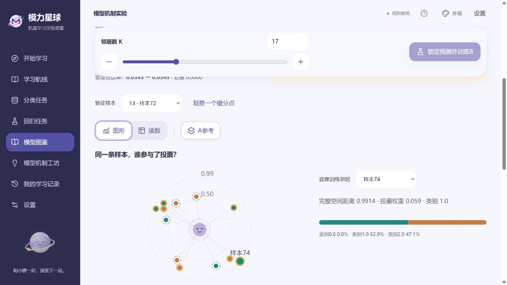

# 模力星球1.7：连续实验体验与提交准备判断

2026-11-17，功能版本1.7.0，最终功能提交98c6877。本轮完成上次复评的优先改进，并使用modern-web-guidance优化实际实验工作台。**产品开发预评92/100，可以进入提交准备阶段。** 分数为按官方权重的开发自评，正式成绩由评审确定。

## 官方对照

Chrome重新核读[官方赛道](https://www.boxuegu.com/matchTrack/detail/?id=10039)：本项目对应高交互教育与可视化方向，核心是把模型机制转成学生能操作并看到结果的面板；React、Three.js、Canvas为举例，技术栈没有强制限定。省赛作品截止为2026年11月18日。

官网还要求真实仓库与演进、至少三条核心Prompt链、环境说明与快速复现，以及演示视频和技术PDF。现有开发记录继续保留；视频/PDF按用户范围暂未制作。本报告是开发验收，不是提交材料，不把学生试用增加为必做条件。

## 已实现的学习与交互

- 迁移v2把事前预期、揭示后的读数结论与解释分开。可以先选择不确定，也可以保留未命中的预测；证据阅读与解释均正确时完成本轮理解检查。原选择和提交时间不可回写。v1保持原题与原判分协议，复练创建新情境。
- 解释题随本例检查训练/验证变化、适用范围或受控条件，不再固定三句通用模板。120题构造检查覆盖三类认知任务和三个正确位置，正确项包含长、短、等长情形。这是题库结构检查，不是学习效果研究。
- 线性与近邻知识课直接进入Ridge/KNN代表课，刷新后仍可回原知识课。正式单目标训练结果直接复用该运行的邻居/系数场景；固定示例入口明确标识为示例课。
- 训练B与刷新保留公开验证样本；特征按名称、邻居按身份记忆，失效时提示换到可用项。K大于12时选中邻居仍进入绘图范围，完整投票使用全部K个。轨道角度只负责稳定排布，半径才表示真实处理空间距离。
- 已计算的探针解释可直接复用。缓存核对来源运行、数据版本、模型指纹、样本和目标；不返回封存测试，也不把浏览器缓存当数值来源。

## 前端展示与现代网页规范

参数从高侧卡移到顶部操作区，主图获得完整宽度；固定配置和辅助动作按需展开。图形、完整读数、A参考可切换，减少一条长页面中反复堆叠的内容。保留原有六套课堂配色、等宽数字、柔和多层阴影和星球图案。

桌面操作横排，手机分为完整参数区和通栏运行按钮，预测选项高度一致。320px首次验收暴露滑块被横排按钮压缩，修正后有效滑块约145px，390px约215px；均保留加减按钮，主要目标至少44px。输入16px，避免手机编辑时缩放；固定区考虑安全边距，滚动定位留出操作区高度。

采用容器查询适配实际实验容器；图形工具栏有名称、分组、单一Tab入口与方向键，支持原生focusgroup时不安装第二套控制，不支持时使用条件回退。新题使用原生单选、fieldset/legend及表单提交；缺答在提交时由浏览器定位，改变选项不会自动提交。品牌色使用accent-color，旧实现回退仅在不支持时启用，滑块填充按实际对数位置计算。动画遵循减少动态设置。

[手机界面](../artifacts/screenshots/modern-lab-mobile-v17.jpg) · [实际布局测量](../artifacts/validation/modern-lab-v17/layout.json)

| Chrome视口 | 吸附操作区 | 横向溢出 | 数字输入字号 |
|---|---|---|---|
| 1366×768 | 顶部72px，高约134px | 无 | 16px |
| 1024×768 | 顶部72px，高约134px | 无 | 16px |
| 390×844 | 顶部62px，高180px | 无 | 16px |
| 320×667 | 顶部62px，高180px | 无 | 16px |

表中为已训练、未修改参数的状态；390px的待预测状态操作区约264px，三项选择同为48px。极短高度取消吸附，避免覆盖主要视口。

## 数值路径修复与历史更正

本轮发现旧挑战工作进程自行重新划分，没有使用接口锁定的测试角色。1.6的原检查只验证声明中的角色，未检查实际工作进程使用的身份，因而不足以证明封存。已在旧验收与复评顶部补更正，保留原审查经过。

1.7实际计算使用传入划分，并断言A/B与锁定评估签名相同；工作进程回传实际训练与验证身份，接触台账据此记录。新增实际工作进程回归，确认没有使用原封存群体。

升级前完整归档本地SQLite，再在副本追溯旧迁移。能重构时记录原实际接触；不能确认时保守标记。首次独立评估在先、探索在后时保留首次结论并提示后续接触；评估前已有接触则标记为探索性，并保留原结论档案、数值与首答。

[实际追溯结果](../artifacts/validation/modern-lab-v17/legacy-role-audit.json)：主档案原有2份运行、0份旧迁移，独立性结论更正0项；旧隔离QA有1份迁移，已追溯，无缓存测试结论需要更正。主服务1.7启动后再次确认审计计数一致，未代答主档案。

## 完整验收

- 本地202项Python、48项前端逻辑、类型检查、生产构建通过。
- [b609efc完整Windows运行](https://github.com/ioytgvcbtr-pixel/see-overfitting/actions/runs/44039337915)和[最终功能98c6877运行](https://github.com/ioytgvcbtr-pixel/see-overfitting/actions/runs/44040039668)均通过202后端、48逻辑、23浏览器检查，含新环境安装、生产启动、类型与构建。
- 首轮新环境从检出后安装到服务可用82.445秒；这是GitHub Windows虚机的观测值，已经预装基础工具，不承诺所有网络环境的相同耗时。
- 自动浏览器覆盖正式Ridge结果复用、迁移原生表单、代表课两条闭环、同一观察焦点跨B与刷新、K>12高亮、工具栏方向键、短屏/窄屏及悬浮问答不挤压。
- Chrome隔离QA：K5→17保持样本72；第17邻居74可见且刷新后保留；新种子10015的K17→34错误率0.03333333→0.10000000，先保留不确定，再正确解释通过。Ridge α1→10验证RMSE11.1762→11.2760 MPa，样本10及water特征跨训练/刷新保持；返回原知识课成功。
- 主服务保持DeepSeek Flash和用户已存high，密钥配置继续有效；本轮没有新增付费问答。临时视口恢复，Chrome保留正式首页。

## 严格评分与下一步

| 官方维度简称 | 满分 | 本轮预评 | 仍保留的扣分理由 |
|---|---:|---:|---|
| 复现与演进 | 25 | 23 | 真实记录充分，历史较长，关键演进链仍需要评委定位。 |
| 有效性与实用性 | 25 | 23 | 预测与理解分开、学习主线和真实证据成立；前沿课内容仍偏入门，深入程度不均。 |
| 创新与意图控制 | 20 | 18 | 真实机制、预测对照、可执行AI和迁移组合有辨识度；针对个体错因的自适应教学仍有限。 |
| 工程质量 | 15 | 14 | 修复实际划分路径并追溯，完整回归通过；工程规模已有复杂度，进一步模块整理仍有价值。 |
| 体验与精细度 | 15 | 14 | 宽画布、焦点保持、移动端、原生表单与工具栏更连续；其余模型机制仍较依赖通用读数。 |
| 合计 | 100 | **92** | 产品可冻结进入提交准备；这不是官方得分或奖项承诺。 |

下一阶段适合整理官网要求的交付与演示主线，完成最终交付核对。继续扩模型、扩玩法、加入重型3D或额外学生试用，不作为这次完成或进入提交准备的门槛。
