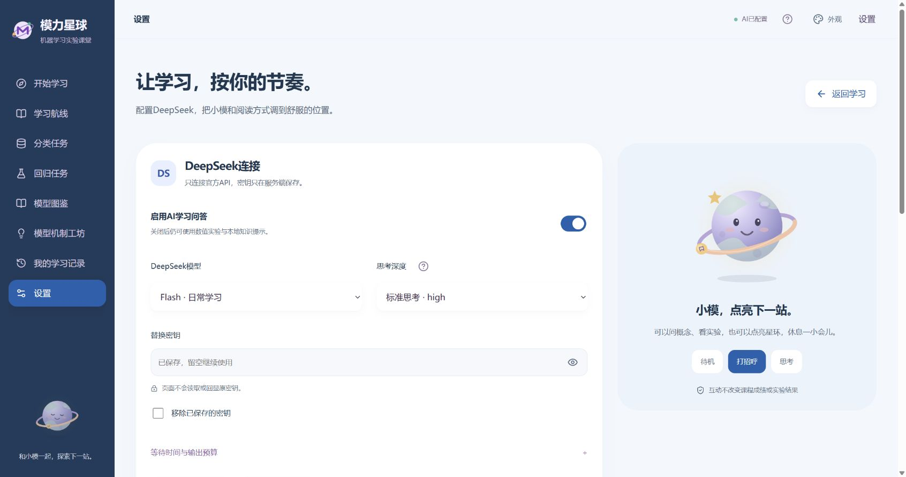
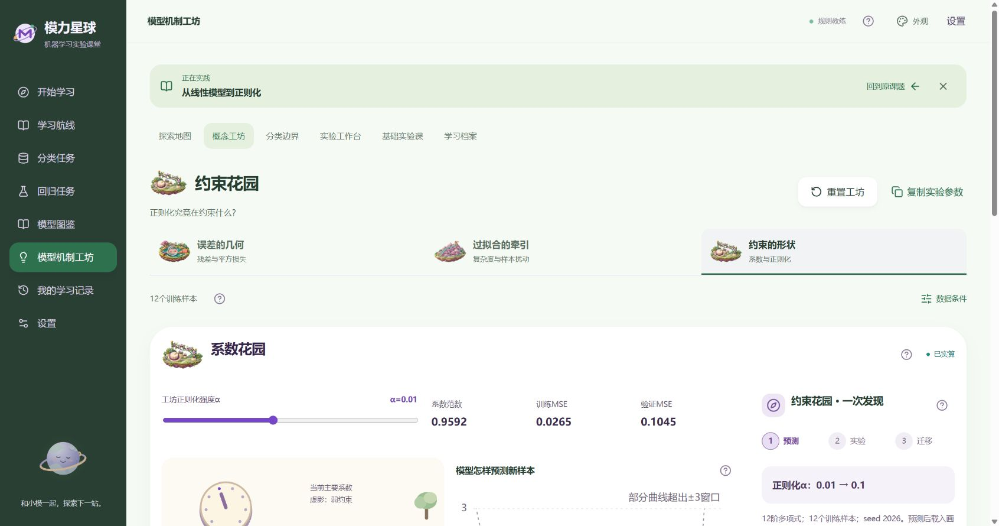
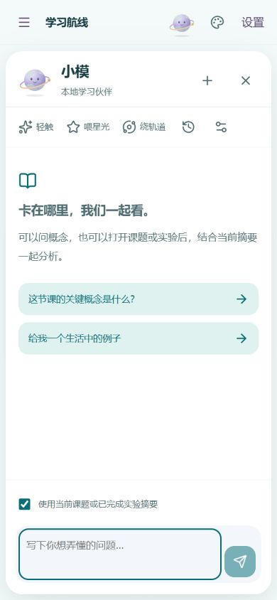

# 模力星球1.4星球向导与流程验收

运行版本1.4.0，功能代码d352371。整体诊断和已实施方向见[流程与视觉复核](PLANET_GUIDE_REVIEW_V14.md)。本轮聚焦角色协调与学习环节衔接。

## 星球角色

小模采用代码原生SVG球体、柔和地表、前后星环与书签卫星。所有部件共用运动坐标，卫星连续绕行并在星体前后分层；切换状态改变目标速度，保留轨道相位。待机轻浮和眨眼，思考显示信号，轻触回应、投喂星光和卫星绕行均有即时反馈。提示、继续挑战与机制反馈复用同一角色，静态提示不持续播放动作。原有环境插画保留。

Chrome实际核对：额外装饰轨道数量为0，设置预览星球250px；关闭待机后两个可见角色的data-animating均为false。卫星互动进入orbit，投喂进入feed并显示“收到了星光，轨道也亮起来了。”。系统减少动效、偏好关闭/重载与交互不授课完成由浏览器回归覆盖。后台标签页停止帧循环。

## 完整学习流程

- 继续学习优先最近未完成的已打开课题，再找下一未完成课；全部完成进入复习。打开但尚未通过检查也可继续。
- 从知识课进入数据任务或机制实验，保留来源课题；“回到原课题”可直接返回，刷新仍保留来源，退出实践或打开旧运行时明确清除来源。实践本身不授予知识完成。
- 分类课例支持二分类/多分类/多标签；回归支持单目标/多目标/时间顺序。类型来自任务元数据，计数标识辅助说明。
- 模型图鉴可按名称、标识和组合关键词检索；显示实际匹配数，空结果有清除入口。
- 训练完成后可直达该次已完成运行的结果；记录展示该次实际模型，失败、取消或超时可调整重试。
- 机制内原路径入口改为“基础实验课”，与18课学习航线区分。

Chrome实际完成线性模型课→约束花园→返回原课，筛选二分类得到Banknote，搜索Ridge得到岭回归。隔离QA沿用了旧浏览器存储，曾遇到指向另一份QA库的学习记录；按界面“开始一次发现”恢复后继续核验，未清除主档案。截图中的实算读数来自既有数值服务，未代答学习检查。

## 布局与运行

保留留白、柔和阴影、等宽数字和完整词组标题。筛选在列表上方，实践来源用单条横栏，设置预览不叠加多条独立轨道。390×844实测：页面无横向溢出，宠物入口44×44px，问答面板374px宽、左右8px；截图核对工具栏、问句和输入区域不重叠。临时视口已恢复。

主服务1.4.0已重新启动，现有Flash、已保存密钥和用户当前high深度均保留，本轮未执行新付费问答；AI底层模型接口未改，仅更新伙伴身份描述。QA使用独立库与无API模式，检查后已停止。知识首答、机制进度、历史档案和独立测试封存规则保留。

## 自动检查

[最终功能代码的Windows全量运行](https://github.com/ioytgvcbtr-pixel/see-overfitting/actions/runs/43906458193)通过：190项后端、44项前端逻辑、16项浏览器，以及类型检查和生产构建。该运行在新Windows环境安装锁定依赖，并使用无API配置。

新增覆盖轨道几何/前后深度/姿态边界、任务子类、组合检索、课程继续选择、课题实践来回与重载、空结果恢复、动作偏好和减少动效。真实迭代中，一次后端用例受本机已保存high设置影响，修正为用例显式设定所验证的xhigh；一次浏览器选择器误匹配描述中也含“待机动作”的安静开关，改为从名称开头精确匹配。修正测试隔离后全部通过，未为测试更改用户配置。

Git保留真实顺序，公开AI过程继续脱敏保存。本轮没有学生试用要求，也没有准备比赛视频、PDF或其他提交材料。
