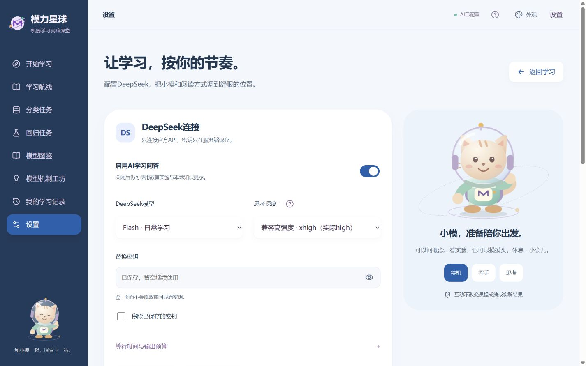

# 模力星球1.3设置与小模验收

日期：2026-11-16。最终功能代码8751c1f，运行版本1.3.0。设计见[设置与宠物方案](SETTINGS_PET_V13.md)。本轮继续开发产品与真实记录，没有准备比赛视频/PDF。

## 设置定位与界面

根因是顶部设置按钮调用`openMechanism('settings')`，旧设置也被解析为机制分支，但机制导航未列设置。现在设置为独立视图`#classroom/settings`，顶部和侧栏入口一致，当前导航选中“设置”，不再显示机制页签。旧`#settings`、`#mechanisms/settings`也解析为独立设置。

页面分DeepSeek连接、宠物预览、小模陪伴、阅读与问答、学习档案入口。服务商固定，保留Flash默认并可选Pro。密钥可替换或移除，留空保留；已存密钥从不回显，新输入可主动显示核对。验证错误不携带输入内容。保存与测试分开，改配置后连接测试状态失效。

可选思考none、low、high、max及原有xhigh兼容值；xhigh实际映射high。保存后的深度用于连接测试、原实验讲解/建议和宠物问答。等待上限、输出预算可调。其余本机偏好包括宠物开关、待机动作、安静陪伴、字号、配色、回答风格、摘要共享和问答保存。

## 小模网页宠物

原创分层SVG的Q版猫咪宇航员，包含头盔、耳朵、手臂、腿、轨道、星星等独立元素。待机呼吸、眨眼、轻浮；问候挥手、思考、开心和睡眠状态。摸头、喂星星、绕一圈有即时动作与文字回应，不增加学习分数。

桌面入口放在侧栏预留区；手机入口进入顶部栏。宽屏打开问答会为抽屉预留空间，不压住实验；窄屏为可关闭对话层，限制背景焦点与滚动，Escape返回入口。尊重减少动效，后台页面暂停动作。设置中可预览动作或重新启用宠物。

问答从服务端读取已公开课题与已完成实验摘要，不采信客户端自报指标，不发送原始样本行/封存测试。未提交知识检查时，索取选项只返回引导，不修改首答。回答只提供最终内容和用量，不保存或展示模型推理内容。失败明确为本地提示；聊天本身不会自动执行模型操作。提供回课题/已完成运行的入口，主动点击后导航。

会话保存在本机SQLite，支持新会话与最近记录恢复；关闭保存后新提问不写档案，当前临时对话仍可连续问。前端可停止等待，迟到回答不覆盖另一会话。长答从问题/回答开头展示，复制与用量按需展开。

## 实际Chrome验收

独立QA服务使用规则模式，思考深度改low并保存，刷新后仍为low；未改主服务原密钥与xhigh默认。QA验证喂星星触发feed状态、问过拟合得到本地提示、刷新重开恢复问答。390×844中入口44×44、顶部约9px，输入区在可见范围，面板374px宽，无页面横向溢出；对话层打开时背景inert。

主服务保留配置，实际向DeepSeek提问“什么是过拟合？我应该怎样用训练与验证结果判断？”，返回在线回答，记录实际用量580 tokens，元数据xhigh→high；未展示内部推理。问答不改变新知识进度或原基础课程记录。1440宽屏核对抽屉与内容之间保留间隔，设置预览在聊天打开时收起，参数无需挤窄。

[在线问答](../artifacts/screenshots/pet-online-v13.jpg) · [手机小模](../artifacts/screenshots/pet-mobile-v13.jpg)。截图来自本轮对应操作阶段；桌面最终问答展示完整开头，视口测试后恢复默认。

## 自动检查

基线[Windows运行43889700554](https://github.com/ioytgvcbtr-pixel/see-overfitting/actions/runs/43889700554)全部通过：189项后端、40项前端逻辑、13项浏览器测试，以及类型与生产构建。

覆盖5种深度实际请求体、官方服务商限制、密钥留空保留/替换/移除与错误不回显、无推理文本、离线历史幂等、关闭保存、未提交检查保护、真实Iris运行摘要不含样本/测试、导航兼容、偏好校验、设置保存与手机宠物。原学习、反例、AI迁移及全绿进度仍通过。

真实迭代中，私有答案检查初次误匹配`first_answer_submitted`，改为结构键校验；实验摘要用例初次未初始化惰性表，定向修正后通过。另补会话切换取消等待、最新记录顺序、手机焦点和长答起始位置。

## 官方依据

2026-11-16核对：[DeepSeek思考模式](https://api-docs.deepseek.com/guides/thinking_mode/)、[Chat Completions](https://api-docs.deepseek.com/api/create-chat-completion/)、[模型列表](https://api-docs.deepseek.com/api/list-models/)、[支持模型](https://api-docs.deepseek.com/quick_start/pricing/)。模型别名使用deepseek-flash与deepseek-v4-pro，具体服务版本随官方别名更新，不在界面承诺固定底层版本。

收尾补充：草稿差异比较涵盖全部数值相关条件而非仅模型参数；工作台索取题目选项同样给引导，普通模型选择问题不会被误当作代答。8751c1f定向检查通过，完整全量结果如下。

最终代码8751c1f的[Windows运行43893759493](https://github.com/ioytgvcbtr-pixel/see-overfitting/actions/runs/43893759493)通过189后端、40逻辑、13浏览器、类型和构建。负向URL测试夹具将虚构查询参数改为invalid以避免下载签名扫描误报，定向9项仍通过；应用代码与主服务不受该夹具文字调整影响。公开记录扫描完成后仅同步文档、截图和开发过程。
