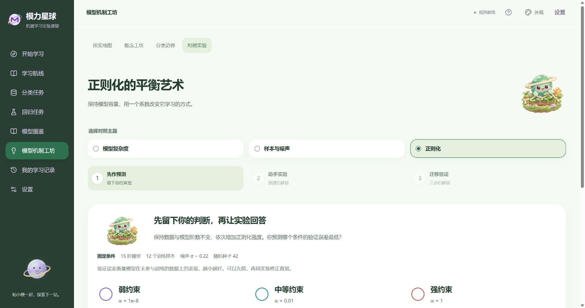
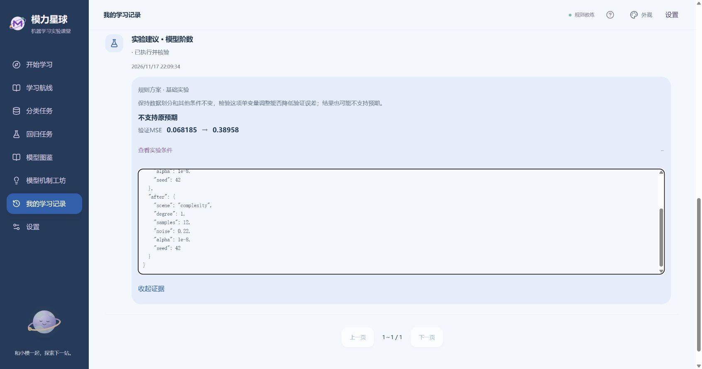

# 模力星球1.9.1：统一课堂入口

2026-11-17。按用户截图检查学生可见入口，集中使用当前课堂，保留并优化有教学价值的机制与对照实验。

## 入口整理

| 环节 | 当前使用方式 |
|---|---|
| 学习档案 | “我的学习记录”和“设置”共用同一个完整JSON导出、导入预览、重置及撤销组件 |
| 知识入门 | 6章18课学习航线；课程首答与进度按原样保留 |
| 真实数据 | 分类与回归任务中的完整清洗、划分、参数、训练及评估流程 |
| 机制工坊 | 探索地图、概念工坊、分类边界、对照实验四个入口 |
| 三组对照实验 | 在同一页面切换模型复杂度、样本与噪声、正则化；保留预测、实际计算及迁移 |
| 所有记录 | 新版时间线回看课程、机制探索、保存的实验及核验证据 |

移除截图中的分项备份、直接上传框和三条下载链接，修正导入错误提示，避免继续指向已移除的入口。删除不再使用的独立设置、数据工作台、记录页及应用壳；原机制组件专用于统一课堂。

历史书签统一解析并更新地址：`#path`进入学习航线，`#datasets`/`#bench`进入回归任务，`#history`进入学习记录，`#settings`进入设置；相应`#mechanisms/...`地址也进入同一页面。`/mechanisms`使用当前课堂，不加载单独的应用界面。

后端的分项校验协议继续服务完整档案验证与历史首答复核，不作为学生操作入口。当前导入选择“导出全部学习记录”产生的完整JSON。数值模型、数据角色、首答判分协议和测试接触历史没有改变。

## 保留内容的优化

对照实验主题使用有名的原生单选组，键盘方向键可切换，刷新保留主题。通栏主题选项等高，当前主题的解释集中在标题下；三步导航改为紧凑有序列表，不再占用大块画布。采用已有Q版星球对应曲线、误差和约束主题，装饰图不代替真实计算。

手机机制导航采用两列排布，四个入口完整可见；三组实验选项各52px高、间隔12px。320×667下根内容宽305px，scrollWidth同为305px，无页面横溢。三组主题在首屏内可见，文字与控件没有交叠。

[手机对照实验](../artifacts/screenshots/unified-contrast-mobile-v191.jpg) · [正式学习记录](../artifacts/screenshots/unified-records-v191.jpg)

## 核验证据接入

检查发现实验内“AI核验”提示指向已不存在的栏目。基础实验与岛内操作建议现在进入“我的学习记录→机制探索”，显示待执行/已核验状态，按需读取真实假设、来源、执行前后数值与参数。

隔离QA实算一项阶数调整，验证MSE从0.0681848065142159变为0.3895847250398295，页面如实显示“不支持原预期”。数值取自原核验接口，未改判为进步。参数详情为可键盘聚焦、可滚动的区域。

另在隔离QA走通正则化主题的预测、真实曲线及误差、保存实验、新版实验时间线与回看实验。正式档案仅查看，没有代答、运行或重置。当前档案与本轮备份基线一致，保留既有撤销入口；DeepSeek仍为Flash/high、已配置密钥，未新增付费问答。

## 验证与边界

本地207项Python、55项前端逻辑、类型检查与生产构建通过，27项定向知识/操作/档案检查通过。新增浏览器回归覆盖统一档案入口、历史书签归一、主题切换与刷新、320px布局、真实核验证据。

Chrome实际核对了上述入口、原生方向键、刷新保留、三组主题布局、证据读数、实验保存与回放。正式页面只有1个完整档案组件，分项备份链接和可见上传框均为0。结束时恢复浏览器尺寸，保留正式学习记录页面。

本轮远程CI状态暂未核实：Git推送已成功触发流程，但GitHub CLI、连接器和网页读取均出现网络错误。此处不沿用上一版本29项浏览器通过的结果，不将新增31项浏览器回归声明为已通过；可在网络恢复后查看当前功能提交的Windows检查。该限制不影响已完成的本地构建与Chrome实机验证。

同步状态：主要功能38ef445已推送到main和feature/initial-release；后续手机精简与验收提交0b80fa2已保存在本地，两次最终推送均因TLS握手失败未完成，没有跳过证书校验。正式网页运行当前本地1.9.1构建。

真实失败保留在AI开发记录：移除分支时锚点检查与类型检查发现残留状态/图标，修正后通过；证据循环变量一度遮蔽筛选参数，定向测试两项失败后修正；首次实机发现旧双栏挤压主题选项，随后修正为通栏，并再次精简手机重复说明。保留真实Git与脱敏过程，未制作比赛提交材料。
