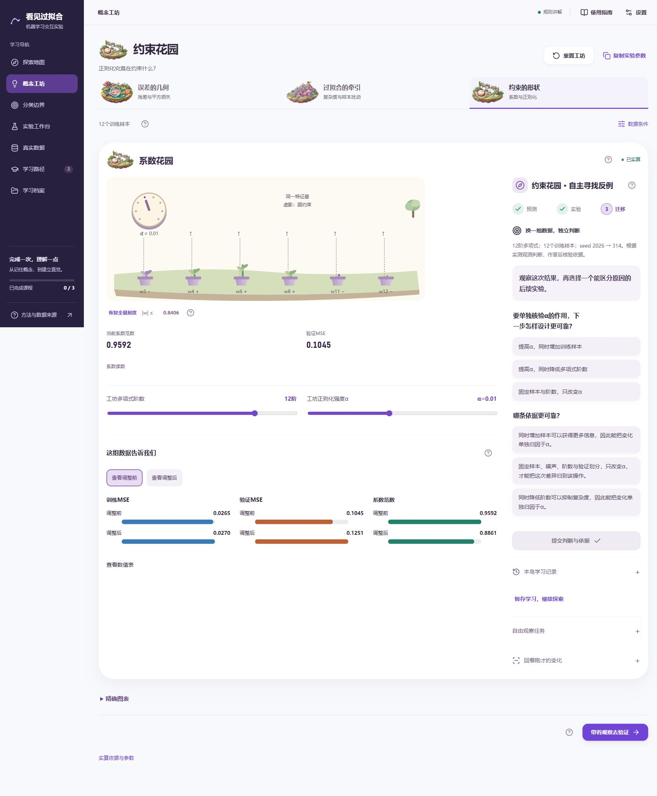

# v0.15 教学质量与验证

2026-11-16完成；范围见[计划](TEACHING_QUALITY_V15.md)。这是开发验收，不是学生学习效果研究。

## 实现结果

- 四岛迁移提供实算观测，首答后核验判断和依据。理由使用同一情境读数和可信干扰项；旧题按原题意恢复。
- 花园轮换读观测、从三个α模型中选择、设计单变量后续实验。图表每列独立从零起算，数值表可展开；按钮载入对应场景，迁移开始就切换新种子。
- 自主反例先锁定第一次α和预测，再只调α寻找“系数范数下降、验证MSE升高”。保留失败尝试，拒绝样本/噪声/阶数等混杂变化；预测只与第一次操作比较。三个种子均有可复算的未达标首轮和有效反例。
- AI接收已提交的选择、依据和待检验线索，生成合法单变量操作；执行后重算验证指标，补充范数/训练误差等证据。方向性预期区分支持/不支持；uncertain仅观察。迁移作答期间暂停AI方案。
- 草稿、失败尝试和首答可恢复；备份导入重算图表、理由及评分，内部答案与错因标签不导出。

## 实际验收

| 检查 | 结果 |
|---|---|
| Python | 128通过，覆盖新题、三个种子、单变量、首答、备份、旧题、Windows脚本 |
| 前端逻辑 | 34通过 |
| 类型 / 生产构建 | 通过 |
| Windows浏览器回归 | 2条通过：自主实验及迁移中断恢复；离线设置与390px布局 |
| 本机Chrome | 自主任务、失败/成功试验、迁移、刷新、离线设置、真实在线AI执行通过；切换场景的MSE与观测一致 |
| 布局 | 6阶段×390/768/1440px，共18组无横向溢出、控件出界或所查按钮/选择器/折叠入口小于约44px；新增场景按钮后再查3宽度完成态，通过 |
| 主工作区 | 0.15.0已启动；原3/3、岛屿记录与xhigh保留 |

最终实现提交`6f03237`的[Windows运行43741706646](https://github.com/ioytgvcbtr-pixel/see-overfitting/actions/runs/43741706646)完整通过。前几次远端运行依次暴露：旧测试依赖环境AI开关、PowerShell 5.1中文脚本编码、额外控制台编码设置后的退出异常。修正测试隔离、补UTF-8 BOM、撤回额外编码修改并处理子进程退出竞争；失败运行保留。共享浏览器脚本也修正了异步保存/设置加载等待和多题型选项假设。

工程接口参考：[Playwright CI](https://playwright.dev/docs/ci)、[官方setup-node](https://github.com/actions/setup-node)。

本机布局批次快速改变视口后一次点击等待超时，读取状态后完成后续检查；没有把该次中断记成完整通过。后续独立完整流程及远端流程通过。

## 实测成本

- 托管Windows全新工作区/虚拟环境，从检出后的运行时准备开始，含无显式依赖缓存的安装、构建、服务就绪，**77.407秒**。镜像已有基础工具/运行时缓存，不含Windows安装或人工配置，不代表所有学生电脑。未使用API密钥，核心学习离线可完成。见[复现记录](../artifacts/validation/v15/windows-reproduction.json)。
- 本机依赖已安装，每次新建应用进程，PowerShell 7为8.407秒、独立隐藏PowerShell 5.1辅助进程为8.021秒，均含退出清理。嵌套终端两次5.1计时未形成结果，不计成功。
- 本机HTTP单客户端12次相同请求，热缓存中位数：花园3.16ms、森林16.50ms。首测分别22.23ms、91.53ms，不保证是全新进程冷计算；不含浏览器绘制或公网AI延迟。见[原始测量](../artifacts/validation/v15/performance.json)。

## 真实AI核验

隔离数据库实际调用deepseek-flash、xhigh。AI提出α从0.1调到1，预期验证误差降低；执行得到验证MSE **0.1251 → 0.2140**、系数范数 **0.8861 → 0.6833**、训练MSE **0.0270 → 0.0382**。界面显示“这次结果不支持预期”。这验证操作及结果链路，不代表AI建议准确率或教学效果。学生认识描述只作待检验线索；提示进一步限制把选择方向写成指标事实。见[实测记录](../artifacts/validation/v15/online-ai-verification.json)。

## 待验证

真实3–5位初学者试用尚未开展，已有[试用流程](FORMATIVE_TRIAL.md)。尚无另一台学生电脑人工安装观察，也无教学提升或获奖概率实证。本轮没有制作竞赛视频或提交PDF。

