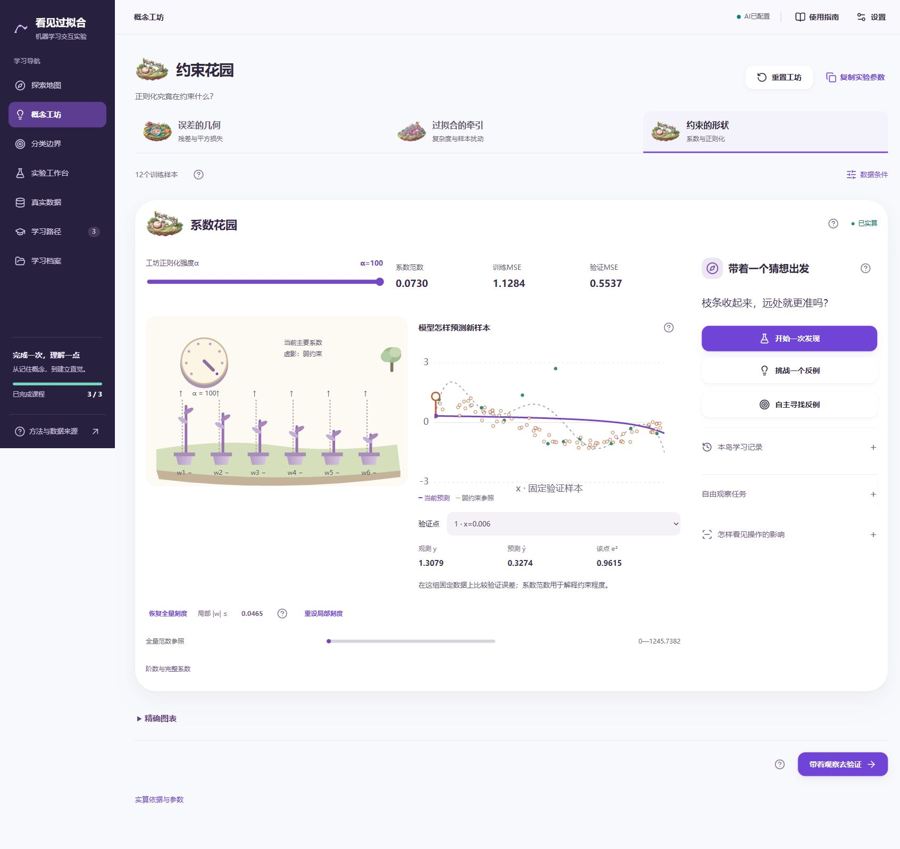
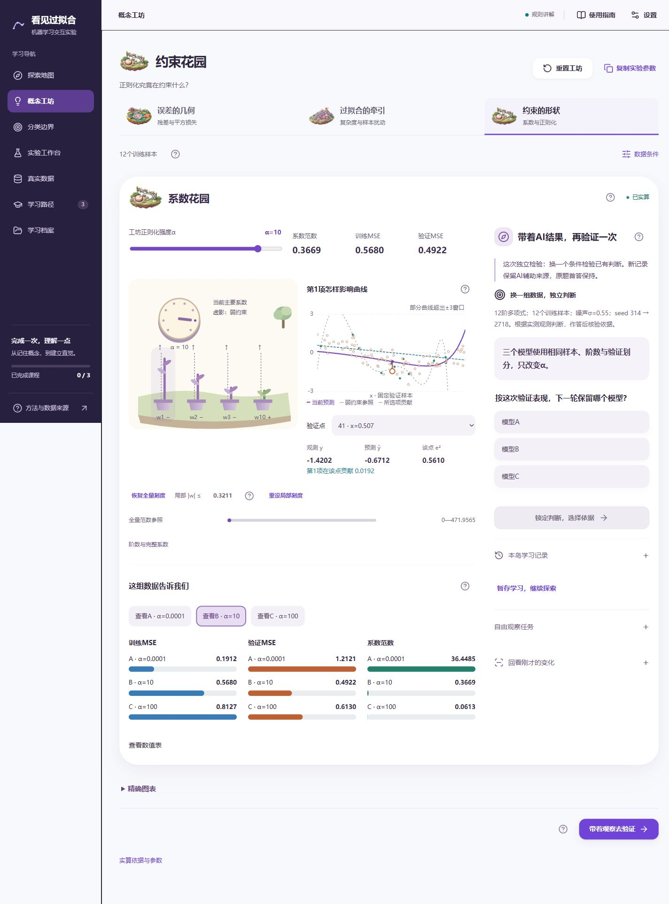

# 0.16 实施与验收

本轮按[实施计划](LEARNING_REFINEMENT_V16.md)完成题目、花园因果可视化、首屏布局和AI后迁移。主应用版本0.16.0；原课程3/3与xhigh配置保留，写入验收使用隔离数据库。

## 题目协议

- 新题v3先锁定判断，再返回依据；服务器拒绝改写首次判断或跳过锁定直接评分。刷新、草稿、备份均保留该阶段。
- 模型候选来自同一训练/验证划分的真实Ridge计算，包含不同噪声情境。9个确定性题例中A/B/C各为正确答案3次，最优α覆盖0.0001、0.01、0.1、1、10。见[实算矩阵](../artifacts/validation/v16/question-balance.json)。
- 排除近似并列的选择题，避免把平局强行判成单一赢家；优先采用误差比例可读的干扰项。旧方向判断仍支持“几乎不变”。
- 依据不再提前写出赢家或数值结论。新模型选择题未评分时，公共目的参数与备份均不携带获胜模型参数；评分由内部重算结果完成。
- v1/v2历史按旧题意恢复，旧首答和成绩不重写。新题协议版本独立。

## 花园因果可视化

α、系数范数、训练MSE、验证MSE位于画布上方。主画面并排显示主要系数枝条与真实预测曲线；窄屏自然堆叠。完整阶数与系数按需展开，所有系数均可选择。

枝条默认局部放大，刻度在同一数据/阶数下锁定，另保留全量范数参照。放大、全量恢复、超窗箭头和重设入口明确显示，不静默把不同模型画成同样高度。显示当前主要系数并保留所选项，避免弱约束大系数挤掉当前模型的主要贡献。窄画布减少同时显示的枝条，保留点击间距。

点击枝条高亮其标准化多项式项贡献；全部贡献加截距可还原紫色预测曲线。验证探针支持拖动、键盘和选择器，显示观测、预测、该点残差平方；移动探针不重训、不改变总MSE。图窗固定±3，裁切明确提示，全部误差仍按真实完整数值计算。

自由观察中，根据同组真实候选提示训练/验证差距或较强约束下两种误差上升，使用待检验措辞。迁移作答期间隐藏解释性结论，保留题目观测。单次敏感性、系数收缩与过拟合不互相替代。

## AI后的迁移

原迁移已完成且AI方案已执行后，可直接“带着这个结果再验证”。系统创建新种子/条件的验证记录，保留来源操作、原学习记录与辅助标记；原首答和预测保持。

新验证不伪造一轮预测或实验。入口幂等，刷新、判断锁定、备份重算、返回原记录均可用。UI实测：原题选择C并通过；新情境选择B并通过且标明辅助；返回后仍为原C首答。本轮该写入链路使用规则方案，界面如实标记来源，没有冒充新的在线模型调用。

## 验收结果

| 检查 | 结果 |
|---|---|
| Python | 147通过，覆盖9组题例、锁定、提前提示、旧题、备份、贡献项加和、残差与四岛AI后验证 |
| 前端逻辑 | 34通过 |
| 类型 / 生产构建 | 通过 |
| Windows浏览器回归 | 5条通过：自主反例/中断恢复、离线设置、短屏花园、AI后验证及手机花园 |
| 本机Chrome | 实测锁定前无依据、锁定后不可改、C/B题例评分、AI新情境、返回原首答、贡献与探针操作 |
| 响应布局 | 1366×768、1440×900、390×844的DOM检查无横向溢出、控件出界或所查目标小于约44px；α主控件底部分别约552/549/564px |
| 主工作区 | Chrome已打开0.16；3/3与xhigh保留；没有制作提交视频/PDF |

最终[Windows回归运行43816082009](https://github.com/ioytgvcbtr-pixel/see-overfitting/actions/runs/43816082009)对应`1b0eaa2`，147项Python与5条浏览器回归全部通过。新工作区安装/构建/服务就绪56.720秒；范围见[复现记录](../artifacts/validation/v16/windows-reproduction.json)。托管镜像预装基础工具，计时不包含Windows安装或人工配置。

本轮修正了实测暴露的枝条命中面积和展开系数按钮高度。初次短屏自动点击等待超时，读取状态后键盘操作可完成；没有把该次中断写成完整通过。原生缩略图截图曾与DOM视口不一致，相关缩略图不作为手机效果证据；改用浏览器viewport能力检查实际导航/堆叠。远端手机截图初次拍到淡入起始帧，增加透明度就绪检查，并在截图时完成过渡后重新捕获。公开验收与AI过程按真实结果记录。

