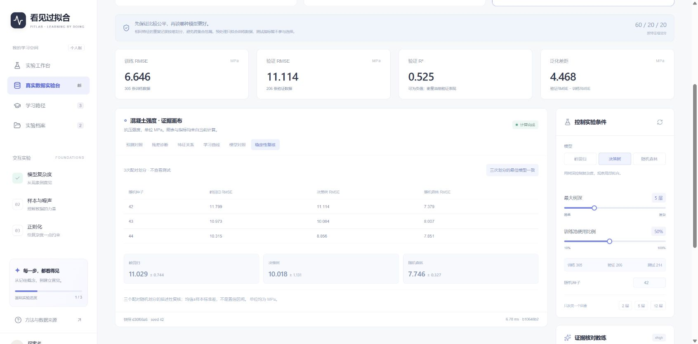
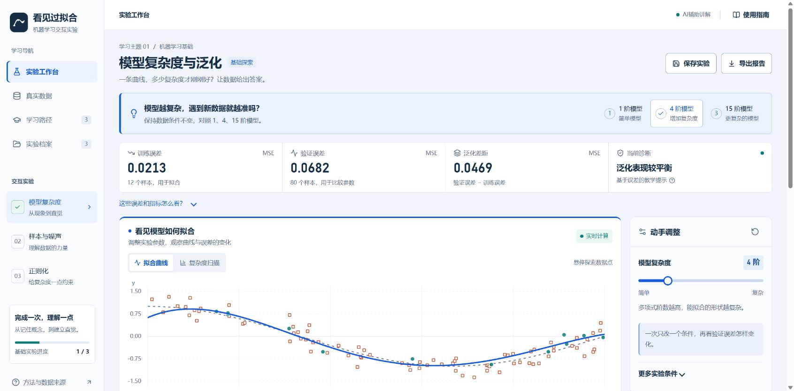
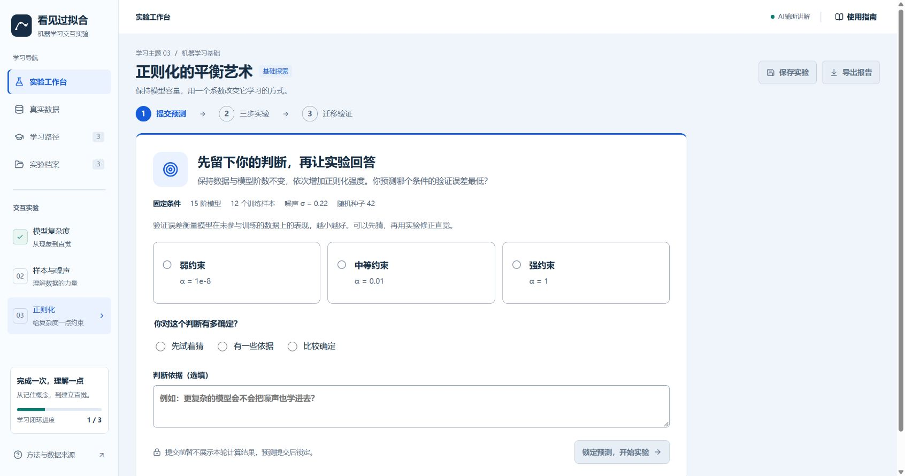

# 真实公开会话记录

由当前会话脱敏导出，排除内部推理及系统指令。

## 2026-11-12T13:48:44.981Z · user

那就做“看见过拟合”吧，先制定详细的功能设计和开发计划，再从环境搭建开始实现，界面和交互要精致，并按比赛要求保留Git提交和AI开发过程记录。把项目放在项目文件夹下，py环境采用<PYTHON_ENV>。


## 2026-11-12T13:48:50.791Z · assistant

我会先写好功能设计、交互方案和开发计划，再按计划搭建并实现。项目放在当前工作目录下的独立文件夹，使用你指定的 `<PYTHON_ENV>`，从第一步起保留 Git 提交和本次 AI 开发记录。


## 2026-11-12T13:50:27.155Z · assistant

我会用 git-workflow 技能管理提交，用文档协作流程完成设计，并按 Sites 的本地开发流程验证界面。功能先贯通“预测—实验—解释—练习—报告”：三组实验场景、实时曲线与误差、参数对比、学习记录，以及可配置的 AI 解释。你指定的 Python 环境已具备所需核心依赖。


## 2026-11-12T13:51:37.717Z · user

<send_user_message_question_reply>
[{"questionItemId":"[\"request_user_input_async\",\"call_f4d54be1bfa74d6099d4c58785912166\",0]","question":"请补充已有API的服务商、模型名和Base URL（不需要发送密钥）。我会先完成应用和本地配置方式，密钥后续保存在项目忽略的配置文件中。","answer":"ds，采用flash的最新模型，[REDACTED]。"}]
</send_user_message_question_reply>


## 2026-11-12T13:55:40.970Z · assistant

功能设计和开发计划已写入项目，并完成首个 Git 提交。密钥会只保存在忽略的后端配置中，过程记录会脱敏。我接下来先实现数值核心，确保改参不会改变数据划分、测试集保持独立，再完成界面和 AI 联调。


## 2026-11-12T14:04:09.489Z · assistant

数值核心的首批测试已通过，覆盖了固定种子复现、数据集独立性、测试指标隔离和记录保存。DeepSeek 也返回了可用的 `deepseek-flash` 模型。界面会采用暖白底、靛蓝主色的实验工作台，让曲线、参数和证据解释成为视觉重点。


## 2026-11-12T14:15:48.987Z · assistant

浏览器中已跑通保存、回放、双实验对比、预测题、迁移练习和 Flash 在线解释。为了让示例中的现象更容易观察，我依据实际计算将初始训练样本调整为12个，并加入1、4、15阶快捷对照；三者使用相同数据，显示的指标均来自计算。


## 2026-11-12T14:26:53.822Z · assistant

我在收尾核验报告导出和移动端布局。浏览器自动化未能确认 Blob 下载文件，因此我会把导出改为服务端生成附件，再校验附件内容；同时补齐启动说明和最终评估后的状态规则，方便后续复现与参赛录屏。


## 2026-11-12T14:38:13.448Z · assistant

当前版本的7项后端测试、TypeScript检查和生产构建均已通过。390像素嵌入窗口中，菜单与参数操作可用，未发现横向溢出；浏览器也已成功请求服务端报告附件。我正在整理最终验收记录、三组功能迭代证据和启动文档。


## 2026-11-12T14:41:33.198Z · assistant

当前 Chrome 策略拦截了附件导航，虽然服务端已返回报告。我会补上报告在线预览和复制功能，让你能直接取得完整内容，同时保留标准附件接口。验收文档会注明这项浏览器限制。


## 2026-11-12T14:48:02.766Z · assistant

首版已完成，项目位于 [see-overfitting](<PROJECT_ROOT>/README.md)，使用指定的 `<PYTHON_ENV>`。

已实现三组交互实验、复杂度扫描、预测与练习、实验保存与对比、独立测试、报告预览和 DeepSeek Flash 在线解释。

- [详细功能设计](<PROJECT_ROOT>/docs/FUNCTIONAL_DESIGN.md)
- [开发计划](<PROJECT_ROOT>/docs/DEVELOPMENT_PLAN.md)
- [AI开发过程记录](<PROJECT_ROOT>/docs/ai-process/README.md)
- [验收记录](<PROJECT_ROOT>/docs/VALIDATION.md)

**已保留9次真实 Git 提交，工作区干净。** 7项后端测试、类型检查、生产构建和一键启动验证通过。密钥仅保存在忽略的本地配置中。

在 PowerShell 运行：

```powershell
& '<PROJECT_ROOT>\scripts\start.ps1'
```

启动后打开 [实验工作台](http://127.0.0.1:3000)。

当前 Chrome 策略限制附件下载，已提供报告在线预览和复制。正式比赛视频、技术PDF及真实用户试用仍需按[交付清单](<PROJECT_ROOT>/docs/COMPETITION_CHECKLIST.md)补齐。


## 2026-11-12T14:52:45.958Z · user

github的话打开我的谷歌浏览器，按要求去建立一个仓库。目前先主要完成好项目内容，不做其他的提交文件准备。先介绍一下项目我看看。


## 2026-11-12T14:53:11.849Z · assistant

我会先按比赛要求建立 GitHub 仓库，检查后再上传当前源码和开发记录。后续重点放在项目功能与体验，暂不继续准备比赛视频、技术PDF等材料。建好后我会介绍现有项目，方便你判断下一步怎么改。


## 2026-11-12T14:54:05.153Z · assistant

Chrome 当前停在 GitHub 登录页，需要你亲自登录。我先检查待上传内容和历史记录，并整理项目介绍。


## 2026-11-12T14:55:31.506Z · assistant

本机 GitHub CLI 已登录 `ioytgvcbtr-pixel`，可以直接建立仓库，Chrome 的登录状态不影响创建。现有 Git 历史中未发现密钥或运行数据库。我会使用这个已登录账号创建公开仓库并保留提交历史，完成后给你链接核对。


## 2026-11-12T14:58:31.893Z · assistant

仓库已创建并上传，原有9次提交完整保留，默认分支为 `main`，Chrome 已能公开查看。项目的核心是一间“能亲手做实验”的机器学习教室：拖动参数就能看到曲线和误差变化，AI 再依据这次实验解释原因。当前版本聚焦过拟合、数据量与噪声、正则化三个主题。


## 2026-11-12T15:00:30.376Z · assistant

GitHub 仓库已建立并在 Chrome 打开：[see-overfitting](https://github.com/ioytgvcbtr-pixel/see-overfitting)。仓库为 **Public**，默认分支 `main`，目前有 **10次真实提交**，密钥和运行数据库未上传。后续先专注项目功能与体验，暂缓其他提交材料。

**“看见过拟合”是一间可以亲手操作的机器学习实验室。** 它帮助初学者理解一个容易混淆的问题：为什么模型在训练数据上表现越来越好，遇到新数据反而变差？

目前有三个实验：

- **模型复杂度**：调整多项式阶数，观察曲线怎样从过于简单变得过度弯曲。
- **样本与噪声**：改变数据量和噪声，观察泛化表现。
- **正则化**：给复杂模型增加约束，寻找表达能力与稳定性之间的平衡。

例如，当前固定数据条件下，实际计算结果是：

| 模型 | 训练误差 MSE | 验证误差 MSE |
|---|---:|---:|
| 1阶 | 0.2152 | 0.3896 |
| 4阶 | 0.0213 | 0.0682 |
| 15阶 | **0.0061** | **0.1538** |

15阶模型的训练误差更低，验证误差却比4阶更高。用户可以通过曲线和指标，直接看到这次实验中的过拟合现象。

推荐体验流程是：**先预测 → 调参观察 → 保存并对比实验 → 请AI解释 → 完成练习 → 最后揭示独立测试结果。**

这里的 AI 教练使用 DeepSeek Flash，收到的是本次实验的真实参数和计算指标，再给出观察、原因和下一步建议。实验记录可以回放，报告可以预览和复制。

当前版本聚焦**一维多项式回归**，已贯通上述流程。接下来最值得打磨的是新手引导、图表操作、对比结果的解释，以及AI反馈的教学质量。[查看项目界面](<PROJECT_ROOT>/artifacts/screenshots/desktop.jpg)


## 2026-11-12T15:12:11.810Z · user

接下来要对仓库的介绍进行脱敏，不应该出现我的磁盘路径等内容。完成这些任务后，dsflash模型的思考强度采用xhigh。接下来开始对项目的功能进行改进，可以多搞几个公开数据集来完成，效果展示也可以多搞几种，同时要符合比赛赛道要求，要有一定的创新性。


## 2026-11-12T15:12:34.131Z · assistant

我会先清理仓库介绍和可公开文件中的个人路径，并检查 Git 历史里是否仍有残留；再核对 DeepSeek Flash 的思考强度参数，扩展公开数据集和实验展示。改进会继续围绕“理解过拟合、比较泛化、依据实验解释”这条主线，保留真实开发记录，暂不准备其他提交材料。


## 2026-11-12T15:17:24.339Z · assistant

这轮会用 research-improve 流程验证数据划分、模型比较和展示结果。另一个需要说明的点：DeepSeek Flash 的官方参数没有 `xhigh`，目前最高档是 `max`；我会把你的 `xhigh` 偏好映射到 `max`，并做一次真实接口验证。


## 2026-11-12T15:17:51.796Z · assistant

进一步核对后，需要更正刚才的说明：DeepSeek 接口兼容接受 `xhigh`，并将其映射为原生 `high`，不是 `max`。我会按你指定的值发送 `reasoning_effort="xhigh"`，启用思考模式。[官方参数说明](https://api-docs.deepseek.com/api/create-chat-completion/)

路径也出现在已有提交中，只改 README 不够。我会保留一份仅在本机的原始备份，清理公开历史中的路径内容，保留提交顺序和时间。


## 2026-11-12T15:24:36.435Z · assistant

当前文件的路径清理已完成，嵌套日志也通过了 JSON 校验。历史清理后的本地 Git 对象校验发现异常，因此远端还没有被覆盖；原始备份仍在。我会先恢复并验证历史，再发布，避免损坏已有提交。


## 2026-11-12T15:28:45.529Z · assistant

公开 README 和分支历史已完成清理并回读验证，原有10次提交的顺序、作者和时间均已保留。

功能扩展会新增“真实数据实验台”，接入葡萄酒质量、汽车油耗、混凝土强度三个公开数据集，提供模型对照、预测与残差图、学习曲线和多种子稳定性检查。模型与结论仍以代码计算为依据，AI 负责解释结果。


## 2026-11-12T15:51:58.963Z · assistant

三个数据集已下载并固定快照：葡萄酒1599条、汽车油耗392条、混凝土1030条，均附来源、许可和校验值。`xhigh` 真实请求已成功，思考模式也已启用。

实验台会增加两项有用的设计：重复特征记录按组划分，避免跨集合泄漏；浏览器记录测试集接触，查看后会提示后续调参属于探索。另用三个配对划分复核模型排序，展示结论的稳定性。


## 2026-11-12T15:53:45.246Z · assistant

新版后端已通过16项测试，另完成了63组配对实验，比较过程均未使用测试集指标。结果并非所有数据都偏向同一种模型：例如葡萄酒数据上，岭回归和随机森林的平均验证RMSE接近；混凝土数据上，随机森林在本轮条件下较好。界面会展示这些实际差异和波动。


## 2026-11-12T16:11:11.821Z · assistant

浏览器已跑通三种数据集切换、六种展示、模型对照、稳定性复核、实验收藏和 xhigh 在线解释。测试接触提醒在改参后仍会保留。核验中还修正了 AI 的参数说明：树模型不会再收到岭回归的 α 参数，下一步建议也会限制在界面已有控件内。


## 2026-11-12T16:34:33.045Z · assistant

新版的桌面和窄屏流程已核验：六种展示均可切换，窄屏未发现横向溢出，键盘方向键也能切换图表。现在进入收尾：更新工程说明和真实开发记录，做最后一次脱敏检查，再将0.2版同步到 GitHub。不会生成新的比赛提交材料。


## 2026-11-12T16:50:26.722Z · assistant

0.2版已通过20项测试、类型检查和生产构建，一键启动也确认仍使用你指定的本地 Python 环境。公开文件检查未发现本机路径残留。现在正在把代码、数据快照、展示截图和开发记录同步到仓库。


## 2026-11-12T16:52:15.227Z · assistant

已完成并同步到 [GitHub 仓库](https://github.com/ioytgvcbtr-pixel/see-overfitting)，当前版本 **0.2.0**。

- **仓库脱敏**：清理了介绍、配置、公开开发记录及分支历史中的本机路径和会话标识，保留原有提交顺序、作者和时间。
- **Flash 思考模式**：实际发送 `reasoning_effort="xhigh"` 并启用思考。DeepSeek 按[官方兼容规则](https://api-docs.deepseek.com/api/create-chat-completion/)映射为原生 `high`。
- **新增公开数据**：葡萄酒质量1599条、汽车油耗392条、混凝土强度1030条，附来源、许可和校验值。
- **新增模型与展示**：岭回归、决策树、随机森林及均值基线；支持预测对照、残差诊断、特征关系、学习曲线、模型对照、稳定性复核。
- **创新落地**：重复特征分组防泄漏、配对划分复核、测试集接触记录，以及依据实际指标和可用控件生成建议的AI教练。

**验证通过：20项测试、类型检查、生产构建、桌面与窄屏操作；完成63组配对实验，未用测试指标调参。** 本轮没有生成新的比赛提交材料。

历史清理改变了提交哈希，旧克隆需重新同步；旧提交缓存可能仍受 [GitHub保留机制](https://docs.github.com/en/authentication/keeping-your-account-and-data-secure/removing-sensitive-data-from-a-repository)影响。



## 2026-11-12T16:52:23.033Z · user

采用 $frontend-design 和 $ui-ux-pro-max 对这份项目进行改进，前端的设计要考虑该项目面向的用户群体，其中的一切决策由你扮演用户来进行思考，同时联网搜索查看其他的网页是怎么做的，前端是如何设计的。


## 2026-11-12T16:52:28.585Z · assistant

我会从“刚接触机器学习、想弄懂过拟合的学生”视角审视当前界面，检查学习顺序、操作反馈和图表是否容易理解；同时查看同类交互教学网站的设计，并按你指定的两个技能改进前端。


## 2026-11-12T16:59:16.447Z · assistant

两个技能已找到并读完：`frontend-design` 和 `ui-ux-pro-max`。当前界面的主要问题是文字偏小、对比度偏低，图表被推到首屏下方，而且新用户要同时面对太多参数和指标。我会优先让学生知道“先改什么、该看哪里、怎样比较结果”，再统一视觉细节。


## 2026-11-12T17:05:06.432Z · assistant

我已查看 TensorFlow Playground、Seeing Theory 和 Google 的过拟合课程页。可借鉴的是：让控件靠近可视化、每次聚焦一个概念、把练习反馈和观察结果连起来。

这次会采用清晰的“学习实验台”布局：放大文字和图表、按课程突出主要参数，并把真实计算过的条件自动放在一起比较。技能检索没有给出匹配的教学控件方案，局部交互会依据其基础可访问性规则和这些网页观察来确定。


## 2026-11-12T17:11:33.616Z · assistant

设计方向已写入项目。我正在实现“三步对照”：学生依次观察不同复杂度、样本量或约束强度后，界面会并排展示实际计算结果；一旦其他条件变化，就清空本轮对照，避免比较混杂条件。参数面板也会按课程突出当前重点，其余条件可展开查看。


## 2026-11-12T17:47:30.660Z · assistant

新版已进入浏览器验收：首屏直接呈现实验问题、三个对照条件和拟合图，参数按当前学习主题展开。接下来重点检查对照结果是否真实累计、切换条件是否正确重置，以及手机端和真实数据实验的操作流程。

## 2026-11-12T17:49:59.955Z · assistant

三步对照已核验：1、4、15阶的结果都来自实际计算，修改噪声后会重新开始比较。真实数据页也能依次完成“比较模型→复核结论→解释结果”。我正在收尾窄屏布局，并修正等待状态和数据来源说明，避免学生把旧结果当成新条件的结果。

## 2026-11-12T17:55:24.104Z · assistant

手机端已确认没有横向溢出，点击推荐实验条件后会直接定位到图表。主要配色的对比度也已核对：正文、辅助文字和按钮达到4.5:1以上。当前6项前端逻辑测试、21项Python测试通过，正在整理截图、设计依据和真实开发记录。

## 2026-11-12T18:00:27.414Z · assistant

桌面和手机端的主要流程已验收，在线Flash讲解也成功使用了本次模型对照与复核结果。保存、回放、报告预览和浏览器后退均可用，生产构建通过。现在将这轮改进按模块提交，并同步脱敏后的Git和AI开发记录。

## 2026-11-12T18:06:34.300Z · assistant

已用 **frontend-design + ui-ux-pro-max** 完成0.3版改进，并同步到[GitHub仓库](https://github.com/ioytgvcbtr-pixel/see-overfitting)。

围绕机器学习初学者“先改什么、看什么、如何比较”重新设计：

- **三步实验引导**：自动记录真实计算结果，条件变化后重新对照。
- **参数渐进展开**：突出当前课程主参数，补充指标释义。
- **真实数据学习流程**：比较模型 → 复核结论 → AI解释。
- **视觉与交互**：清晰中文字体、更高对比度、自适应图表；窄屏点击条件直接定位曲线。

实际参考了[TensorFlow Playground](https://playground.tensorflow.org/)、[Seeing Theory](https://seeing-theory.brown.edu/regression-analysis/index.html)和[Google MLCC](https://developers.google.com/machine-learning/crash-course/overfitting/interpreting-loss-curves)。[设计依据与决策](https://github.com/ioytgvcbtr-pixel/see-overfitting/blob/main/design-system/fitlab/MASTER.md)已保留。

21项Python测试、6项前端逻辑测试、类型检查和生产构建通过；桌面及375px窄屏流程已验收。Git提交与脱敏AI开发记录已更新。



## 2026-11-13T04:59:10.386Z · user

把项目启动起来，用谷歌浏览器打开，我看看改版后的实际效果和交互。


## 2026-11-13T04:59:16.626Z · assistant

我来启动前后端，并用谷歌浏览器打开新版工作台供你体验。

## 2026-11-13T05:01:07.228Z · assistant

已启动前后端，并在谷歌浏览器打开：[新版工作台](http://127.0.0.1:3000/)。

服务会保持运行。你可以点击“1、4、15阶模型”体验三步对照，或进入“真实数据”比较模型、复核结论并获取AI讲解。


## 2026-11-13T05:12:26.714Z · user

对比官方的要求，目前的作品效果怎么样？以严格的角度对其进行打分，最后能拿几分。


## 2026-11-13T05:12:41.245Z · assistant

我先重新核对官方赛道要求和评分细则，再结合当前代码、实际界面与已完成的验证，按严格评审口径打分，并区分“作品本身”和“最终参赛材料”的得分。

## 2026-11-13T05:14:37.072Z · assistant

官方评分已核对：过程可复现性25%、实用价值25%、创新与意图控制20%、工程15%、体验15%。当前作品符合“AI驱动的高交互教育与可视化”方向；严格来看，主要扣分点会是差异化、教学效果证据，以及评委能否完整复现开发和运行过程。

## 2026-11-13T05:17:18.316Z · assistant

**严格预评，我给当前0.3版：74/100，合理区间约70—78分。**

目前的优势是界面较成熟、计算真实、功能能够连通。主要失分在**差异化、教学效果证明，以及开发过程的完整可复现证据**。这个分数是依据现有作品的主观预评，正式成绩还需要完整提交材料。

我重新查看了官网：项目符合第5个推荐方向“AI驱动的高交互教育与可视化”。官方五项权重如下，并不只看界面或模型能力。[官方赛道及评分要求](https://www.boxuegu.com/matchTrack/detail/?id=10039)

| 官方维度 | 满分 | 严格估分 | 判断依据与扣分原因 |
|---|---:|---:|---|
| 过程可复现性与演进链路 | 25 | **18** | 有真实Git历史、公开对话、模块迭代和环境模板。但另一份干净环境的10分钟复现尚未实测，三条完整Prompt链及你如何约束、纠错，还需要更清楚地展示。 |
| 解题有效性与实用价值 | 25 | **18** | 学习场景明确，实验、比较、解释、练习、报告基本形成闭环。但没有目标学生的实际使用证据，尚未证明它能解决哪些常见误解、比普通教学方式好在哪里。 |
| 方法创新性与意图控制 | 20 | **12** | 固定条件对照、测试接触提醒、真实指标约束AI解释有价值。但交互式过拟合演示已有成熟同类；三份数据、多个图表和接入大模型，尚不足以形成突出的创新辨识度。 |
| 工程质量与架构设计 | 15 | **13** | 前后端分层、输入约束、确定性计算、训练集预处理、请求取消和测试较扎实。仍缺更系统的异常场景验证；AI回答中的数值与结论主要靠提示约束，没有自动核验。 |
| 用户体验与产品精细度 | 15 | **13** | 新版字体、对比度、参数层级、三步引导和窄屏交互已经较好。AI采用整段等待返回，合成实验与真实数据的档案、报告体验仍不统一。 |
| **总分** | **100** | **74** | **完成度较好的教学应用原型，距离高分作品还有明确差距。** |

其中，最值得严格指出的是三个问题。

**第一，“先预测，再验证”目前没有真正落实。**
页面先展示误差、诊断、曲线和三步对照，预测题在后面。学生可以先看到答案，再选择预测。这会削弱教学设计的说服力。应先记录判断，再揭示实验结果，最后用另一道题检验能否迁移理解。

**第二，AI目前主要负责解释，尚未形成有辨识度的教学机制。**
现在是“计算结果→AI讲解”。更有竞争力的机制是：根据学生的错误判断提出一个具体实验，预览将修改的参数，执行真实计算，再核对原判断是否成立。这样能把AI、实验和学习反馈连接起来。赛题不要求发明新算法，但要求说明方法和意图控制的价值。

**第三，测试通过不能替代教学有效性。**
21项Python测试、6项前端逻辑测试及浏览器验收，证明了部分程序行为正确；目前没有证据说明学生使用后更能识别过拟合。少量真实学生完成指定任务、记录卡点和前后判断，都会比继续增加几个数据集更有评分价值。

另外，**当前还不是完整的参赛交付状态**。按你此前“先完善项目”的安排，演示视频和技术PDF尚未制作；官网要求5—8分钟1080p视频，其中至少2分钟展示AI协同过程，以及不超过30页的技术PDF、完整演进记录和复现指南。缺少必交材料不能简单折算成固定扣几分，官网没有给出这样的扣分表。[官方提交要求](https://www.boxuegu.com/matchTrack/detail/?id=10039)

接下来最值得投入的顺序是：

1. **落实预测→实验→迁移验证的学习闭环。**
2. **做一轮真实学生试用，按真实问题改进。**
3. **把AI建议接成可执行、可核验的实验操作。**
4. **完成干净环境复现，并整理三条完整的人机协同证据链。**

**我的最终判断：目前按74分看待比较客观；82—86分可以作为下一阶段的改进目标，现有证据还不足以支撑90分预期。** 获奖等级还取决于同组作品和官方划线，官网没有“某个分数必得某等奖”的固定对应关系。[官方评奖规则](https://www.boxuegu.com/matchTrack/detail/?id=10039)

## 2026-11-13T05:18:34.397Z · user

那就按你指出的问题继续改进，先落实“预测→实验→迁移验证”的学习闭环，再把AI建议做成可一键执行、可核验结果的实验操作，提升创新性和实用性。先不准备提交材料，继续保留Git提交和AI开发过程记录。


## 2026-11-13T05:18:40.741Z · assistant

我会先把学习流程改成“提交预测后再看结果，完成对照后再做迁移验证”，然后把AI建议接成带参数预览、真实计算和结果核验的一键实验。提交材料继续暂缓，Git和AI开发记录照常保留。

## 2026-11-13T05:21:20.084Z · assistant

闭环会保留三份证据：提交时的预测、后端实际算出的对照结果、换一批数据后的迁移答题记录。AI建议则先显示“改哪个参数、改成多少、预期怎样变化”，点击后由后端重算，并明确报告结果是否支持预期。

## 2026-11-13T05:34:37.861Z · assistant

后端已实现预测锁定、三步实算记录和新数据迁移题；迁移答案由后端核验，未通过不会计入完成。AI操作也限定为合法的单变量方案，执行后会保留“支持预期”或“不支持预期”的真实结果。接下来完成界面接入、刷新恢复和错误分支测试。

## 2026-11-13T05:37:58.481Z · assistant

第一轮检查已通过：35项Python测试、8项前端逻辑测试和类型检查。测试覆盖了预测前不返回结果、固定条件变化后拒绝沿用旧预测、迁移错答与重试留痕，以及AI预期改善但实算结果变差时如实报告。接下来用浏览器走完整个学习流程。

## 2026-11-13T05:46:30.313Z · assistant

浏览器已走通“预测与结果不同→迁移题答错→换新数据重试→通过后计入完成”，首次错答仍保留在记录里。Flash也已返回合法的单变量建议，正在核验条件变化后旧方案是否失效，以及执行后的数值是否与工作台一致。

## 2026-11-13T06:02:49.604Z · assistant

两次真实AI联调都已核验：合成实验中，15阶降到4阶后验证MSE从0.153804降到0.068185；混凝土实验中，树深5降到2反而让验证RMSE从11.1141升到12.0097，界面如实显示“不支持预期”。预测、错答和重试记录也能在刷新后恢复。

## 2026-11-13T06:12:36.671Z · assistant

功能和浏览器验收已完成：三门基础课均采用预测先行，真实数据也能执行并核验建议，核验档案会保留结果变差的案例。窄屏、跨课程刷新恢复和固定条件变化后的重新预测也已检查。现在整理产品说明和开发记录，做最后一轮构建与隐私检查后提交到仓库。

## 2026-11-13T06:20:40.138Z · assistant

最终检查通过：36项Python测试、8项前端逻辑测试、类型检查和生产构建均通过。基础课的AI建议还接入了后端保存的原预测与迁移反馈；实际联调中，Flash能围绕“15阶更好”的判断提出反证实验，预期验证误差会上升。正在同步最后的说明、提交和脱敏过程记录。

## 2026-11-13T06:28:16.730Z · assistant

已完成 **0.4版**，新版已在Chrome打开，服务保持运行：[体验工作台](http://127.0.0.1:3000/)。

- **预测先行**：提交预测和信心后才显示结果，原判断锁定保存。
- **迁移验证**：完成三组对照后换新数据答题；错答留痕，重试换题，刷新可恢复。
- **可执行AI建议**：参考原预测与迁移反馈，先预览参数变化，再一键执行、重算并核验；结果进入档案和功能报告。

真实联调中，混凝土实验的AI建议让验证RMSE从 **11.1141升到12.0097 MPa**，系统如实记录为“不支持预期”，保留反例。

**36项Python测试、8项前端逻辑测试、类型检查和生产构建通过。** [Git与脱敏AI过程记录](https://github.com/ioytgvcbtr-pixel/see-overfitting)已同步，提交材料继续暂缓。



## 2026-11-13T06:32:02.721Z · user

目前的作品方案是什么？讲述一下特点


## 2026-11-13T06:33:39.775Z · assistant

目前的方案是 **“看见过拟合 · FitLab”——面向机器学习初学者的交互式教学实验室**。让学生通过亲自预测、调整参数和比较结果，理解模型为什么会欠拟合、过拟合，以及怎样判断泛化能力。

完整学习流程是：

**提交预测 → 动手实验 → 对照原判断 → 用新数据验证理解 → 执行并核验AI建议**

主要有六个特点：

1. **先预测，再展示结果**
   学生先判断哪组条件的验证误差最低，记录信心和理由。提交后锁定判断，再开放曲线与指标，便于发现自己的理解偏差。

2. **把抽象概念变成可操作的实验**
   三门基础实验分别围绕模型复杂度、样本与噪声、正则化展开。滑块调整后即时重算，三个推荐条件帮助学生进行公平对照。

3. **用新数据检验理解**
   完成对照后，更换随机种子和参数组合，要求学生同时选择模型与判断依据。错答会保留，重试使用新题，学习进度和作答可恢复。

4. **AI建议可以直接接受实验检验**
   AI参考当前指标、原预测和迁移反馈，提出一个单变量假设。学生查看参数变化后，一键执行；系统实际重算并报告是否支持预期，也会保留结果变差的案例。

5. **从合成曲线走向公开数据**
   提供葡萄酒质量、汽车油耗、混凝土强度三个数据集，支持岭回归、决策树、随机森林及均值基线，并提供残差、学习曲线、模型对照、稳定性复核等展示。

6. **每个结论都有可追溯证据**
   图表与指标来自Python实际计算。预测、参数、数据指纹、迁移作答、AI假设和执行结果可以保存、回放并进入报告；验证集用于选参，独立测试留到最后。

项目的主要创新集中在**把学生的判断、AI提出的假设和实际计算结果连接起来**。当前形态是本地可运行的个人学习工作台，适合机器学习入门课程、自主练习与课堂演示；教学效果还需要通过真实学生试用进一步验证。

## 2026-11-13T06:42:43.425Z · user

从这一列的特点和环节中，还有没有改进的空间，进一步的完善整个项目，同时对于前端界面的展示我还是不够满意，矩形框太多，颜色单挑，看着很一般，有没有让人眼前一亮的前端设计方案。根据我的问题逐一进行解决。


## 2026-11-13T06:43:02.899Z · assistant

我会分两部分逐一处理：先检查学习闭环和AI实验中还存在的断点，再重新设计前端。视觉上会减少矩形卡片，用更有层次的色彩、排版和科学图形组织页面，让实验画布成为主角。

## 2026-11-13T06:50:56.458Z · assistant

我确认了三个值得补齐的环节：过去的预测和错答不容易找回；AI实验结果变差后缺少直接恢复原条件的入口；刷新后，本轮报告可能漏掉已经执行的AI实验。

视觉方向定为“科学探索馆”：深紫导航、明亮画布，用紫、青、橙区分学习阶段；大曲线和环形节点表现真实进度，表单与记录采用开放排版，减少层层卡片。Mathigon和Explorable Explanations给我的启发是让数学图形和交互承担视觉表达。

## 2026-11-13T07:02:33.981Z · assistant

学习足迹和“新数据再挑战”的后端已完成，报告也能按学习轮次找回已执行的AI实验；新增检查后，39项Python测试通过。

接下来落实界面重构：把预测选项、指标和记录改成开放式排版，曲线航线直接反映当前学习阶段；同时补上AI实验的条件恢复操作，便于在结果变差后回到原来的模型。

## 2026-11-13T07:27:08.162Z · assistant

新的开放式布局已接入，类型检查和9项前端逻辑检查通过。学习足迹支持回看、继续和换新数据重练；AI核验后可以切回执行前后条件；真实数据模块也会记住正在研究的参数。接下来在浏览器里检查实际效果，重点看是否还有多余边框、字号问题和窄屏溢出。

## 2026-11-13T07:46:40.452Z · assistant

浏览器复核发现，较大的开场区会把实验曲线推到下方。我已把进入实验后的标题区收紧，并将三组推荐条件并入绘图工具栏，让主要曲线更早出现。

档案也改为“学习足迹、AI核验、已保存实验”三个入口，避免把不同用途的记录堆在一页。现在核对历史恢复、新数据重练和参数切回是否实际可用。

## 2026-11-13T08:18:23.031Z · assistant

新增操作已经实测可用：AI实验执行后，参数能在执行前后往返切换，核验结果保持不变；刷新后的报告也找回了本轮AI记录。真实数据页离开再返回、以及整页刷新后，都恢复了数据集、模型、参数和残差视图。接下来收尾手机布局和截图。

## 2026-11-13T08:30:27.749Z · assistant

手机端已确认内容区宽度与页面宽度均为375px，没有横向溢出；点击航线节点能把焦点和视图移到实验画布。收尾时还发现一个边界：点击“新数据再挑战”后，如果尚未提交预测就刷新，新的随机种子会丢失。我会补上这段待预测条件的恢复。

## 2026-11-13T09:01:13.210Z · assistant

收尾验收完成：39项Python测试、10项前端逻辑检查、类型检查和生产构建均通过。320、390、768、1024、1440px的浏览上下文中均未发现页面横向溢出；待预测的新种子刷新后也能保留。测试结束后，已恢复你原来的学习轮次和真实数据条件。现在同步代码、截图和脱敏开发记录。
