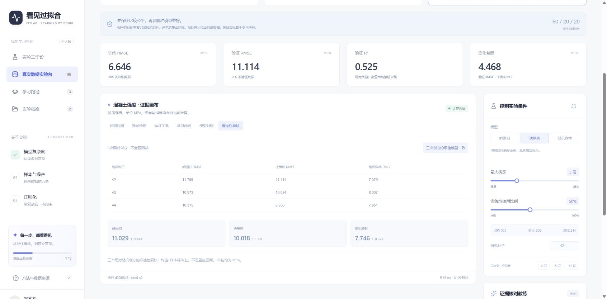
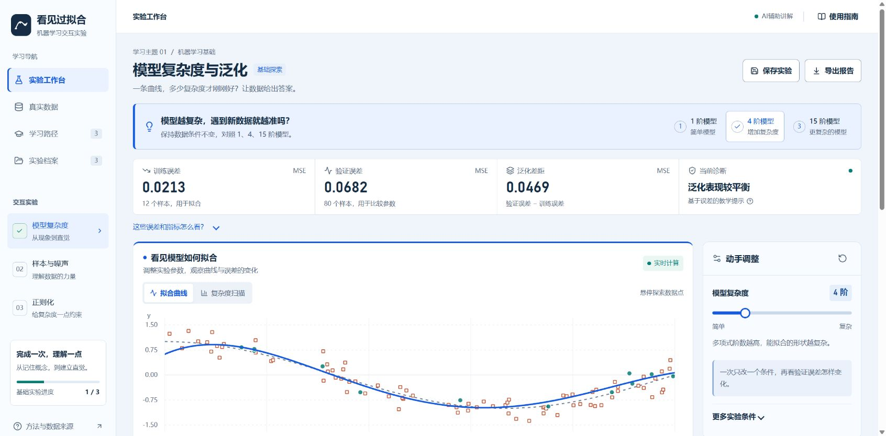
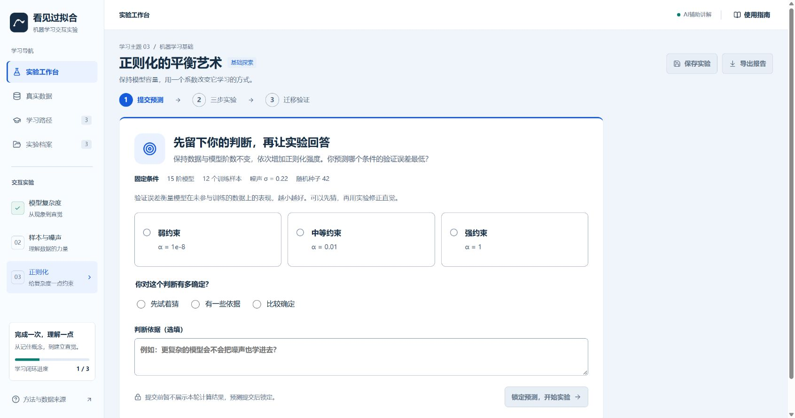
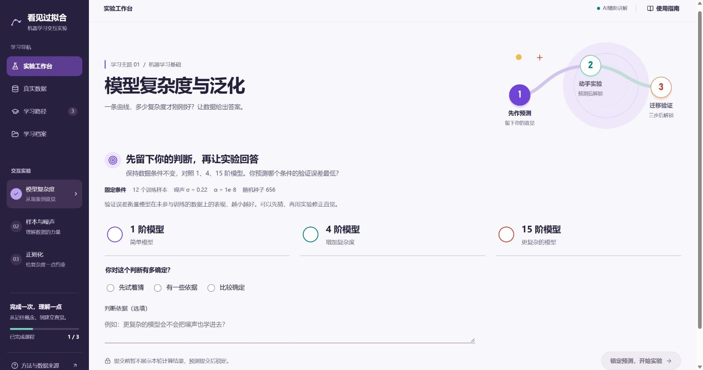

# 真实公开会话记录

由当前会话脱敏导出，排除内部推理及系统指令。

## 2026-11-12T13:48:44.981Z · user

那就做“看见过拟合”吧，先制定详细的功能设计和开发计划，再从环境搭建开始实现，界面和交互要精致，并按比赛要求保留Git提交和AI开发过程记录。把项目放在项目文件夹下，py环境采用<PYTHON_ENV>。


## 2026-11-12T13:48:50.791Z · assistant

我会先写好功能设计、交互方案和开发计划，再按计划搭建并实现。项目放在当前工作目录下的独立文件夹，使用你指定的 `<PYTHON_ENV>`，从第一步起保留 Git 提交和本次 AI 开发记录。


## 2026-11-12T13:50:27.155Z · assistant

我会用 git-workflow 技能管理提交，用文档协作流程完成设计，并按 Sites 的本地开发流程验证界面。功能先贯通“预测—实验—解释—练习—报告”：三组实验场景、实时曲线与误差、参数对比、学习记录，以及可配置的 AI 解释。你指定的 Python 环境已具备所需核心依赖。


## 2026-11-12T13:51:37.717Z · user

<send_user_message_question_reply>
[{"questionItemId":"[\"request_user_input_async\",\"call_f4d54be1bfa74d6099d4c58785912166\",0]","question":"请补充已有API的服务商、模型名和Base URL（不需要发送密钥）。我会先完成应用和本地配置方式，密钥后续保存在项目忽略的配置文件中。","answer":"ds，采用flash的最新模型，[REDACTED]。"}]
</send_user_message_question_reply>


## 2026-11-12T13:55:40.970Z · assistant

功能设计和开发计划已写入项目，并完成首个 Git 提交。密钥会只保存在忽略的后端配置中，过程记录会脱敏。我接下来先实现数值核心，确保改参不会改变数据划分、测试集保持独立，再完成界面和 AI 联调。


## 2026-11-12T14:04:09.489Z · assistant

数值核心的首批测试已通过，覆盖了固定种子复现、数据集独立性、测试指标隔离和记录保存。DeepSeek 也返回了可用的 `deepseek-flash` 模型。界面会采用暖白底、靛蓝主色的实验工作台，让曲线、参数和证据解释成为视觉重点。


## 2026-11-12T14:15:48.987Z · assistant

浏览器中已跑通保存、回放、双实验对比、预测题、迁移练习和 Flash 在线解释。为了让示例中的现象更容易观察，我依据实际计算将初始训练样本调整为12个，并加入1、4、15阶快捷对照；三者使用相同数据，显示的指标均来自计算。


## 2026-11-12T14:26:53.822Z · assistant

我在收尾核验报告导出和移动端布局。浏览器自动化未能确认 Blob 下载文件，因此我会把导出改为服务端生成附件，再校验附件内容；同时补齐启动说明和最终评估后的状态规则，方便后续复现与参赛录屏。


## 2026-11-12T14:38:13.448Z · assistant

当前版本的7项后端测试、TypeScript检查和生产构建均已通过。390像素嵌入窗口中，菜单与参数操作可用，未发现横向溢出；浏览器也已成功请求服务端报告附件。我正在整理最终验收记录、三组功能迭代证据和启动文档。


## 2026-11-12T14:41:33.198Z · assistant

当前 Chrome 策略拦截了附件导航，虽然服务端已返回报告。我会补上报告在线预览和复制功能，让你能直接取得完整内容，同时保留标准附件接口。验收文档会注明这项浏览器限制。


## 2026-11-12T14:48:02.766Z · assistant

首版已完成，项目位于 [see-overfitting](<PROJECT_ROOT>/README.md)，使用指定的 `<PYTHON_ENV>`。

已实现三组交互实验、复杂度扫描、预测与练习、实验保存与对比、独立测试、报告预览和 DeepSeek Flash 在线解释。

- [详细功能设计](<PROJECT_ROOT>/docs/FUNCTIONAL_DESIGN.md)
- [开发计划](<PROJECT_ROOT>/docs/DEVELOPMENT_PLAN.md)
- [AI开发过程记录](<PROJECT_ROOT>/docs/ai-process/README.md)
- [验收记录](<PROJECT_ROOT>/docs/VALIDATION.md)

**已保留9次真实 Git 提交，工作区干净。** 7项后端测试、类型检查、生产构建和一键启动验证通过。密钥仅保存在忽略的本地配置中。

在 PowerShell 运行：

```powershell
& '<PROJECT_ROOT>\scripts\start.ps1'
```

启动后打开 [实验工作台](http://127.0.0.1:3000)。

当前 Chrome 策略限制附件下载，已提供报告在线预览和复制。正式比赛视频、技术PDF及真实用户试用仍需按[交付清单](<PROJECT_ROOT>/docs/COMPETITION_CHECKLIST.md)补齐。


## 2026-11-12T14:52:45.958Z · user

github的话打开我的谷歌浏览器，按要求去建立一个仓库。目前先主要完成好项目内容，不做其他的提交文件准备。先介绍一下项目我看看。


## 2026-11-12T14:53:11.849Z · assistant

我会先按比赛要求建立 GitHub 仓库，检查后再上传当前源码和开发记录。后续重点放在项目功能与体验，暂不继续准备比赛视频、技术PDF等材料。建好后我会介绍现有项目，方便你判断下一步怎么改。


## 2026-11-12T14:54:05.153Z · assistant

Chrome 当前停在 GitHub 登录页，需要你亲自登录。我先检查待上传内容和历史记录，并整理项目介绍。


## 2026-11-12T14:55:31.506Z · assistant

本机 GitHub CLI 已登录 `ioytgvcbtr-pixel`，可以直接建立仓库，Chrome 的登录状态不影响创建。现有 Git 历史中未发现密钥或运行数据库。我会使用这个已登录账号创建公开仓库并保留提交历史，完成后给你链接核对。


## 2026-11-12T14:58:31.893Z · assistant

仓库已创建并上传，原有9次提交完整保留，默认分支为 `main`，Chrome 已能公开查看。项目的核心是一间“能亲手做实验”的机器学习教室：拖动参数就能看到曲线和误差变化，AI 再依据这次实验解释原因。当前版本聚焦过拟合、数据量与噪声、正则化三个主题。


## 2026-11-12T15:00:30.376Z · assistant

GitHub 仓库已建立并在 Chrome 打开：[see-overfitting](https://github.com/ioytgvcbtr-pixel/see-overfitting)。仓库为 **Public**，默认分支 `main`，目前有 **10次真实提交**，密钥和运行数据库未上传。后续先专注项目功能与体验，暂缓其他提交材料。

**“看见过拟合”是一间可以亲手操作的机器学习实验室。** 它帮助初学者理解一个容易混淆的问题：为什么模型在训练数据上表现越来越好，遇到新数据反而变差？

目前有三个实验：

- **模型复杂度**：调整多项式阶数，观察曲线怎样从过于简单变得过度弯曲。
- **样本与噪声**：改变数据量和噪声，观察泛化表现。
- **正则化**：给复杂模型增加约束，寻找表达能力与稳定性之间的平衡。

例如，当前固定数据条件下，实际计算结果是：

| 模型 | 训练误差 MSE | 验证误差 MSE |
|---|---:|---:|
| 1阶 | 0.2152 | 0.3896 |
| 4阶 | 0.0213 | 0.0682 |
| 15阶 | **0.0061** | **0.1538** |

15阶模型的训练误差更低，验证误差却比4阶更高。用户可以通过曲线和指标，直接看到这次实验中的过拟合现象。

推荐体验流程是：**先预测 → 调参观察 → 保存并对比实验 → 请AI解释 → 完成练习 → 最后揭示独立测试结果。**

这里的 AI 教练使用 DeepSeek Flash，收到的是本次实验的真实参数和计算指标，再给出观察、原因和下一步建议。实验记录可以回放，报告可以预览和复制。

当前版本聚焦**一维多项式回归**，已贯通上述流程。接下来最值得打磨的是新手引导、图表操作、对比结果的解释，以及AI反馈的教学质量。[查看项目界面](<PROJECT_ROOT>/artifacts/screenshots/desktop.jpg)


## 2026-11-12T15:12:11.810Z · user

接下来要对仓库的介绍进行脱敏，不应该出现我的磁盘路径等内容。完成这些任务后，dsflash模型的思考强度采用xhigh。接下来开始对项目的功能进行改进，可以多搞几个公开数据集来完成，效果展示也可以多搞几种，同时要符合比赛赛道要求，要有一定的创新性。


## 2026-11-12T15:12:34.131Z · assistant

我会先清理仓库介绍和可公开文件中的个人路径，并检查 Git 历史里是否仍有残留；再核对 DeepSeek Flash 的思考强度参数，扩展公开数据集和实验展示。改进会继续围绕“理解过拟合、比较泛化、依据实验解释”这条主线，保留真实开发记录，暂不准备其他提交材料。


## 2026-11-12T15:17:24.339Z · assistant

这轮会用 research-improve 流程验证数据划分、模型比较和展示结果。另一个需要说明的点：DeepSeek Flash 的官方参数没有 `xhigh`，目前最高档是 `max`；我会把你的 `xhigh` 偏好映射到 `max`，并做一次真实接口验证。


## 2026-11-12T15:17:51.796Z · assistant

进一步核对后，需要更正刚才的说明：DeepSeek 接口兼容接受 `xhigh`，并将其映射为原生 `high`，不是 `max`。我会按你指定的值发送 `reasoning_effort="xhigh"`，启用思考模式。[官方参数说明](https://api-docs.deepseek.com/api/create-chat-completion/)

路径也出现在已有提交中，只改 README 不够。我会保留一份仅在本机的原始备份，清理公开历史中的路径内容，保留提交顺序和时间。


## 2026-11-12T15:24:36.435Z · assistant

当前文件的路径清理已完成，嵌套日志也通过了 JSON 校验。历史清理后的本地 Git 对象校验发现异常，因此远端还没有被覆盖；原始备份仍在。我会先恢复并验证历史，再发布，避免损坏已有提交。


## 2026-11-12T15:28:45.529Z · assistant

公开 README 和分支历史已完成清理并回读验证，原有10次提交的顺序、作者和时间均已保留。

功能扩展会新增“真实数据实验台”，接入葡萄酒质量、汽车油耗、混凝土强度三个公开数据集，提供模型对照、预测与残差图、学习曲线和多种子稳定性检查。模型与结论仍以代码计算为依据，AI 负责解释结果。


## 2026-11-12T15:51:58.963Z · assistant

三个数据集已下载并固定快照：葡萄酒1599条、汽车油耗392条、混凝土1030条，均附来源、许可和校验值。`xhigh` 真实请求已成功，思考模式也已启用。

实验台会增加两项有用的设计：重复特征记录按组划分，避免跨集合泄漏；浏览器记录测试集接触，查看后会提示后续调参属于探索。另用三个配对划分复核模型排序，展示结论的稳定性。


## 2026-11-12T15:53:45.246Z · assistant

新版后端已通过16项测试，另完成了63组配对实验，比较过程均未使用测试集指标。结果并非所有数据都偏向同一种模型：例如葡萄酒数据上，岭回归和随机森林的平均验证RMSE接近；混凝土数据上，随机森林在本轮条件下较好。界面会展示这些实际差异和波动。


## 2026-11-12T16:11:11.821Z · assistant

浏览器已跑通三种数据集切换、六种展示、模型对照、稳定性复核、实验收藏和 xhigh 在线解释。测试接触提醒在改参后仍会保留。核验中还修正了 AI 的参数说明：树模型不会再收到岭回归的 α 参数，下一步建议也会限制在界面已有控件内。


## 2026-11-12T16:34:33.045Z · assistant

新版的桌面和窄屏流程已核验：六种展示均可切换，窄屏未发现横向溢出，键盘方向键也能切换图表。现在进入收尾：更新工程说明和真实开发记录，做最后一次脱敏检查，再将0.2版同步到 GitHub。不会生成新的比赛提交材料。


## 2026-11-12T16:50:26.722Z · assistant

0.2版已通过20项测试、类型检查和生产构建，一键启动也确认仍使用你指定的本地 Python 环境。公开文件检查未发现本机路径残留。现在正在把代码、数据快照、展示截图和开发记录同步到仓库。


## 2026-11-12T16:52:15.227Z · assistant

已完成并同步到 [GitHub 仓库](https://github.com/ioytgvcbtr-pixel/see-overfitting)，当前版本 **0.2.0**。

- **仓库脱敏**：清理了介绍、配置、公开开发记录及分支历史中的本机路径和会话标识，保留原有提交顺序、作者和时间。
- **Flash 思考模式**：实际发送 `reasoning_effort="xhigh"` 并启用思考。DeepSeek 按[官方兼容规则](https://api-docs.deepseek.com/api/create-chat-completion/)映射为原生 `high`。
- **新增公开数据**：葡萄酒质量1599条、汽车油耗392条、混凝土强度1030条，附来源、许可和校验值。
- **新增模型与展示**：岭回归、决策树、随机森林及均值基线；支持预测对照、残差诊断、特征关系、学习曲线、模型对照、稳定性复核。
- **创新落地**：重复特征分组防泄漏、配对划分复核、测试集接触记录，以及依据实际指标和可用控件生成建议的AI教练。

**验证通过：20项测试、类型检查、生产构建、桌面与窄屏操作；完成63组配对实验，未用测试指标调参。** 本轮没有生成新的比赛提交材料。

历史清理改变了提交哈希，旧克隆需重新同步；旧提交缓存可能仍受 [GitHub保留机制](https://docs.github.com/en/authentication/keeping-your-account-and-data-secure/removing-sensitive-data-from-a-repository)影响。



## 2026-11-12T16:52:23.033Z · user

采用 $frontend-design 和 $ui-ux-pro-max 对这份项目进行改进，前端的设计要考虑该项目面向的用户群体，其中的一切决策由你扮演用户来进行思考，同时联网搜索查看其他的网页是怎么做的，前端是如何设计的。


## 2026-11-12T16:52:28.585Z · assistant

我会从“刚接触机器学习、想弄懂过拟合的学生”视角审视当前界面，检查学习顺序、操作反馈和图表是否容易理解；同时查看同类交互教学网站的设计，并按你指定的两个技能改进前端。


## 2026-11-12T16:59:16.447Z · assistant

两个技能已找到并读完：`frontend-design` 和 `ui-ux-pro-max`。当前界面的主要问题是文字偏小、对比度偏低，图表被推到首屏下方，而且新用户要同时面对太多参数和指标。我会优先让学生知道“先改什么、该看哪里、怎样比较结果”，再统一视觉细节。


## 2026-11-12T17:05:06.432Z · assistant

我已查看 TensorFlow Playground、Seeing Theory 和 Google 的过拟合课程页。可借鉴的是：让控件靠近可视化、每次聚焦一个概念、把练习反馈和观察结果连起来。

这次会采用清晰的“学习实验台”布局：放大文字和图表、按课程突出主要参数，并把真实计算过的条件自动放在一起比较。技能检索没有给出匹配的教学控件方案，局部交互会依据其基础可访问性规则和这些网页观察来确定。


## 2026-11-12T17:11:33.616Z · assistant

设计方向已写入项目。我正在实现“三步对照”：学生依次观察不同复杂度、样本量或约束强度后，界面会并排展示实际计算结果；一旦其他条件变化，就清空本轮对照，避免比较混杂条件。参数面板也会按课程突出当前重点，其余条件可展开查看。


## 2026-11-12T17:47:30.660Z · assistant

新版已进入浏览器验收：首屏直接呈现实验问题、三个对照条件和拟合图，参数按当前学习主题展开。接下来重点检查对照结果是否真实累计、切换条件是否正确重置，以及手机端和真实数据实验的操作流程。

## 2026-11-12T17:49:59.955Z · assistant

三步对照已核验：1、4、15阶的结果都来自实际计算，修改噪声后会重新开始比较。真实数据页也能依次完成“比较模型→复核结论→解释结果”。我正在收尾窄屏布局，并修正等待状态和数据来源说明，避免学生把旧结果当成新条件的结果。

## 2026-11-12T17:55:24.104Z · assistant

手机端已确认没有横向溢出，点击推荐实验条件后会直接定位到图表。主要配色的对比度也已核对：正文、辅助文字和按钮达到4.5:1以上。当前6项前端逻辑测试、21项Python测试通过，正在整理截图、设计依据和真实开发记录。

## 2026-11-12T18:00:27.414Z · assistant

桌面和手机端的主要流程已验收，在线Flash讲解也成功使用了本次模型对照与复核结果。保存、回放、报告预览和浏览器后退均可用，生产构建通过。现在将这轮改进按模块提交，并同步脱敏后的Git和AI开发记录。

## 2026-11-12T18:06:34.300Z · assistant

已用 **frontend-design + ui-ux-pro-max** 完成0.3版改进，并同步到[GitHub仓库](https://github.com/ioytgvcbtr-pixel/see-overfitting)。

围绕机器学习初学者“先改什么、看什么、如何比较”重新设计：

- **三步实验引导**：自动记录真实计算结果，条件变化后重新对照。
- **参数渐进展开**：突出当前课程主参数，补充指标释义。
- **真实数据学习流程**：比较模型 → 复核结论 → AI解释。
- **视觉与交互**：清晰中文字体、更高对比度、自适应图表；窄屏点击条件直接定位曲线。

实际参考了[TensorFlow Playground](https://playground.tensorflow.org/)、[Seeing Theory](https://seeing-theory.brown.edu/regression-analysis/index.html)和[Google MLCC](https://developers.google.com/machine-learning/crash-course/overfitting/interpreting-loss-curves)。[设计依据与决策](https://github.com/ioytgvcbtr-pixel/see-overfitting/blob/main/design-system/fitlab/MASTER.md)已保留。

21项Python测试、6项前端逻辑测试、类型检查和生产构建通过；桌面及375px窄屏流程已验收。Git提交与脱敏AI开发记录已更新。



## 2026-11-13T04:59:10.386Z · user

把项目启动起来，用谷歌浏览器打开，我看看改版后的实际效果和交互。


## 2026-11-13T04:59:16.626Z · assistant

我来启动前后端，并用谷歌浏览器打开新版工作台供你体验。

## 2026-11-13T05:01:07.228Z · assistant

已启动前后端，并在谷歌浏览器打开：[新版工作台](http://127.0.0.1:3000/)。

服务会保持运行。你可以点击“1、4、15阶模型”体验三步对照，或进入“真实数据”比较模型、复核结论并获取AI讲解。


## 2026-11-13T05:12:26.714Z · user

对比官方的要求，目前的作品效果怎么样？以严格的角度对其进行打分，最后能拿几分。


## 2026-11-13T05:12:41.245Z · assistant

我先重新核对官方赛道要求和评分细则，再结合当前代码、实际界面与已完成的验证，按严格评审口径打分，并区分“作品本身”和“最终参赛材料”的得分。

## 2026-11-13T05:14:37.072Z · assistant

官方评分已核对：过程可复现性25%、实用价值25%、创新与意图控制20%、工程15%、体验15%。当前作品符合“AI驱动的高交互教育与可视化”方向；严格来看，主要扣分点会是差异化、教学效果证据，以及评委能否完整复现开发和运行过程。

## 2026-11-13T05:17:18.316Z · assistant

**严格预评，我给当前0.3版：74/100，合理区间约70—78分。**

目前的优势是界面较成熟、计算真实、功能能够连通。主要失分在**差异化、教学效果证明，以及开发过程的完整可复现证据**。这个分数是依据现有作品的主观预评，正式成绩还需要完整提交材料。

我重新查看了官网：项目符合第5个推荐方向“AI驱动的高交互教育与可视化”。官方五项权重如下，并不只看界面或模型能力。[官方赛道及评分要求](https://www.boxuegu.com/matchTrack/detail/?id=10039)

| 官方维度 | 满分 | 严格估分 | 判断依据与扣分原因 |
|---|---:|---:|---|
| 过程可复现性与演进链路 | 25 | **18** | 有真实Git历史、公开对话、模块迭代和环境模板。但另一份干净环境的10分钟复现尚未实测，三条完整Prompt链及你如何约束、纠错，还需要更清楚地展示。 |
| 解题有效性与实用价值 | 25 | **18** | 学习场景明确，实验、比较、解释、练习、报告基本形成闭环。但没有目标学生的实际使用证据，尚未证明它能解决哪些常见误解、比普通教学方式好在哪里。 |
| 方法创新性与意图控制 | 20 | **12** | 固定条件对照、测试接触提醒、真实指标约束AI解释有价值。但交互式过拟合演示已有成熟同类；三份数据、多个图表和接入大模型，尚不足以形成突出的创新辨识度。 |
| 工程质量与架构设计 | 15 | **13** | 前后端分层、输入约束、确定性计算、训练集预处理、请求取消和测试较扎实。仍缺更系统的异常场景验证；AI回答中的数值与结论主要靠提示约束，没有自动核验。 |
| 用户体验与产品精细度 | 15 | **13** | 新版字体、对比度、参数层级、三步引导和窄屏交互已经较好。AI采用整段等待返回，合成实验与真实数据的档案、报告体验仍不统一。 |
| **总分** | **100** | **74** | **完成度较好的教学应用原型，距离高分作品还有明确差距。** |

其中，最值得严格指出的是三个问题。

**第一，“先预测，再验证”目前没有真正落实。**
页面先展示误差、诊断、曲线和三步对照，预测题在后面。学生可以先看到答案，再选择预测。这会削弱教学设计的说服力。应先记录判断，再揭示实验结果，最后用另一道题检验能否迁移理解。

**第二，AI目前主要负责解释，尚未形成有辨识度的教学机制。**
现在是“计算结果→AI讲解”。更有竞争力的机制是：根据学生的错误判断提出一个具体实验，预览将修改的参数，执行真实计算，再核对原判断是否成立。这样能把AI、实验和学习反馈连接起来。赛题不要求发明新算法，但要求说明方法和意图控制的价值。

**第三，测试通过不能替代教学有效性。**
21项Python测试、6项前端逻辑测试及浏览器验收，证明了部分程序行为正确；目前没有证据说明学生使用后更能识别过拟合。少量真实学生完成指定任务、记录卡点和前后判断，都会比继续增加几个数据集更有评分价值。

另外，**当前还不是完整的参赛交付状态**。按你此前“先完善项目”的安排，演示视频和技术PDF尚未制作；官网要求5—8分钟1080p视频，其中至少2分钟展示AI协同过程，以及不超过30页的技术PDF、完整演进记录和复现指南。缺少必交材料不能简单折算成固定扣几分，官网没有给出这样的扣分表。[官方提交要求](https://www.boxuegu.com/matchTrack/detail/?id=10039)

接下来最值得投入的顺序是：

1. **落实预测→实验→迁移验证的学习闭环。**
2. **做一轮真实学生试用，按真实问题改进。**
3. **把AI建议接成可执行、可核验的实验操作。**
4. **完成干净环境复现，并整理三条完整的人机协同证据链。**

**我的最终判断：目前按74分看待比较客观；82—86分可以作为下一阶段的改进目标，现有证据还不足以支撑90分预期。** 获奖等级还取决于同组作品和官方划线，官网没有“某个分数必得某等奖”的固定对应关系。[官方评奖规则](https://www.boxuegu.com/matchTrack/detail/?id=10039)

## 2026-11-13T05:18:34.397Z · user

那就按你指出的问题继续改进，先落实“预测→实验→迁移验证”的学习闭环，再把AI建议做成可一键执行、可核验结果的实验操作，提升创新性和实用性。先不准备提交材料，继续保留Git提交和AI开发过程记录。


## 2026-11-13T05:18:40.741Z · assistant

我会先把学习流程改成“提交预测后再看结果，完成对照后再做迁移验证”，然后把AI建议接成带参数预览、真实计算和结果核验的一键实验。提交材料继续暂缓，Git和AI开发记录照常保留。

## 2026-11-13T05:21:20.084Z · assistant

闭环会保留三份证据：提交时的预测、后端实际算出的对照结果、换一批数据后的迁移答题记录。AI建议则先显示“改哪个参数、改成多少、预期怎样变化”，点击后由后端重算，并明确报告结果是否支持预期。

## 2026-11-13T05:34:37.861Z · assistant

后端已实现预测锁定、三步实算记录和新数据迁移题；迁移答案由后端核验，未通过不会计入完成。AI操作也限定为合法的单变量方案，执行后会保留“支持预期”或“不支持预期”的真实结果。接下来完成界面接入、刷新恢复和错误分支测试。

## 2026-11-13T05:37:58.481Z · assistant

第一轮检查已通过：35项Python测试、8项前端逻辑测试和类型检查。测试覆盖了预测前不返回结果、固定条件变化后拒绝沿用旧预测、迁移错答与重试留痕，以及AI预期改善但实算结果变差时如实报告。接下来用浏览器走完整个学习流程。

## 2026-11-13T05:46:30.313Z · assistant

浏览器已走通“预测与结果不同→迁移题答错→换新数据重试→通过后计入完成”，首次错答仍保留在记录里。Flash也已返回合法的单变量建议，正在核验条件变化后旧方案是否失效，以及执行后的数值是否与工作台一致。

## 2026-11-13T06:02:49.604Z · assistant

两次真实AI联调都已核验：合成实验中，15阶降到4阶后验证MSE从0.153804降到0.068185；混凝土实验中，树深5降到2反而让验证RMSE从11.1141升到12.0097，界面如实显示“不支持预期”。预测、错答和重试记录也能在刷新后恢复。

## 2026-11-13T06:12:36.671Z · assistant

功能和浏览器验收已完成：三门基础课均采用预测先行，真实数据也能执行并核验建议，核验档案会保留结果变差的案例。窄屏、跨课程刷新恢复和固定条件变化后的重新预测也已检查。现在整理产品说明和开发记录，做最后一轮构建与隐私检查后提交到仓库。

## 2026-11-13T06:20:40.138Z · assistant

最终检查通过：36项Python测试、8项前端逻辑测试、类型检查和生产构建均通过。基础课的AI建议还接入了后端保存的原预测与迁移反馈；实际联调中，Flash能围绕“15阶更好”的判断提出反证实验，预期验证误差会上升。正在同步最后的说明、提交和脱敏过程记录。

## 2026-11-13T06:28:16.730Z · assistant

已完成 **0.4版**，新版已在Chrome打开，服务保持运行：[体验工作台](http://127.0.0.1:3000/)。

- **预测先行**：提交预测和信心后才显示结果，原判断锁定保存。
- **迁移验证**：完成三组对照后换新数据答题；错答留痕，重试换题，刷新可恢复。
- **可执行AI建议**：参考原预测与迁移反馈，先预览参数变化，再一键执行、重算并核验；结果进入档案和功能报告。

真实联调中，混凝土实验的AI建议让验证RMSE从 **11.1141升到12.0097 MPa**，系统如实记录为“不支持预期”，保留反例。

**36项Python测试、8项前端逻辑测试、类型检查和生产构建通过。** [Git与脱敏AI过程记录](https://github.com/ioytgvcbtr-pixel/see-overfitting)已同步，提交材料继续暂缓。



## 2026-11-13T06:32:02.721Z · user

目前的作品方案是什么？讲述一下特点


## 2026-11-13T06:33:39.775Z · assistant

目前的方案是 **“看见过拟合 · FitLab”——面向机器学习初学者的交互式教学实验室**。让学生通过亲自预测、调整参数和比较结果，理解模型为什么会欠拟合、过拟合，以及怎样判断泛化能力。

完整学习流程是：

**提交预测 → 动手实验 → 对照原判断 → 用新数据验证理解 → 执行并核验AI建议**

主要有六个特点：

1. **先预测，再展示结果**
   学生先判断哪组条件的验证误差最低，记录信心和理由。提交后锁定判断，再开放曲线与指标，便于发现自己的理解偏差。

2. **把抽象概念变成可操作的实验**
   三门基础实验分别围绕模型复杂度、样本与噪声、正则化展开。滑块调整后即时重算，三个推荐条件帮助学生进行公平对照。

3. **用新数据检验理解**
   完成对照后，更换随机种子和参数组合，要求学生同时选择模型与判断依据。错答会保留，重试使用新题，学习进度和作答可恢复。

4. **AI建议可以直接接受实验检验**
   AI参考当前指标、原预测和迁移反馈，提出一个单变量假设。学生查看参数变化后，一键执行；系统实际重算并报告是否支持预期，也会保留结果变差的案例。

5. **从合成曲线走向公开数据**
   提供葡萄酒质量、汽车油耗、混凝土强度三个数据集，支持岭回归、决策树、随机森林及均值基线，并提供残差、学习曲线、模型对照、稳定性复核等展示。

6. **每个结论都有可追溯证据**
   图表与指标来自Python实际计算。预测、参数、数据指纹、迁移作答、AI假设和执行结果可以保存、回放并进入报告；验证集用于选参，独立测试留到最后。

项目的主要创新集中在**把学生的判断、AI提出的假设和实际计算结果连接起来**。当前形态是本地可运行的个人学习工作台，适合机器学习入门课程、自主练习与课堂演示；教学效果还需要通过真实学生试用进一步验证。

## 2026-11-13T06:42:43.425Z · user

从这一列的特点和环节中，还有没有改进的空间，进一步的完善整个项目，同时对于前端界面的展示我还是不够满意，矩形框太多，颜色单挑，看着很一般，有没有让人眼前一亮的前端设计方案。根据我的问题逐一进行解决。


## 2026-11-13T06:43:02.899Z · assistant

我会分两部分逐一处理：先检查学习闭环和AI实验中还存在的断点，再重新设计前端。视觉上会减少矩形卡片，用更有层次的色彩、排版和科学图形组织页面，让实验画布成为主角。

## 2026-11-13T06:50:56.458Z · assistant

我确认了三个值得补齐的环节：过去的预测和错答不容易找回；AI实验结果变差后缺少直接恢复原条件的入口；刷新后，本轮报告可能漏掉已经执行的AI实验。

视觉方向定为“科学探索馆”：深紫导航、明亮画布，用紫、青、橙区分学习阶段；大曲线和环形节点表现真实进度，表单与记录采用开放排版，减少层层卡片。Mathigon和Explorable Explanations给我的启发是让数学图形和交互承担视觉表达。

## 2026-11-13T07:02:33.981Z · assistant

学习足迹和“新数据再挑战”的后端已完成，报告也能按学习轮次找回已执行的AI实验；新增检查后，39项Python测试通过。

接下来落实界面重构：把预测选项、指标和记录改成开放式排版，曲线航线直接反映当前学习阶段；同时补上AI实验的条件恢复操作，便于在结果变差后回到原来的模型。

## 2026-11-13T07:27:08.162Z · assistant

新的开放式布局已接入，类型检查和9项前端逻辑检查通过。学习足迹支持回看、继续和换新数据重练；AI核验后可以切回执行前后条件；真实数据模块也会记住正在研究的参数。接下来在浏览器里检查实际效果，重点看是否还有多余边框、字号问题和窄屏溢出。

## 2026-11-13T07:46:40.452Z · assistant

浏览器复核发现，较大的开场区会把实验曲线推到下方。我已把进入实验后的标题区收紧，并将三组推荐条件并入绘图工具栏，让主要曲线更早出现。

档案也改为“学习足迹、AI核验、已保存实验”三个入口，避免把不同用途的记录堆在一页。现在核对历史恢复、新数据重练和参数切回是否实际可用。

## 2026-11-13T08:18:23.031Z · assistant

新增操作已经实测可用：AI实验执行后，参数能在执行前后往返切换，核验结果保持不变；刷新后的报告也找回了本轮AI记录。真实数据页离开再返回、以及整页刷新后，都恢复了数据集、模型、参数和残差视图。接下来收尾手机布局和截图。

## 2026-11-13T08:30:27.749Z · assistant

手机端已确认内容区宽度与页面宽度均为375px，没有横向溢出；点击航线节点能把焦点和视图移到实验画布。收尾时还发现一个边界：点击“新数据再挑战”后，如果尚未提交预测就刷新，新的随机种子会丢失。我会补上这段待预测条件的恢复。

## 2026-11-13T09:01:13.210Z · assistant

收尾验收完成：39项Python测试、10项前端逻辑检查、类型检查和生产构建均通过。320、390、768、1024、1440px的浏览上下文中均未发现页面横向溢出；待预测的新种子刷新后也能保留。测试结束后，已恢复你原来的学习轮次和真实数据条件。现在同步代码、截图和脱敏开发记录。

## 2026-11-13T09:26:03.122Z · assistant

已完成 **0.5版**，新版已在Chrome保留：[直接体验](http://127.0.0.1:3000/)。

| 问题 | 已落实的改进 |
|---|---|
| 学习过程不易复盘 | 新增学习足迹，可回看预测、错答和重试，继续旧轮次或换新数据挑战 |
| AI执行后缺少恢复入口 | 可切换执行前后参数，原核验结果保持不变 |
| 刷新容易丢状态和证据 | 恢复真实数据参数、视图及待预测条件；报告自动找回本轮关联核验 |
| 矩形框多、配色单调 | 改为“科学探索馆”：深紫导航、紫青橙语义色、曲线航线、开放式预测与连续画布 |

航线反映真实学习阶段，也能直接跳到已解锁区域；实验页增加了明确的“下一步观察”。

**39项Python测试、10项前端逻辑检查、类型检查及生产构建通过。** Git与脱敏AI记录已同步，提交材料继续暂缓。[逐项改进说明](https://github.com/ioytgvcbtr-pixel/see-overfitting/blob/main/docs/REFINEMENT_V05.md)



## 2026-11-13T11:13:54.976Z · user

目前的内容你进行自我评估，判断一下是处于什么水平的作品


## 2026-11-13T11:14:17.140Z · assistant

我会按当前0.5版的实际功能、界面和验证证据来评估，并区分产品完成度与竞赛竞争力。

## 2026-11-13T11:21:42.480Z · assistant

复查发现了一处需要扣分的教学边界：默认数据下，15阶模型把正则化调到100时，训练和验证误差都明显升高，界面仍给出绿色“泛化表现较平衡”提示。数值计算正确，但诊断提示偏乐观。另外，当前迁移题主要检验“会不会按验证误差选模型”，对概念理解的覆盖还比较窄。

## 2026-11-13T11:22:56.313Z · assistant

**我的判断：当前0.5版属于中上水平、完成度较高的教育类竞赛MVP，约80分档。** 工程和交互已经有竞争基础，教学内容的严谨性与实际效果证据仍是主要短板。

这份评分针对作品本体和现有开发证据，正式视频、PDF等交付材料另行核验。沿用此前核对的[官方评分维度](https://www.boxuegu.com/matchTrack/detail/?id=10039)，我的严格自评是：

| 维度 | 得分 | 判断 |
|---|---:|---|
| 过程可复现性与演进链路 | **20/25** | Git、AI记录、模块演进和验证较完整，独立环境的10分钟复现尚未实测 |
| 解题有效性与实用价值 | **19/25** | 学习闭环完整、记录可恢复，但缺少目标学生的真实使用证据 |
| 方法创新性与意图控制 | **15/20** | “预测—AI假设—实算核验—反证留痕”有价值，创新主要在应用方法 |
| 工程质量与架构 | **12/15** | 39项Python、10项前端逻辑检查及构建通过，但发现教学诊断边界问题 |
| 用户体验与产品精细度 | **14/15** | 视觉有辨识度，主要交互可用，多尺寸已核验；首次使用体验仍需学生验证 |
| **合计** | **80/100** | **有特色、能完整演示和复核的竞赛原型** |

目前最有价值的亮点，是**AI建议可以被实验否定，并留下证据**。结合预测锁定、首次错答保留、新数据重试和参数恢复，已经形成比较完整的产品机制。新的视觉体系也增强了作品辨识度。

但有三个问题，使我暂时不给更高评价：

1. **诊断提示存在真实的教学边界缺口。**
   我刚复算了默认12样本、噪声0.22、seed42的情况：15阶、正则化系数100时，训练MSE约 **0.2905**、验证MSE约 **0.5216**，界面仍显示绿色“泛化表现较平衡”。数值计算正确，但规则没有充分识别双高误差及过强约束的风险，提示偏乐观。这条应优先修正。

2. **迁移验证覆盖的能力还比较窄。**
   当前主要要求学生选择验证误差较低的模型，再选择判断依据。它能检验基本模型选择，但不足以证明学生理解了样本量、噪声和正则化之间的关系。需要加入趋势预测、错误依据识别和不同情景的解释题。

3. **实用价值尚缺外部验证。**
   现有证据主要来自开发验收。学生能否独立完成任务、哪些地方会误解、使用后是否改善判断，目前还没有真实反馈支撑。测试通过与教学有效性需要分别评估。

**放在研究生组，我会将它定位为“有冲奖基础的应用作品”，目前不足以认定为一等奖水平。** 同组作品和实际评审尚不明确，不能由80分直接推定奖项。

下一轮最值得优先做的是：**修正诊断边界、扩充迁移题的区分力、开展真实学生试用、完成独立环境复现。**

## 2026-11-13T11:44:36.075Z · user

接下来应该是主要完成好作品的使用体验，可视化表达，和核心模块，比如题目中所说的：借助AI强大的前端代码（React/Three.js/Canvas）生成能力，将抽象、复杂的概念转化为直观的、可通过滑块与拖拽互动的可视化面板。这些面板和概念也没有体现出来，我希望你可以联网搜索一些做的很好的网站，来学习一下他们的前端技术设计。


## 2026-11-13T11:45:09.840Z · assistant

我会先研究优秀的交互学习网站，重点看它们怎样让概念、图形和操作直接关联，再把适合“看见过拟合”的方式做进核心面板：让滑块和拖拽改变可观察的现象，并清楚呈现背后的原因。

## 2026-11-13T11:54:54.921Z · assistant

这些参考的共同点很明确：操作、模型内部量、图形和解释会一起变化。TensorFlow Playground把参数、网络与输出联动；Seeing Theory允许拖动样本观察回归变化；Distill把公式参数接到可操纵的几何图形上。

我会据此落地三个核心面板：**残差与损失地形、样本扰动与过拟合敏感性、正则化与系数收缩**。用React协调交互、SVG承载拖拽和标注、Canvas绘制损失地形，让用户看见计算过程。

## 2026-11-13T12:10:21.134Z · assistant

三个面板的数值接口已实现，新增校验后47项Python测试通过。残差平方、损失地形、曲线变化和正则惩罚项都由后端实算。高阶强正则、两侧误差都偏高的情况也已改为警示提示。现在接入拖拽图形和滑块联动。

## 2026-11-13T12:26:31.423Z · assistant

概念工坊的前端已经接入：可以拖动样本点、在损失地形上移动参数，并联动查看曲线、误差和正则化系数。接下来我会在浏览器里逐项验收，重点检查拖拽反馈、数值一致性和小屏显示。


## 2026-11-13T12:30:49.904Z · assistant

实机拖拽已经能同时改变拟合图、误差柱和损失地形；训练数据指纹随拖拽变化，验证集指纹保持不变。配对面板也能显示“高阶模型这次并没有更敏感”的结果，避免把预设结论当成实验事实。现在继续检查滑块键盘操作和手机布局。


## 2026-11-13T12:40:31.094Z · assistant

手机布局已收紧开场区，让用户更早看到图形；320～1440px的五档宽度检查目前都没有页面横向溢出。数值测试还核对了残差平方求和、损失等高线、配对曲线变化，以及岭回归的“SSE＋惩罚项”，这些展示均有实际计算依据。


## 2026-11-13T12:49:10.781Z · assistant

三个面板已通过桌面和窄屏实测。验收中还发现并修好了两处会影响读图的问题：60个样本时误差柱挤出绘图区，以及目标函数条形未填满、导致占比容易误读。接下来整理这轮实际开发记录并提交 Git，页面会保持运行供你体验。


## 2026-11-13T12:58:52.146Z · assistant

你指出的缺口已经补上：**0.6版新增“概念工坊”，Chrome中已打开，可直接[开始体验](http://127.0.0.1:3000/#concepts)。**

这次重点学习了三个网站的交互机制：

| 参考网站 | 学到并落实的设计 |
|---|---|
| [TensorFlow Playground](https://playground.tensorflow.org/) | 参数、模型变化和结果相邻展示，操作后直接反馈 |
| [Seeing Theory](https://seeing-theory.brown.edu/regression-analysis/index.html) | 拖动数据点，让回归线、残差和平方误差联动 |
| [Distill：动量的解释](https://distill.pub/2017/momentum/) | 用可操纵的几何图解释参数与损失之间的关系 |

现在已有三个真正可操作的核心面板：

1. **误差的几何**：拖动训练点，观察残差平方和误差柱；拖动损失地形中的标记，改变斜率、截距和拟合线，也可以定位最小二乘解。
2. **过拟合的牵引**：同一个样本扰动同时作用于两种模型，比较曲线变化范围、变化强度和验证误差。
3. **约束的形状**：滑动α或点击正则化路径节点，联动查看曲线、系数收缩及“SSE＋惩罚项”。

技术采用 **React＋SVG＋Canvas 2D**。这些概念适合二维表达；所有误差、系数和地形数值均由Python实算。同步完善了键盘操作、刷新恢复、参数复制和手机布局。


**47项Python测试、13项前端逻辑测试、类型检查和生产构建通过。** Git提交及脱敏AI开发记录已同步至[仓库](https://github.com/ioytgvcbtr-pixel/see-overfitting)，本轮提交为 `47b0d81`。

## 2026-11-13T13:19:09.998Z · user

接下来根据比赛要求从每个环节和流程进行评估，项目还有没有需要改进的地方？另外机器学习算法和数据集的例子可以更丰富一些，同时引入gptimage模型的生图功能，加入一些图案和元素等内容进行丰富，前端界面也可以采用Q版画风。


## 2026-11-13T13:19:33.396Z · user

接下来根据比赛要求从每个环节和流程进行评估，项目还有没有需要改进的地方？另外机器学习算法和数据集的例子可以更丰富一些，同时引入gptimage模型的生图功能，加入一些图案和元素等内容进行丰富，前端界面也可以适当加上一些Q版画风。

## 2026-11-13T13:19:45.437Z · assistant

我会先重新核对官方赛题与评分要求，逐环节评估现有作品，再补充更有教学价值的算法和数据案例。视觉上会用生图制作少量原创Q版元素，重点服务概念理解和操作提示。


## 2026-11-13T13:20:21.806Z · user

<send_user_message_question_reply>
[{"questionItemId":"[\"request_user_input_async\",\"call_ab5ad598361b484bae43d222e1e61613\",0]","question":"GPT Image你希望用于哪种方式？我会先制作并接入原创Q版素材，继续完成算法与案例改进。","answer":"生成项目插画并固定到界面中（推荐）"}]
</send_user_message_question_reply>


## 2026-11-13T13:22:37.203Z · assistant

已确认采用固定插画素材。我会使用 `imagegen` 技能制作原创Q版引导角色，并让它出现在操作提示和案例入口旁。

案例扩展准备加入“分类边界”：用月牙、同心圆等合成数据，加上公开数据，对比逻辑回归、近邻、SVM和树模型。这样能增加新的概念和交互，而不只是增加数据集列表。


## 2026-11-13T13:26:40.527Z · assistant

官网的评分权重已核对：过程与复现25%、实用价值25%、创新与意图控制20%、工程15%、体验15%。按目前证据，较明显的缺口是：教学效果尚未经过目标用户验证，干净环境10分钟复现尚未实测，自由探索与正式学习记录之间的衔接也可以更清楚。我会把这些逐项写入评估，并在本轮补上分类案例和更明确的探索提示。


## 2026-11-13T13:34:02.970Z · assistant

分类数值模块已完成，新增的25项测试通过。它现在支持5种模型、3种合成数据和2个UCI公开数据集；两份公开快照已保留来源、许可和校验值。

分类图会明确标出模型只用了哪两个特征。合成训练点可以拖动，公开样本与验证点保持只读，便于分清“模型变化”和“数据被修改”这两件事。


## 2026-11-13T13:43:46.893Z · assistant

分类边界、混淆矩阵和“先预测再对照”已经接入前端；72项Python测试和16项前端逻辑测试通过。对照会保留并列结果，点击模型可查看它的边界；改动噪声、样本比例或参数后，旧预测会失效。

两张生图素材也已保存到项目：Q版实验向导和鸢尾花／麦穗插画。它们用于引导与案例识别，科学图形仍由代码和实算数据绘制。接下来做浏览器验收。


## 2026-11-13T13:47:21.009Z · assistant

实机验收发现了一处数值测试覆盖不到的问题：选中训练点时的图层重排会打断拖拽，画面看似选中了点，坐标却没有改变。我会先修好事件捕获，再重新核验坐标、边界和结果的联动。


## 2026-11-13T13:51:16.018Z · assistant

拖拽已修好并实测通过：训练点坐标从约（−1.77，0.25）变为（−0.83，−1.03），边界重新计算后退出了更新状态。混淆矩阵也能定位错分样本。

本轮模型对照出现了SVM与随机森林并列最佳，界面已保留并列结果；切换模型看边界时保留对照，修改实验条件时清除旧预测。接下来检查手机布局、公开案例和刷新恢复。


## 2026-11-13T14:01:57.801Z · assistant

浏览器验收已完成：分类页在320～1440px五档宽度下都没有页面横向溢出，窄屏刷新后也能把当前案例滚动到可见位置。固定条件下的XOR例子中，逻辑回归与RBF SVM的验证准确率分别为61.7%和96.7%，能直观说明线性与非线性边界的差别。

我在收尾逐环节评估、来源说明、素材提示词和脱敏开发记录。下一阶段最值得优先补的，仍是真实学生试用和干净环境复现。


## 2026-11-13T14:09:27.269Z · assistant

代码和实机检查已完成，严格自评暂定82/100。整理过程记录时发现，这次续跑的日志单独保存在一个分段中，原导出方式会漏掉本轮操作。我会把两个分段按时间合并、去重并脱敏，确认本轮记录完整后再推送仓库。


## 2026-11-13T14:32:16.256Z · assistant

已完成逐环节复评，并落实到 **0.7版**。目前属于完成度较高的参赛原型，严格开发自评约 **82/100**。

按[官方评分权重](https://www.boxuegu.com/matchTrack/detail/?id=10039)评估：

| 维度 | 自评分 | 主要欠缺 |
|---|---:|---|
| 过程与复现 | 20/25 | 尚未完成干净环境的10分钟复现实测 |
| 实用价值 | 21/25 | 尚缺目标学生的真实使用反馈 |
| 创新与意图控制 | 16/20 | 已有可操作、可核验机制，教学收益还需验证 |
| 工程质量 | 12/15 | 自动检查较完整，触屏硬件尚未验收 |
| 使用体验 | 13/15 | 交互和视觉已改善，仍需用户任务测试 |

**接下来最值得补三个环节：**

1. 找3～5名学习者实际完成“找错分→预测模型→换数据验证”，记录卡点和用时。
2. 在另一份干净环境完整安装，实际验证10分钟复现。
3. 将新增分类探索接入正式学习档案、首次判断和迁移验证；目前它明确属于不计成绩的探索模式。

完整逐环节评估已写入[复评报告](<PROJECT_ROOT>/docs/REVIEW_V07.md)。

本轮已经完成：

- **算法与案例扩展**：分类支持逻辑回归、K近邻、RBF SVM、决策树、随机森林；加入月牙、同心圆、XOR，以及公开的 [Iris](https://archive.ics.uci.edu/dataset/53/iris) 和 [Seeds](https://archive.ics.uci.edu/dataset/236/seeds)。
- **交互闭环**：拖训练点、调参数、定位错分、点击混淆矩阵、先预测后配对比较；保留并列结果，条件变化后旧预测失效。
- **Q版视觉**：用内置生图工具制作了[实验向导](<PROJECT_ROOT>/public/illustrations/fitlab-guide-v1.png)和[案例插画](<PROJECT_ROOT>/public/illustrations/case-garden-v1.png)，已接入界面。[完整提示词与用途](<PROJECT_ROOT>/public/illustrations/README.md)已保留。

Chrome已打开，可[体验分类实验室](http://127.0.0.1:3000/#classification)。


**74项Python测试、16项前端逻辑测试、类型检查和生产构建通过。** Git与脱敏AI过程已同步至[仓库](https://github.com/ioytgvcbtr-pixel/see-overfitting)，最新提交 `0907c4c`。

## 2026-11-13T14:42:08.721Z · user

接下来从前端UI的设计上，内容的展示上，画面和玩法的丰富程度进行改进，先自我评审，学习其他的前端网站如何设计的，然后进一步修改。


## 2026-11-13T14:42:45.081Z · assistant

我会先审查现有界面的视觉层级、内容密度和操作路径，再找优秀的交互学习网站对照。随后落实一轮改版，重点让用户更容易发现可玩的内容，并清楚看到每次操作带来的变化。

## 2026-11-13T14:51:35.144Z · assistant

当前界面的主要问题已经比较明确：入口按功能排列，第一次使用不容易判断先做什么；图形、指标和解释经常需要来回滚动；玩法大多是调参数，缺少清晰的观察任务。Q版向导也还没有充分参与引导。

本轮继续采用 `frontend-design` 和 `ui-ux-pro-max`。参考网站让我重点关注两点：用具体问题带用户开始操作，把结果反馈放在操作附近。我准备加入探索地图、错分侦探和A/B边界对照，让现有模型与数据形成更有目的的玩法。


## 2026-11-13T15:22:19.560Z · assistant

探索地图、错分侦探和A/B对照已经接入。A/B只允许对照数据指纹、坐标范围一致的两份实算结果；左右区域分别显示对应模型的预测标记。

我也把分类指标移到了画布前，并补上训练点的方向按钮。接下来集中检查视觉排布，以及侦探模式的揭晓、刷新恢复和A/B拖幕是否一致。


## 2026-11-13T15:44:05.043Z · assistant

实机检查中，侦探模式已能保留发现、避免重复计数；刷新后也能恢复，改参数后会开始新一轮。测试里找到点31后显示1/23，揭晓时才显示全部23个错分。

A/B对照已接通两份独立实算结果。视觉上我还在收紧重复信息：对照时主要呈现A、B的验证表现，并把拖幕控件放到画布旁，减少来回滚动。


## 2026-11-13T16:10:40.669Z · assistant

A/B的关键检查已通过：全看B时显示0个错分，全看A时显示6个；拖幕后标记跟随对应模型。刷新会按保存的参数重新计算A，换数据后会停止对照。

窄屏检查发现，刚调整的标题断句方式撑宽了页面。我正在修复换行，再复核地图和分类页的各档宽度。


## 2026-11-13T16:31:02.108Z · assistant

标题换行已修正。地图和A/B页面在320、390、768、1024、1440五档宽度下都没有横向溢出；21项前端逻辑测试、74项Python测试和生产构建也已通过。现在只剩最终截图、开发记录和Git提交的收尾。


## 2026-11-13T16:52:33.131Z · assistant

最终画面已保存：探索地图、错分侦探、A/B拖幕和手机版布局都经过实测。原工作区仍显示3/3，探索草稿也保留着。

菜单快速按Esc无法关闭的问题已修复并复测；侦探模式的提示也改成了与“固定样本、寻找错分”一致的文案。接下来整理并推送这一轮真实改动记录。


## 2026-11-13T17:12:16.024Z · assistant

推送时发现本地Git有一个对象损坏，上传未成功。代码和验收结果都已保留。我会先备份Git元数据，再定位并恢复该对象，保留现有提交历史。


## 2026-11-13T17:17:51.344Z · assistant

损坏对象已用完全相同的文件内容恢复，原对象ID和提交ID均保持不变，完整Git检查已通过。备份保留在忽略目录中。我会记录这次修复并重新推送。


## 2026-11-13T17:22:29.019Z · assistant

**0.8版已改好**，Chrome中已保留[探索地图预览](http://127.0.0.1:3000/#explore)。

自评后，重点解决了三类问题：

| 原问题 | 本轮改进 |
|---|---|
| 功能入口多，不知道先做什么 | 四座概念岛屿组成探索地图，先选问题，再看步骤、进入实验 |
| 图形、指标和解释分散 | 指标前移，反馈贴近画布；加入一键定位、放大画布和方向按钮 |
| 玩法主要是自由调参 | 新增错分侦探、A/B边界掀幕及实验配方 |

设计上借鉴了 [The Evolution of Trust](https://ncase.me/trust/)的分步叙事、[Polypad](https://polypad.amplify.com/p)的画布工具组织，以及 [Brilliant](https://brilliant.org/)公开页面的引导方式。

两个新玩法已经实测：

- **错分侦探**：先寻找、再揭晓；发现会去重并恢复，改参数后重新开始。
- **A/B掀幕**：定格A、调整B，拖动中线比较。仅允许同一数据对照，左右标记分别对应各自模型。


**74项Python测试、21项前端逻辑测试、类型检查和生产构建通过。** 原学习记录保留，Git及脱敏开发记录已同步至 `c2cdc0e`。

[查看自评](<PROJECT_ROOT>/docs/UI_REVIEW_V08.md) · [查看实测记录](<PROJECT_ROOT>/docs/VALIDATION_V08.md)

## 2026-11-14T06:34:35.500Z · user

比如四座概念岛就可以使用形象化的图案来表示可以点击的模块，还有很多处可以这么修改的内容，目前的前端设计太过于原始了，像是几年前的简单界面设计，接下来应该充分考虑如何形象化的改进前端界面，如果说是要给学生使用的，这种寡淡的使用界面没有学生感兴趣，可以查询几个教学网站看看他们是怎么设计的。


## 2026-11-14T06:35:51.489Z · assistant

这次我会把重点放在“形象化表达”上：让概念岛有可识别的场景和物件，也检查其他入口、提示和结果展示能否用图形帮助学生理解。我会先看教学网站的实际设计，再落实到界面中，避免只改颜色和圆角。

## 2026-11-14T06:45:18.592Z · assistant

上一版的概念岛仍然是抽象色块，场景辨识度不够。接下来我会用 `imagegen` 制作统一风格的微缩插画：误差测量台、曲线路径山、约束花园和分类观察林。

这些图会作为真正可点击的入口，并复用到概念页、课程封面和玩法选择中，形成连续的视觉体验。

## 2026-11-14T06:47:57.038Z · assistant

四个场景插画正在生成。我会重点检查：缩小后能否辨认主要物件，概念之间是否有明显区别，以及按钮的文字、选中态和点击反馈是否清楚。插画会承担入口和场景引导，数值图继续由代码绘制。

## 2026-11-14T07:03:10.035Z · user

可以在浏览器中打开网页了，不需要控制鼠标了。


## 2026-11-14T07:04:58.066Z · assistant

好的，接下来使用浏览器页面接口查看和验证，不再操作系统鼠标。四个场景插画已生成，我会继续把它们接入首页、概念页和课程入口。

## 2026-11-14T07:12:35.971Z · assistant

参考页面里值得采用的做法很明确：Code.org用作品图帮助学生选择入口，PhET用实验画面说明能操作什么，多邻国则把角色、封面和状态反馈做成统一语言。

这轮会把图案直接接到模块入口：点击场景就进入实验；同一场景也会出现在对应的概念页和课程封面上，帮助学生认出自己正在学什么。

## 2026-11-14T07:53:52.386Z · assistant

插画已接入首页、概念面板、玩法选择和三门课程封面；首页的场景图案现在可以直接进入模块。侦探模式也增加了“最近定位”样本条，方便回看已经发现的错分。

我会用实际浏览器继续检查图片加载、画面比例、小屏排布和键盘进入路径，全程通过页面接口验证。

## 2026-11-14T08:33:46.539Z · assistant

四个场景的一键进入已用键盘验证通过，对应的概念面板也能正确切换。课程页最初受旧的行式布局影响，封面被挤得很窄；我已调整为桌面三列课程图册、手机单列。

接下来检查小屏排布、图片加载，以及原有预测和对照流程是否正常。


## 2026-11-14T08:49:23.832Z · assistant

四座概念岛已经换成了可直接点击的场景插画，并延伸到概念页、课程入口和实验玩法。接下来我会检查实际页面的桌面与手机效果，确认图案能帮助学生理解操作，同时验证原有实验功能。


## 2026-11-14T08:51:54.827Z · assistant

新版已完成桌面和窄屏检查：手机首页能直接看到四座插画岛，课程页也已改为完整的场景封面。错分侦探新增了可回看的“发现标本”；滑块、训练点和 A/B 掀幕仍对应真实计算结果。74 项后端测试和生产构建已通过。


## 2026-11-14T08:57:22.978Z · assistant

主预览已在 Chrome 中打开，原来的 3/3 学习进度保持不变。这轮把图像入口扩展到了首页、概念页、课程和玩法，并补上了发现样本的回看；接下来完成 Git 提交和脱敏开发记录。


## 2026-11-14T09:03:07.487Z · assistant

本地改版和验收已完成，最新为 75 项后端测试、21 项前端逻辑测试通过。代码、插画提示词和脱敏记录均已提交到本地 Git；同步 GitHub 时连接被重置，我正在重试。浏览器中的本地预览可以正常使用。


## 2026-11-14T09:06:03.506Z · assistant

已完成 **0.9 形象化改版**，并在 Chrome 打开了[本地预览](http://127.0.0.1:3000/#explore)。

- **四座概念岛**：换成原创微缩场景，整个图案可点击，按 Enter 也能直接进入。
- **跨页视觉统一**：概念选择、课程封面、预测入口和玩法选择使用相同场景，帮助学生识别主题。
- **发现反馈**：错分侦探增加可回看的样本标本；真实实验画布继续支持滑块、点操作和 A/B 掀幕。

参考了 [Duolingo 的统一视觉设计](https://blog.duolingo.com/core-tabs-redesign/)、[Code.org 的课程入口](https://code.org/en-US/students)和 [PhET 的实验预览](https://phet.colorado.edu/en/simulations/filter?subjects=math-and-statistics&type=html)。


四张插画由内置 image_gen 生成并固定到项目，[素材与完整提示词](<PROJECT_ROOT>/public/illustrations/world-v09/README.md)已保留。

**验证通过**：75 项后端测试、21 项前端逻辑测试、生产构建，以及 20 种页面与宽度组合的溢出检查。

代码和脱敏 AI 记录已提交本地 Git；GitHub 同步因网络连接中断尚未完成。

## 2026-11-14T11:43:59.756Z · user

接下来把四座概念岛内部的实验界面也进一步形象化，让场景中的物件与滑块、拖拽和真实计算结果联动，增加适合学生的互动玩法，并继续保留Git提交和AI开发记录。


## 2026-11-14T11:44:12.351Z · assistant

我会把四座岛内部的“物件—操作—结果”连起来：让学生拖动、调节后，场景和真实指标一起回应；同时设计有明确目标和反馈的小任务。先检查现有画布与计算接口，再逐岛实现和验收，继续保留 Git 与脱敏 AI 开发记录。


## 2026-11-14T11:49:14.652Z · assistant

这轮会沿用 `frontend-design` 和 `ui-ux-pro-max`，把主要体验放在可操纵的场景上：误差湖拖浮标看残差，曲线山拉路钉比较两条曲线，约束花园转旋钮看系数收缩，边界森林用投递任务辨认模型判断与真实类别。每座岛都保留精确图表，并提供按钮和键盘操作，任务反馈只依据当前实算结果。


## 2026-11-14T11:56:14.515Z · assistant

前三座岛已接入真实结果：浮标、小船、道路和系数植株都有明确的数值对应，参数更新时也会区分输入预览与最近实算。森林正在加入“先投递、再揭晓、尝试修复错分”的玩法，让学生区分“模型这样判断”和“样本真实属于这一类”。


## 2026-11-14T12:09:23.606Z · assistant

实机检查中，误差港和双道路任务都已能根据实算值反馈判断。也发现了一个容易遇到的问题：点击“布置任务”后立刻转旋钮，可能让任务一直等不到起点结果。我会先修好这个异步衔接，再验证花园和森林，避免快速操作把任务卡住。


## 2026-11-14T12:20:49.069Z · assistant

森林投递与救援已走通：在固定 XOR 条件下，点 31 的模型预测和真实类别被清楚区分；换用 RBF SVM 后，该点改判正确，全体验证准确率从 61.7% 变为 96.7%。快速转旋钮的衔接问题也已修复。现在进行浏览器内拖拽、窄屏布局和旧答案失效检查。


## 2026-11-14T12:38:27.013Z · assistant

四座岛的 20 种页面与宽度组合均无横向溢出。浏览器内已验证浮标和旋钮拖拽、包裹投递，以及键盘替代操作；改变数据条件后，旧任务结论会失效。75 项后端测试、26 项前端逻辑测试和生产构建已通过，正在整理验收记录与 Git 提交。


## 2026-11-14T12:48:15.208Z · assistant

这轮代码、验收截图和脱敏 AI 记录已提交本地 Git，工作区干净。GitHub 推送再次遇到连接重置，已核对远端仍为 0.8；本地 0.10 可正常运行，Chrome 中保留了四岛互动预览，原学习进度仍为 3/3。


## 2026-11-14T12:49:12.672Z · assistant

已完成 **0.10 四岛内部联动版**，并在 Chrome 保留了[本地预览](http://127.0.0.1:3000/#concepts)。

- **误差湖**：拖浮标、调船帆和船身，联动显示预测、残差、平方误差；加入“最小误差港”任务。
- **曲线山**：拖同一枚路钉，让两条真实拟合道路回应，再判断谁的变化更大。
- **约束花园**：转 α 旋钮观察系数枝条收缩，支持放大查看，并核对验证误差是否改善。
- **边界森林**：查看样本特征与区域小地图，投递包裹、揭晓判断，再固定错分样本尝试救援。

任务均依据实算核验，可复制发现回执；参数改变后旧答案失效，精确图表可以展开。


已通过 **75 项后端测试、26 项前端逻辑测试、生产构建及 20 种布局检查**。[详细验收记录](<PROJECT_ROOT>/docs/VALIDATION_V10.md)已保存，原学习进度仍为 3/3。

本地 Git 和脱敏 AI 记录已提交；GitHub 同步仍因网络连接重置未完成。

## 2026-11-14T13:28:45.092Z · user

先git上同步一下。
生成精致现代UI界面，遵守5项规范：\
1\. 数字启用等宽tabular-nums，数值变化不抖动\
2\. 嵌套卡片用同心圆角，外圆角半径=内圆角+内边距\
3\. 元素拆分错开100ms依次淡入\
4\. 标题均衡换行，避免最后一行只剩孤词\
5\. 用多层柔和阴影代替硬边框，适配不同背景\
整体要干净简约、充足留白，不要厚重粗糙的阴影。
Avoid unnecessary secondary labels and descriptions. Let the layout do the explaining.\
避免不必要的辅助标签与说明。让布局本身发挥解形作用。
可以把必要的说明都用一个问号，指向悬浮式。
完成后想想看接下来可以怎么做？像duolingguo的设计就很好，还有什么细节方面可以优化的？


## 2026-11-14T13:29:04.676Z · assistant

我会先同步 GitHub，再按这五项规范精修界面：稳定数字排版、统一同心圆角和柔和阴影、加入分组淡入、优化标题换行，并把必要的辅助说明收进问号提示。完成后再结合 Duolingo 的设计，评估下一步最值得打磨的交互细节。


## 2026-11-14T13:41:42.787Z · assistant

GitHub 已同步成功，`main` 和开发分支都已更新到包含 0.9、0.10 的完整提交。接下来开始界面精修；我也重新核对了 Duolingo 的官方设计文章，重点借鉴它用留白、统一层级和按需反馈减少杂乱的做法。


## 2026-11-14T13:51:46.741Z · assistant

五项规范的首轮修改已落地：读数改为固定网格和数字槽位，圆角按内边距统一计算，入场淡入按 100ms 分组错开，卡片硬边框换成了轻柔阴影。重复说明已移入问号浮层，接下来重点验证悬停、键盘和触屏都能打开、阅读和关闭。


## 2026-11-14T14:14:26.167Z · assistant

实机验证通过：数值从 `0.0263` 变成 `-3.0000`、平方误差从 `2.1391` 变成 `20.1497` 时，读数槽位和相邻元素的位置保持不变。40 种页面与宽度组合均无横向溢出；问号提示也已验证键盘、悬停和手机宽度下点击，并修正了滚动条占宽导致浮层贴边的问题。


## 2026-11-14T14:29:14.341Z · assistant

界面精修已完成，观察任务、回执复制和错分救援也已复测通过。现在保存最终截图和脱敏记录，再同步本轮改动到 GitHub。下一步我建议优先做“继续上次挑战”、错误后的分层提示，以及现有 Q 版角色对学习结果的轻量回应。


## 2026-11-14T14:41:32.583Z · assistant

截图复核时还发现：首页有一行重复说明仍然可见，现已修正，只保留主题、岛名和操作按钮，操作步骤通过问号查看。原来的 3/3 学习进度保持不变，最后把验收记录和 0.11 版本同步到仓库。


## 2026-11-14T14:50:05.232Z · assistant

GitHub 已同步，`main` 和开发分支均为 `dfc8346`。0.11 已启动：[本地预览](http://127.0.0.1:3000/#explore)。

五项规范均已落实：**等宽数字与固定槽位、同心圆角、100ms 分组淡入、标题均衡换行、多层轻柔阴影**。重复说明已收进问号浮层，支持悬停、点击和键盘操作。


75 项 Python 测试、26 项前端逻辑测试、生产构建及 40 种布局检查通过。Git 和脱敏 AI 记录已保存。

下一步建议依次优化：

1. **挑战续接**：回来后直接继续上次任务。
2. **分层提示**：答错时先指向相关图形，再解释关键数值。
3. **角色回应**：让 Q 版向导回应真实核验结果，参考 [Duolingo 的角色反馈设计](https://blog.duolingo.com/building-character/)。

## 2026-11-14T15:10:45.425Z · user

按照你的方案继续开始下一步的全部任务，同时要检查布局情况，不要出现小图标或者是元素拥挤的情况，同时还可以加入更多的小元素或者是小图标或者是角色来丰富前端设计。


## 2026-11-14T15:11:16.915Z · assistant

我会把三项继续做完：挑战续接、答错后的分层提示，以及角色对核验结果的回应。同时检查各页面的布局，重点避免图标过小、按钮挤压和浮层遮挡；新增元素会围绕当前操作和反馈安排。


## 2026-11-14T15:23:48.193Z · assistant

我会沿用前端设计技能，并用内置 image_gen 为现有向导制作“思考”和“庆祝”两种姿态。续接只保存参数、作答和提示进度，返回时重新计算后再恢复核验状态。提示则分两步：先引向图上的证据，再解释关键数值。


## 2026-11-14T15:38:07.703Z · assistant

续接草稿的校验已写好，并通过了参数、旧答案失效和缓存结果排除测试。角色生图第一次连接失败，我会重试内置工具，继续实现续接和提示，不让素材生成阻塞功能开发。


## 2026-11-14T16:02:35.140Z · assistant

两种角色姿态已生成，风格与原向导一致。我也在调整页面结构：把操作控件放到图形下方，让挑战反馈独立成区，减少侧栏挤压；图标会统一到 20–24px，主要点击区域至少 44px。


## 2026-11-14T16:26:45.914Z · assistant

实机测试已能恢复未完成挑战的参数、选点和第一层提示；第二层提示会定位到对应读数并解释前后数值。错误作答显示思考姿态，角色动效也可关闭并在刷新后保留。接下来重点验证首页续接、森林救援恢复，以及窄屏布局。


## 2026-11-14T17:08:29.619Z · assistant

森林测试发现了一个续接冲突：直接切换案例后刷新，旧挑战会覆盖新选择。我会让切换案例自动暂存旧挑战，只有主动点“继续”才恢复它。另外，我之前批量更新版本号时误改了两条依赖元数据，现已恢复原值，依赖版本未变。


## 2026-11-14T17:27:19.207Z · assistant

案例切换冲突已修复。现在可以暂存森林救援、去看鸢尾花，再主动续接原来的 XOR 任务。三个概念岛也已验证各自恢复参数、作答和提示层级，成功结果恢复后不会重复庆祝。接下来做布局和小屏密集状态验收。


## 2026-11-14T17:41:58.961Z · assistant

尺寸检查确实发现了小屏问题：部分 SVG 首次显示时仍按桌面宽度缩放，手机上的门和包裹会偏小。我会修正首次测量，让包裹停在门前、避开门按钮，并扩大“下一枚样本”和复制按钮的点击区域。


## 2026-11-14T18:45:22.414Z · assistant

最终 40 种页面与宽度组合均无横向溢出。森林的按钮、门、包裹和续接入口已复测，主要点击区域达到 44px，门与包裹不再重叠。功能测试和生产构建也已通过，正在做素材加载与记录收尾；原工作区的 3/3 进度保持不变。


## 2026-11-14T19:10:05.150Z · assistant

功能和浏览器验收已完成：挑战续接、分层提示、角色反馈都已接入，手机和桌面布局也已检查。现在整理开发记录和验收截图，随后提交并同步到 GitHub。


## 2026-11-14T19:13:37.326Z · assistant

验收记录已整理完成：75项 Python、29项前端逻辑测试及生产构建通过，40组页面与尺寸组合没有横向溢出。手机森林中发现的门与包裹过小、重叠问题也已修正。公开记录的脱敏检查和 Git 对象校验通过，接下来按 git-workflow 技能完成提交与同步。


## 2026-11-14T19:15:09.165Z · assistant

已完成 **0.12版**，应用正在运行：[打开查看](http://127.0.0.1:3000/#concepts)。

- **挑战续接**：四岛保存操作、选择和提示进度，返回后重新计算核验；首页可一键继续。
- **分层提示**：先定位图中证据，再展开真实数值，帮助学生自己发现结论。
- **角色反馈**：增加原创思考、庆祝姿态，跟随核验结果回应；动作可关闭。
- **布局改善**：控件移到场景下方，角色独立占位；图标20～24px、主要触控目标至少44px，修复手机森林中包裹与门的拥挤问题。

75项 Python、29项前端逻辑测试及生产构建通过；40组布局检查无横向溢出，原有3/3学习进度保留。[查看验收记录](<PROJECT_ROOT>/docs/VALIDATION_V12.md)。

Git与脱敏AI开发记录已保存，GitHub两个分支均同步至 `8d7ea49`。新增插画使用内置 image_gen，保留了[素材与完整提示词](<PROJECT_ROOT>/public/illustrations/companion-v12/README.md)。


## 2026-11-15T10:15:04.497Z · user

接下来根据赛道题目要求，还有什么可以改进的地方吗？


## 2026-11-15T10:15:12.722Z · assistant

我先重新核对赛道原题和评分要求，再对照当前0.12版，按“直接影响得分、值得继续投入”的顺序找改进点。


## 2026-11-15T10:16:43.173Z · assistant

原题已核对：当前 React／SVG／Canvas、滑块和拖拽面板已符合第5方向，技术栈没有强制要求使用 Three.js。接下来最值得补的是学习证据：正式课程已有“先预测、再实验、再迁移”，四岛挑战目前主要是“动手后判断”，两套流程还有衔接空间。另外，官方将可复现性列为25%，干净环境安装实测仍是重要缺口。


## 2026-11-15T10:18:09.931Z · assistant

**有。当前最值得改进的是：让学生在四岛中形成可验证的理解，并让评委在另一台电脑上顺利复现。** 这两项对得分的帮助，比继续增加插画或算法数量更直接。

我重新核对了[官方赛题](https://www.boxuegu.com/matchTrack/detail/?id=10039)：第5方向强调将抽象概念变成可操纵的可视化面板。我们现有的 React／SVG／Canvas、滑块、拖拽和真实计算已符合这个方向，技术栈没有强制要求使用 Three.js。

下面是结合0.12版代码与验收记录的判断。

| 官方评分维度 | 当前基础 | 最值得补的部分 |
|---|---|---|
| 可复现性，25% | Git、真实AI记录、依赖与启动脚本齐备 | 干净环境完整安装实测 |
| 实用价值，25% | 正式课程有学习闭环，四岛有互动挑战 | 四岛学习结果与课程档案衔接、学生试用 |
| 创新与意图控制，20% | AI建议可执行、可核验，物件与实算联动 | 误解诊断、反例实验、四岛内的AI操作 |
| 工程质量，15% | 数值测试、状态恢复、构建与布局检查通过 | 关键流程自动回归、响应速度实测 |
| 体验精细度，15% | 视觉体系、角色、提示与手机布局已改善 | 首次使用引导、操作后的因果表达 |

**1. 优先把四岛补成“先预测，再动手，再换条件验证”**

这里仍有一个实际断点：正式课程已有先预测和迁移验证；四岛目前主要是操作之后判断数值。学生可能看懂了这一轮结果，却没有建立可迁移的理解。

建议每岛增加一个短学习挑战：

- 操作前，留下预测和信心，锁定首次判断。
- 操作后，对照预测与真实结果。
- 最后换一组数据或参数，完成一道新的判断，并选择依据。

例如花园挑战先问：“枝条收缩后，验证误差一定下降吗？”随后亲手调节α，再用另一组条件复核。结果中分别记录首次判断、提示使用和迁移表现，**不把看完提示后的答对直接视为独立掌握**。

这是下一轮最重要的产品改进。

**2. 加入“反例挑战”，形成更鲜明的创新点**

当前任务以观察变化为主，可以进一步让学生主动检验自己的认识：

| 常见理解 | 可设计的挑战 |
|---|---|
| 模型越复杂越好 | 找到训练表现改善、验证表现变差的条件 |
| 正则化越强越好 | 找到系数收缩、验证误差却上升的条件 |
| 一个样本救回来了，模型就更好了 | 同时检查该样本和全体验证表现 |

这些挑战使用限定范围的真实计算产生，并核验条件。完成后保留一张简洁的“发现记录”：原判断、操作、证据和结论适用范围。

这样项目会更突出“通过实验修正机器学习误解”的特点。

**3. 把现有可核验AI实验接到四岛现场**

现有AI实验已经能提出单变量方案、执行并核验，但主要在正式课程和真实数据工作区。四岛可以复用这套能力，让AI建议直接对应眼前的物件。

例如学生在森林连续判断错误后：

> 建议保持数据不变，只切换模型，观察第31件包裹与整体错分数。

界面提供参数预览，点击后切换模型、定位包裹，并展示真实前后对照。结果允许支持或不支持AI预期。

建议采用“识别当前困难→给一个操作→核验结果”的短流程，复用后端合法候选约束。角色负责引导，计算服务负责结论。

**4. 继续强化“操作为什么导致变化”的视觉表达**

现有场景已经能联动，下一步可以让因果关系更容易追踪：

- **误差湖**：选中浮标时，同步强调它的残差线、平方块和对应误差项。
- **曲线山**：保留原路、显示当前道路，用同一位置的连接线呈现局部变化。
- **约束花园**：选中一根系数枝条，同时定位系数值及拟合曲线中的对应变化。
- **边界森林**：切换模型后，提供前后边界对照，让学生看清包裹为何改投另一扇门。

每次只强调当前操作相关的证据，短动效可关闭。角色、发现记录和详细说明分别占位，主画面保持一个主要任务，避免继续堆积小图标和卡片。

**5. 补齐两项最有分量的真实验证**

一项是**干净环境复现**：从仓库重新安装，实际记录耗时、缺失依赖、端口问题、无API时的核心体验，以及有API时的接入情况。官网明确要求10分钟复现指南，本机能够运行还不能证明这一点。

另一项是请 **3～5名目标学生试用**，观察：

- 第一次进入能否找到操作入口；
- 能否解释训练表现和验证表现的区别；
- 使用提示后能否独立完成新题；
- 哪一步停顿、误解或放弃。

这类小规模试用能够发现真实体验问题；样本量不足以证明普遍教学效果。当前测试和布局验收也不能替代它。

**我建议下一轮顺序为：四岛学习闭环 → 反例挑战 → 四岛AI操作 → 首次引导与因果动效。** 干净环境复现同时推进，核心流程稳定后开展学生试用。现有算法和数据集已足够支撑这一轮，优先把它们串成完整、有证据的学习体验。

官网目前标注 **2026年11月18日截止**，未写具体时刻。视频与PDF可以按你的安排后置，但仍属于最终提交要求，需要为它们预留时间。[官方要求](https://www.boxuegu.com/matchTrack/detail/?id=10039)

## 2026-11-15T10:57:39.520Z · user

那就按你的方案继续实现，先完成四岛的“预测→实验→迁移验证”闭环、反例挑战和岛内可执行AI操作，再优化首次引导与因果动效。注意界面留白和布局，避免元素拥挤，继续保留Git提交和AI开发记录，暂时不准备提交材料。


## 2026-11-15T10:57:47.665Z · assistant

我会先把四岛的预测、实验和迁移记录统一起来，再接入反例挑战与可核验AI操作，最后补首次引导和因果动效。界面每次只突出当前一步，详细证据按需展开；继续保留真实Git提交和脱敏AI记录。


## 2026-11-15T10:58:32.769Z · assistant

这轮继续沿用 frontend-design 和 ui-ux-pro-max：学习面板按阶段替换内容，预测和迁移题提交前隐藏答案，AI操作先预览参数、再执行核验。旧的自由探索和正式课程记录会保留，新增挑战单独留痕。


## 2026-11-15T11:04:15.419Z · assistant

四岛已接入共用的服务端学习协议：首次预测锁定，实验核验后才能进入另一组数据的迁移题，答案提交前不会返回。反例题会从限定候选中实算筛选，例如“系数收缩但验证误差上升”，接下来逐岛验证这些条件。


## 2026-11-15T11:10:14.335Z · assistant

实算发现，曲线山“高阶变化略小”的候选差异太小，不适合教学。我将它改为更清楚的反例：“曲线变化更大，验证表现却更好”，并设置最小差异门槛，避免只靠小数尾数制造反例。


## 2026-11-15T11:15:50.167Z · assistant

完整流程测试抓到一个评分问题：曲线山迁移题已经改问验证MSE，核验却仍沿用了RMS比较。我正在把核验与题目的实际指标绑定。首次错答保留、过期参数拒绝、AI单变量执行和规则降级检查均已通过。


## 2026-11-15T11:23:44.903Z · assistant

浏览器里已完成误差湖的一轮流程：保留了错误预测，实算展示训练MSE下降、验证MSE上升；DeepSeek Flash随后生成并执行了岛内实验，验证MSE实际从0.5744变为0.6274。换数据后的判断与依据也已核验通过，并标注了本轮使用过AI辅助。


## 2026-11-15T11:30:52.044Z · assistant

四岛的完整流程已在浏览器逐一走通。布局检查中发现，森林模型控件被一起收进了自由投递折叠区，学习时不容易找到；已将模型与参数移到场景下方，任务面板继续独立排布。接下来检查五档宽度下的溢出、重叠和触控尺寸。


## 2026-11-15T11:36:08.337Z · assistant

布局检查还发现“回看”按钮宽度只有38px，已补到44px。另一个衔接细节也已修正：进入新学习挑战时，旧自由观察会暂存，避免后台草稿跟着新任务条件被改写。96项后端测试目前全部通过。


## 2026-11-15T11:49:59.938Z · assistant

四岛的预测与完成界面共40组尺寸检查已通过，没有发现横向溢出、可见控件重叠或小于44px的主要操作目标。另已验证：刷新后保留首次错答和两级提示记录，庆祝不重播；因果回放能显示真实前后变化，系统开启减少动态效果时会关闭动画。


## 2026-11-15T12:00:09.825Z · assistant

功能和实机验收已完成，原工作区仍为3/3，新版已在Chrome中打开。现在收尾整理验收截图、功能文档和脱敏AI过程记录，再同步到GitHub；比赛提交材料继续暂缓。


## 2026-11-15T12:06:50.878Z · assistant

最后一项学习记录细节也已补齐：迁移前生成过AI方案就标记辅助，避免“只看建议、未执行”被记成无辅助。最终96项后端测试、32项前端逻辑测试和生产构建通过，接下来导出脱敏记录并推送。


## 2026-11-15T12:10:37.040Z · assistant

已完成 **0.13版**，Chrome已打开：[查看应用](http://127.0.0.1:3000/#concepts)。

- **四岛学习闭环**：锁定首次预测，动手实验，再用另一组数据验证判断与依据；错答、信心和辅助记录可回看。
- **反例挑战**：覆盖训练与验证冲突、曲线变化与泛化、正则化反效果、单点与整体表现差异，均由真实计算核验。
- **岛内AI操作**：Flash方案支持预览、执行、复算和恢复；生成过方案即标记辅助，保留xhigh配置。
- **体验优化**：引导可收起，增加因果回放；控件与场景相邻，历史按需展开，主要操作目标至少44px。

96项后端测试、32项前端逻辑测试及生产构建通过；40组布局检查通过，原3/3进度保留。[验收记录](<PROJECT_ROOT>/docs/VALIDATION_V13.md)

GitHub两个分支已同步至 `6a79acc`，Git和脱敏AI记录已保存，提交材料继续暂缓。


## 2026-11-15T12:50:28.592Z · user

接下来从项目的整个设置环节和使用流程出发，还有可以改进的空间吗？


## 2026-11-15T12:50:44.421Z · assistant

我会从首次安装、启动配置，到学生进入、完成学习、查看记录的全过程检查一遍，重点找设置门槛和流程断点，再按优先级给出建议。


## 2026-11-15T12:53:39.090Z · assistant

检查到两个明确的流程断点：首页“继续上次挑战”目前只接旧观察草稿，没有接入0.13四岛学习；新学习虽然保存了阶段和首答，但在实验中途点击“继续学习”会回到起点参数。另外，AI状态目前只判断是否填过密钥，不能表示接口已经连通。


## 2026-11-15T12:55:21.326Z · assistant

**有。下一轮最值得做的是整合设置、续接和复盘，让学生能顺畅完成一次学习，并在下次准确接着做。**

检查当前代码后，发现这些具体改进空间：

| 环节 | 当前情况 | 建议改进 |
|---|---|---|
| 安装启动 | 需要手动安装依赖、选择Python环境；端口占用会直接报错 | 增加启动自检，明确提示缺失依赖、版本和端口问题；识别已启动的FitLab，直接打开现有实例 |
| AI设置 | 需要编辑配置文件并重启；顶部状态只判断是否填写密钥 | 增加简洁的设置入口，沿用已有配置；提供主动连接测试，区分“已配置”“连接成功”“规则模式” |
| 首页进入 | 首页“继续上次挑战”仍读取旧观察草稿，尚未连接新四岛学习 | 统一继续入口，直接进入最近任务及其准确阶段。[当前入口](<PROJECT_ROOT>/src/components/ContinueChallenge.tsx) |
| 实验中断 | 新学习保存了阶段与首答，但继续实验时会恢复起点参数 | 保存中途参数、选点及未提交选择，恢复后重新计算。[当前恢复逻辑](<PROJECT_ROOT>/src/components/IslandJourney.tsx) |
| 学习档案 | 原课程、四岛记录和两类AI实验分散；侧栏3/3只统计原课程 | 建立统一“我的学习”，分别呈现课程、四岛发现与AI实验，保留各自的统计含义 |
| 错题再练 | 四岛迁移失败后主要通过“新建练习”重走流程 | 增加针对当前误区的复练入口，完成练习后再次迁移验证；重复题明确提示 |
| 异常恢复 | 各模块分别处理服务失败、API失败和参数失效 | 统一错误反馈与重试操作，保留已提交内容，让学生知道下一步怎么恢复 |
| 数据保存 | 数据库记录与浏览器续接入口分开保存 | 清理浏览器后可从数据库重建入口；在设置中提供学习记录备份与恢复，排除密钥 |

其中，**前三个优先实施项**应该是：

1. **统一首页续接与学习档案。**
   首页突出“开始学习、继续上次、自由探索”。学生不用记住自己上次进入的是概念工坊、分类边界还是实验工作台，所有学习记录都能从同一处找到。

2. **实现准确的中途续接。**
   例如截距从−0.3调到−0.35后离开，回来应恢复−0.35，而不是回到−0.3。恢复输入后重新计算，原预测和已提交首答继续保持锁定。

3. **补启动自检与AI设置体验。**
   学生默认可以直接学习；配置、连接测试和详细诊断放在设置中。学生主界面只需要清楚显示“实验是否可用、AI当前是否可用、失败后如何继续”。

首次使用也可以更有方向感：推荐先完成误差湖第一轮，结束后根据实际作答推荐下一站。高级实验、数据条件和完整证据继续按需展开，保持主画面留白。

下一轮的目标流程可以明确为：

**启动检查 → 开始或继续 → 预测 → 实验 → 迁移 → 复盘 → 针对性再练 → 下次准确续接。**

## 2026-11-15T12:59:00.438Z · user

按照你的方案来完成，完成后汇报结果。


## 2026-11-15T12:59:07.527Z · assistant

我会按这条完整流程落实：启动自检与AI设置、统一继续入口和学习档案、准确中途续接、错题复练，以及备份恢复。完成后会做实际流程和布局验收，继续保存Git提交与脱敏AI开发记录。


## 2026-11-15T13:11:18.910Z · assistant

这轮会把“学生使用”和“维护设置”分开：主页保留开始、继续和探索，配置与备份放进设置；学习档案统一展示课程和四岛记录。中途续接只保存输入与未提交选择，恢复后重新计算，不缓存可信成绩。


## 2026-11-15T13:20:46.146Z · assistant

已建立统一档案和草稿保存接口。备份恢复会保留首答、跳过已有同标识记录，并重新计算指标与判定；接下来先验证这些数据约束，再接前端入口，确保导入文件中的分数不会被直接当成可信结果。


## 2026-11-15T13:38:40.378Z · assistant

启动自检、设置页和统一档案已接入。首页“继续”会进入对应课程或岛屿；学习通过后可前往下一站，迁移未通过则可针对原误区复练。现在开始检查草稿恢复、备份往返和页面布局，重点确认这些入口不会把学生带回错误阶段。


## 2026-11-15T13:43:14.506Z · assistant

自动检查已通过106项后端测试和34项前端逻辑测试，生产构建也通过了。启动脚本已实测冷启动和复用现有实例，复用前后原服务进程保持一致。接下来用独立端口和数据库验收浏览器操作，避免把测试记录混进你的原工作区。


## 2026-11-15T13:49:00.052Z · assistant

浏览器里已验证两种续接：实验中途的截距0.35和第5个选点，离开及刷新后都能恢复；迁移题未提交的判断与依据也能恢复。还走通了“错题→关联原记录的复练→通过→进入曲线山”的流程，原错答仍保留。


## 2026-11-15T13:54:41.469Z · assistant

设置页已完成一次真实Flash连接测试，也验证了空密钥输入会保留原配置。统一AI档案能同时查看课程和岛内实验。备份预览已生成有效内容，但浏览器工具没有捕获到下载事件；我会改用标准附件链接，再检查文件导出与恢复流程。


## 2026-11-15T14:22:16.973Z · assistant

备份已通过标准附件下载，并在空白工作区恢复了6条记录；课程进度、未提交预测和导入来源都能显示，重复导入也只保留原记录。布局检查发现两个旧入口不足44px；另发现森林切换数据集时会卸载学习面板，导致步骤暂时退回入口，正在修复后重新验收。


## 2026-11-15T14:30:47.451Z · assistant

森林切换数据集后的学习步骤已能保持，C参数和包裹选点刷新后也能准确恢复。修正菜单按钮和档案标签尺寸后，已复查的20组布局没有溢出、拥挤或过小目标。还补查了备份出口，确保未提交题目的隐藏答案不会随备份导出。


## 2026-11-15T14:56:09.438Z · assistant

完整流程和40组布局验收已完成，原工作区仍为3/3。标准备份可下载、恢复和跳过已有记录；无效备份会明确拒绝，并提供重新选择入口。现在整理验收截图、启动说明和脱敏开发记录，随后提交并同步GitHub。


## 2026-11-15T15:22:37.973Z · assistant

文档已更新到0.14，启动脚本重复执行时也会跳过已就绪依赖、复用现有实例。最后正在校验脱敏记录和Git对象，并清理测试配置副本；完成后同步远端。


## 2026-11-15T15:33:20.537Z · assistant

自动安全审核拦截了包含“清理测试配置副本”的收尾命令，只返回“策略阻止”，没有更具体原因。我会保留这些Git忽略文件，不再删除它们，继续分开核验服务与仓库。


## 2026-11-15T15:40:52.273Z · assistant

已完成 **0.14版**，Chrome已打开：[进入应用](http://127.0.0.1:3000/#explore)。

- **启动与设置**：环境自检、按需安装、实例复用和端口冲突保护；新增AI连接测试与规则模式，保留指定Python环境和xhigh配置。
- **学习续接**：统一首页与档案，准确恢复参数、选点、理由及未提交选择。
- **复练与恢复**：关联原错题复练，通过后进入下一岛；断线保留记录，可重新连接。
- **学习备份**：支持下载、预览、校验复算与合并恢复，已有首答不覆盖，待答隐藏答案不导出。

107项后端测试、34项前端逻辑测试、生产构建及40组布局检查通过，原3/3进度保留。[验收记录](<PROJECT_ROOT>/docs/VALIDATION_V14.md)

Git与脱敏AI记录已保存，两个远端分支同步至 `a4bdeba`。提交材料继续暂缓。


自动安全审核拦截了清理测试配置副本的收尾命令；副本保留在本地Git忽略目录，未上传。

## 2026-11-15T15:40:53.729Z · user

接下来核对一下官网的要求，对项目进行严格的评分判断，完成后思考对于目前的项目还有需要改进的地方吗？是内容和质量需要进一步提高？还是其他的地方需要进一步提高？给出改进方案。


## 2026-11-15T15:41:00.258Z · assistant

我会重新核对官网赛题、评分权重和提交要求，再对照当前代码与验收证据严格评分，区分产品质量和参赛交付的缺口，并给出下一轮优先改进方案。


## 2026-11-15T15:45:55.298Z · assistant

需要补正一个重要时间点：官网公告明确，省赛最终作品提交截止是 **2026年11月18日15:00**，不是当天深夜。我之前只核对到赛道页上的日期。这次还确认了评分权重25/25/20/15/15，以及视频、PDF和至少三条核心Prompt链的必交要求。


## 2026-11-15T15:53:36.536Z · assistant

源码核对发现，当前教学内容还有提升空间：每岛的理由选项基本固定，错误项常带“必然、只要”等明显提示，学生可能靠措辞选对。工程部分我也用 code-review-excellence 做了只读复核；现有测试和流程完整度是优势，教学有效性仍缺真实学习者证据。


## 2026-11-15T16:00:10.705Z · assistant

当前的主要缺口已比较清楚：功能链路和界面已符合选题方向，继续增加算法、数据集或插画的优先级较低。更影响评分的是题目能否测出理解、真实学生能否独立完成，以及评委能否在干净环境复现。视频和PDF尚未形成，也是官网完整交付的缺口。


## 2026-11-15T16:30:08.606Z · assistant

复评结论是 **84/100的开发自评**。下一轮建议优先做“教学质量与验证”：加深一个旗舰课程、补干净环境复现和真实试用证据，再修最影响体验的卡点。我已把评分依据、截止时刻补正和改进顺序写入评审文档，没有改产品功能或制作提交视频/PDF。


## 2026-11-15T16:34:35.647Z · assistant

已重新核对赛道原题和最新公告。先补正一个重要时间：**省赛最终提交截止是2026年11月18日15:00**。官网最终提交通道公告和时间安排均明确了该时刻，不能按当天深夜准备。[官网公告](https://www.boxuegu.com/matchNotice/)

**对当前0.14版，我给84/100的严格开发自评。** 项目已经具备完整、可演示的竞赛原型形态；下一轮提分重点应转向教学内容深度、真实验证和交付证据。

| 官方评分维度 | 满分 | 当前自评 | 主要扣分原因 |
|---|---:|---:|---|
| 过程可复现性与演进链路 | 25 | **22** | Git、Prompt记录、模板、自检齐备；另一台干净环境完整安装尚未计时，三条核心Prompt链还需精选并核验回放 |
| 解题有效性与实用价值 | 25 | **20** | 学习闭环完整；没有真实学生试用，部分迁移题仍容易靠固定措辞作答 |
| 方法创新性与意图控制 | 20 | **16** | 可执行、可核验AI实验和反例机制有特色；特色带来的实际增益尚未验证 |
| 工程质量与架构设计 | 15 | **13** | 已有107项后端、34项前端逻辑测试及边界验收；缺固化的浏览器回归、CI和定量性能记录 |
| 用户体验与产品精细度 | 15 | **13** | 图形交互、续接、布局已经较完整；术语理解、主线与进阶信息层级仍需目标用户验证 |
| **合计** | **100** | **84** | 依据现有作品和证据评分，不把未完成事项算进去 |

权重来自[官方赛题](https://www.boxuegu.com/matchTrack/detail/?id=10039)。这是开发预评分，无法直接推导官方成绩或奖级。

另外，**当前送审材料仍不完整**。官网明确要求5—8分钟1080p视频，其中至少2分钟展示真实AI协同过程，以及不超过30页的技术PDF。这些目前尚未形成，属于交付缺口；官网没有公布缺某项固定扣几分，不能虚构扣分公式。

我认为最需要提高的是以下几方面。

**1. 内容需要加深，尤其是“题目能否测出理解”。**

源码中的每岛理由选项基本固定，错误项常用“必然、只要”等绝对措辞。学生可能识别措辞就选对，而没有真正理解这次实验。

下一轮应先改好2—3道题：

- 三个选项都具有合理性，必须结合当前数据才能判断。
- 迁移同时改变表达方式，例如从拖动曲线，迁移到解释误差图或选择验证方案。
- 要求学生指出支持判断的具体证据，避免始终只点同一句通用理由。

当前“换种子”是有价值的验证，但还不足以全面代表知识迁移。

**2. 把一个旗舰课程做深，形成更清楚的创新主线。**

建议先选“约束花园”，形成：

**错误认识 → 学生提出假设 → 自选一个合法变量 → 寻找反例 → 实算核验 → 新情境再判断。**

现有入门任务指定目标值，适合初学；进阶任务可以让学生自行寻找“系数收缩但验证表现变差”的条件。

AI也应更明确地利用学生选错的依据设计实验。展示时要区分“预期被支持”“预期不被支持”和“无方向观察”，不能把没有方向预期的实验称为AI被反证。

**3. 最缺的质量证据是真实使用与外部复现。**

建议安排3—5位机器学习初学者独立完成一轮，记录用时、停顿、首次错答、提示使用和口头解释。小样本用于发现问题，不用于宣称普遍教学效果提升。

同时，在另一台机器或干净虚拟机从新克隆开始，完整记录安装和启动时间，包含依赖下载。现有环境跳过安装、服务冷启动成功，不能替代这项验证。

这两项是补强实用价值与可复现性的建议，并非官网额外要求提交一篇教学研究论文。

**4. 工程与界面继续做有针对性的精修。**

优先把曾出现问题的流程固化为自动回归：森林跨数据集切换、中途刷新、迁移草稿和备份恢复；再记录冷启动、调参实算、AI响应耗时。

当前视觉体系可以保留，根据试用只修最明显的三个障碍。更多算法、数据集、角色或3D效果，现阶段优先级较低。React/SVG/Canvas已经符合选题方向，Three.js不是必选项。

若后续扩展内容，可增加多次抽取训练集的曲线束，帮助区分单点敏感性与跨训练样本的预测波动；这类内容比增加模型数量更深入，但不应挤占提交前验证时间。[scikit-learn相关示例](https://scikit-learn.org/stable/auto_examples/ensemble/plot_bias_variance.html)

截止前建议这样安排：

| 时间 | 优先工作 |
|---|---|
| **11月16日** | 干净复现、目标用户试用，定位前三个真实问题；内容聚焦一个旗舰案例 |
| **11月17日** | 修必要问题、改高质量迁移题、完成关键回归，并预留视频/PDF制作时间 |
| **11月18日上午** | 冻结版本、核对附件与提交状态，建议内部目标12:00前完成提交 |

完整评分和验收目标已保存到[严格复评文档](<PROJECT_ROOT>/docs/REVIEW_V14.md)，并同步GitHub。**下一版最值得投入的主线是“教学质量与验证”。**

## 2026-11-15T16:34:38.868Z · user

根据改进方案进行完成，最后汇报一下结果。


## 2026-11-15T16:35:44.575Z · assistant

我会按“教学质量与验证”推进：先加深约束花园的题目和自主反例任务，再完善错因驱动的AI实验，补关键流程回归与性能记录。真实学生试用和异机复现需要外部配合，我会先准备可执行的验证流程，并如实区分已验证与待验证内容。


## 2026-11-15T16:52:52.379Z · assistant

复核后发现一个关键问题：部分迁移题隐藏了判断所需的新情境数据，学生容易变成猜误差方向。我会先补上真实观测证据，再增加约束花园的自主反例搜索，让“预测”和“读证据作判断”各自承担清楚的教学目标。


## 2026-11-15T16:53:33.130Z · assistant

这轮界面会继续沿用现有的Q版场景。我会使用 frontend-design 和 ui-ux-pro-max 两个技能，把新增证据图放在答题位置、将详细数值折叠收纳，并检查窄屏和键盘操作，避免侧栏继续堆叠说明。


## 2026-11-15T16:55:55.489Z · assistant

自主反例的后端逻辑已加入：学生先选第一次α并锁定预测，之后可以继续搜索；每次核验都会记录真实结果。系统会拒绝同时改变样本、噪声或阶数，且首次预测只与第一次操作比较。


## 2026-11-15T17:02:00.186Z · assistant

新题与自主反例的12项后端测试已通过，包括错误依据传给AI、篡改备份后重算、旧题兼容，以及首次预测不被后续结果改写。接下来在Chrome验收完整操作流程，并将关键流程接入持续集成。


## 2026-11-15T17:04:15.690Z · assistant

Chrome验收前的复算发现，不同种子的默认反例起点并不相同，可能导致首轮选值不可用。我已为自主任务统一起点并重新检查；迁移题现在也会轮换三种形式：读观测图、选择模型、设计控制实验。


## 2026-11-15T17:08:52.338Z · assistant

自主实验已在Chrome走到迁移环节，失败尝试、反例核验和刷新续接均已走通。回归脚本也需要适应三种题型，不能把“降低”硬编码为所有题目的选项。Windows干净环境流水线已推送，正在运行。


## 2026-11-15T17:14:34.711Z · assistant

远端Windows环境已完成安装、构建和启动。回归随后暴露出3个旧测试依赖本机AI开关：CI关闭AI时，它们没有进入模拟API的分支。我会让这些测试显式设置开关后重跑；这次失败会保留在开发记录中。


## 2026-11-15T17:17:26.322Z · assistant

截图复查发现，新观测图放在右侧后，任务栏变长，左侧画布下方留下了过多空白。我会把概念岛的观测图移到画布下方，右侧保留判断与依据，让学生更方便地对照证据作答。


## 2026-11-15T17:18:44.118Z · assistant

远端测试还找到了一个启动兼容性问题：Windows PowerShell 5.1会把没有BOM的中文脚本读错。我已补上UTF-8编码兼容，并用5.1解析器验证通过；接着会重跑浏览器验收。


## 2026-11-15T17:23:07.567Z · assistant

真实Flash API验收得到了一条很有价值的结果：AI建议把α从0.1调到1，预期验证误差降低；实算后MSE却从0.1251升到0.2140，界面正确显示“这次结果不支持预期”，并同时展示系数范数和训练误差。AI建议现在能被实际结果核验，结果变差也会如实保留。


## 2026-11-15T17:26:39.080Z · assistant

Windows 5.1的独立启动实测已通过，约8秒就绪；远端流水线也已通过安装、构建、启动和核心测试，正在跑浏览器回归。收尾检查还发现，新增的内部错因标签可能随备份提前暴露答案依据，我已将它们排除，导入时仍由后端重算。


## 2026-11-15T17:29:45.995Z · assistant

远端Windows流水线已全部通过，18组阶段与宽度组合也未发现溢出或过小控件。视觉核对又发现一处易混淆之处：迁移题换了种子，画布还停在上一轮。我会让迁移观测载入对应场景，并支持点击A/B/C模型对照，保证数字与画面一致。


## 2026-11-15T17:35:57.238Z · assistant

最新Chrome回归已通过：A/B/C场景可以切换，载入场景的验证MSE与新种子观测图一致，未提交的判断也能刷新恢复。现在整理验收结果和AI开发记录，随后重启主应用供你查看，并核对原有3/3课程进度。


## 2026-11-15T17:39:24.315Z · assistant

主应用已更新到0.15，Chrome停在新版约束花园，原有3/3课程进度和xhigh配置均已核对。最终Windows回归通过了128项Python测试、34项前端逻辑测试和2条浏览器流程；最后整理报告。真实学生试用仍待安排，我会明确保留这项缺口。


## 2026-11-15T17:48:11.865Z · assistant

已完成 **0.15版**，并在Chrome打开了[新版约束花园](http://127.0.0.1:3000/#concepts)。

- **教学内容**：四岛迁移题补齐真实观测；花园新增读图、选择模型、设计控制实验三种题型。
- **自主实验**：先锁定预测，再自行寻找反例；失败尝试、首次判断和恢复进度均保留。
- **AI核验**：依据已提交的错答生成实验。真实测试中，AI预期误差降低，实算却升高，界面正确显示“不支持预期”。
- **界面联动**：观测图移到画布下方，支持载入对应模型，新种子的画面与数值保持一致。

验收通过：**128项Python测试、34项前端逻辑测试、2条浏览器回归**；托管Windows新环境安装、构建及就绪约77秒。

Git和脱敏AI记录已同步，最新提交 `7431ff7`；原课程 **3/3**、**xhigh** 配置保留。

真实学生试用尚未开展，试用流程已准备好；本轮未制作提交材料。详见[验收报告](<PROJECT_ROOT>/docs/VALIDATION_V15.md)。


## 2026-11-16T04:44:33.968Z · user

<send_user_message_question_reply>
[{"questionItemId":"[\"request_user_input_async\",\"call_7a7897f5336d4eff817568287a18b05e\",0]","question":"这轮真实验证，你能安排哪些外部配合？我会继续实现题目和工程改进；没有实际反馈的部分会保留为待验证。","answer":"为什么需要真实验证？我觉得没有必要啊，题目没有要求。"}]
</send_user_message_question_reply>


## 2026-11-16T04:45:14.887Z · assistant

确实不必安排。我说的“真实验证”是找3–5名学生试用，这是我额外提出的体验评估建议。我把它列成“待完成缺口”，容易让你误以为是比赛要求，这点需要纠正。

**后续取消学生试用安排，也不再把缺少试用列为未完成事项。** 项目继续围绕赛道要求改进：概念可视化、滑块与拖拽交互、真实计算、AI实验操作、界面体验和运行稳定性。现有自动测试、浏览器验收及Git/AI开发记录继续保留。

## 2026-11-16T04:46:10.495Z · user

那就重新对照比赛官方要求，对目前的作品进行严格评分，重点看看内容质量、可视化和交互体验还有哪些需要改进的地方，不再把学生试用作为必做项。


## 2026-11-16T04:46:21.047Z · assistant

我会重新核对官网的赛道要求和评分标准，再结合当前代码、运行效果与交互流程逐项打分。学生试用不再列为必做项，也不作为未完成事项扣分。


## 2026-11-16T04:48:09.753Z · assistant

官网确认，评分仍按25/25/20/15/15五个维度；第5方向重视概念的直观表达，以及滑块、拖拽等有效交互，没有要求学生试用。本轮会重点区分“功能能运行”和“概念是否讲清楚”，尤其检查花园的题目、系数刻度与学习路径。


## 2026-11-16T04:55:16.326Z · assistant

发现了两个具体短板：花园在较大约束下会被“弱约束”参照撑大刻度，枝条几乎看不见；三组模型选择题的正确答案又都落在B，且依据选项直接写出了获胜模型。这些会影响直观性和题目质量，是本轮需要扣分的地方。


## 2026-11-16T05:01:37.519Z · assistant

A/B对照本身是有效的：我实际定格逻辑回归，再切到RBF SVM，滑幕可用方向键控制，验证准确率从90%更新到100%。主要体验问题是两套模型控件并排出现在同一长页面，以及花园的关键读数和α滑块落在首屏下方。改进应集中在这些地方。


## 2026-11-16T05:05:37.670Z · assistant

评审报告已整理，优先级收敛为：题目判别力、花园的因果可视化、首屏操作区、AI结果后的新迁移任务。活动清单也已校正，学生试用不再列为必做项。本轮只保存评审与开发记录，不修改产品功能。


## 2026-11-16T05:08:18.304Z · assistant

重新核对官网并检查当前0.15版后，**我的严格开发预评分是87/100**。学生试用不列为缺项，也不扣分；现有React/SVG/Canvas及滑块、拖拽符合第5方向要求。[官方赛道要求](https://www.boxuegu.com/matchTrack/detail/?id=10039)

| 官方维度 | 得分 | 主要判断 |
|---|---:|---|
| 过程复现与演进 | 23/25 | Git、AI记录、Windows复现齐备，核心三条Prompt链还可更方便定位 |
| 解题有效性与实用价值 | 21/25 | 学习闭环完整，但题目判别力和概念解释仍有不足 |
| 创新与意图控制 | 17/20 | 可执行、可反证的AI实验有辨识度，后续迁移衔接仍需完善 |
| 工程质量 | 14/15 | 数值约束、备份重算、CI较扎实，部分页面状态和控件仍较集中 |
| 用户体验与精细度 | 12/15 | 美术风格已形成，刻度、首屏布局和重复入口影响操作效率 |
| **合计** | **87/100** | **完整且有竞争力，尚未达到稳定90分以上的打磨程度** |

工程判断采用0.15已有的128项Python、34项前端逻辑、2条浏览器回归记录；本轮进行了浏览器检查和定向数值复算，没有冒称全量重跑。

目前最值得改进的是以下四项：

1. **先提高题目质量。**
   实算发现，2026、314、2718三个种子的模型选择题，正确答案全部是B；依据选项还直接写明“模型B最低”。学生可能靠记位置、读选项完成判断。应先锁定判断，再展示依据，并让题例覆盖不同的最优模型和约束强度。

2. **让花园真正解释“为什么”。**
   当前α=100时，全量刻度约3004，而系数范数只有0.0424，枝条几乎不可见。已有放大按钮，但主视图应默认提供清楚的参照与局部放大。进一步把 **α→系数→拟合曲线→验证残差** 联动起来，解释强约束为何可能导致欠拟合，而不仅显示范数和误差数字。

3. **把核心操作带到首屏。**
   本机842px高视口中，α滑块位于约1041px，关键读数也在首屏外。应通过收拢重复页头、调整画布比例，让场景、主滑块和关键读数集中出现，保留留白与44px操作目标。分类页的两套模型控件也应收拢为学习视图和可展开的科学视图。

4. **完善实验结束后的学习出口。**
   AI结果核验后，应能直接进入围绕该误区的新情境，同时保留原首答与辅助标记。现有公开数据则补充完整案例，例如Concrete上固定划分、只改树深，观察训练与验证RMSE如何分离。

**下一轮建议顺序：题目判别力 → 花园因果可视化 → 首屏布局 → AI后续迁移。** 当前最需要提高的是内容解释能力与交互效率。

完整[评审报告](<PROJECT_ROOT>/docs/REVIEW_V15.md)及记录已同步Git，提交为`8a39837`。本轮未修改产品功能；视频和PDF继续按你的要求暂缓，87分不等同于材料齐备后的官方送审成绩。


## 2026-11-16T05:11:27.339Z · user

那就按这个顺序继续改进，先修复题目的答案位置偏置和提前提示，再完善花园的因果可视化、首屏布局和AI实验后的迁移验证。注意界面留白，避免控件拥挤，继续保留Git提交和AI开发记录，暂时不准备提交材料，完成后汇报结果。


## 2026-11-16T05:11:41.481Z · assistant

我会按这个顺序落实：先修题目，再完善花园的因果可视化和首屏布局，最后接上AI实验后的新迁移任务。每个模块验证后分别提交，继续保留脱敏的AI开发记录；本轮不准备提交材料。


## 2026-11-16T05:14:32.561Z · assistant

题目会改成两步作答：先锁定模型或方向判断，再选择依据。新题使用单独版本，旧记录保留原题意和成绩。花园则保留全量参照，增加明确的放大视图，并把拟合曲线和验证残差放到主画面，让α变化的结果更容易看懂。


## 2026-11-16T05:21:59.290Z · assistant

题目模块的53项相关检查已通过。新题会先锁定判断，再返回依据；模型候选来自真实计算，三个答案位置已实现平衡，不同噪声情境也会改变最优约束。接下来处理花园的贡献曲线和验证探针。


## 2026-11-16T05:28:08.080Z · assistant

花园已加入可选择的多项式贡献曲线和验证探针。后端检查确认，所有贡献项加上截距能还原真实预测，验证点残差平方的均值也与验证MSE一致。α滑块和关键读数已移到画布上方，现在接着完成AI实验后的新验证入口。


## 2026-11-16T05:34:29.270Z · assistant

当前145项Python测试、34项前端逻辑测试、类型检查和生产构建均已通过。AI实验后现在可以进入单独保存的新情境验证，原题首答不会被改写。代码已同步，接下来在Chrome检查短屏、手机布局和实际交互，同时等待Windows CI结果。


## 2026-11-16T05:37:50.871Z · assistant

Windows CI也已全部通过，包括新增的花园探针和AI后续迁移两条浏览器流程，浏览器回归共4条。Chrome短屏实测中，α主控件底部位于约552px，在768px高窗口内可直接操作。接下来复查手机布局、极端α下的显示和新迁移入口。


## 2026-11-16T05:46:14.714Z · assistant

手机检查发现，枝条图缩放后，点击区域也会跟着变小。我会扩大命中区域，并在窄画布减少同时显示的枝条，完整系数仍可展开查看。另外，新题候选会避开误差过于悬殊的组合，避免一根极端长柱把其余观测压得难以比较。


## 2026-11-16T05:57:27.558Z · assistant

这轮功能已齐，接下来只做收尾验收。花园现在同时展示训练MSE和验证MSE，并提示观察“训练拟合更紧但验证误差更高”或“约束较强、两种误差都升高”的情况；迁移作答时会隐藏这类解释性结论。最终布局和配置检查完成后就汇报结果。


## 2026-11-16T06:02:45.855Z · assistant

最终三种视口复查均未发现横向溢出、控件出界或所查点击目标过小；手机视口也已确认是实际窄屏布局。AI后续新题通过后显示了辅助标记，返回原记录仍保留原先选择C的首答。现在更新主应用并整理验收记录。


## 2026-11-16T06:12:54.465Z · assistant

主应用已更新到0.16，原有3/3课程进度和xhigh配置已核对保留。147项Python、34项前端逻辑及4条浏览器回归已通过；最后补一条手机花园回归，直接检查窄屏主控件、枝条命中尺寸并保存截图，避免仅凭桌面缩略图判断手机效果。


## 2026-11-16T06:31:28.754Z · assistant

最后一轮已通过：147项Python测试、34项前端逻辑测试和5条Windows浏览器回归。手机截图已等待淡入结束后重新核对，主控件、曲线和分步题目均可见。现在同步验收报告、截图和脱敏AI记录，产品功能不再改动。


## 2026-11-16T06:32:23.333Z · assistant

已完成 **0.16版**，Chrome已打开[新版花园](http://127.0.0.1:3000/#concepts)。

- **题目**：先锁定判断，再展示依据；9个实算题例中A/B/C各为正确答案3次，旧成绩保持兼容。
- **因果可视化**：点击枝条查看贡献曲线，移动验证探针查看预测与残差；全量参照和局部刻度明确区分。
- **首屏布局**：α与三项读数置顶，手机自然堆叠；窄屏减少枝条数量并扩大点击区域，保留留白。
- **AI后迁移**：实验核验后可一键进入新情境，单独保存来源与辅助标记，不覆盖原首答。

验收通过：**147项Python测试、34项前端逻辑测试、5条浏览器回归**，类型检查和生产构建均通过。原课程 **3/3**、**xhigh** 配置保留。

Git与脱敏AI记录已同步，最新提交 `c70b7d7`。详见[验收报告](<PROJECT_ROOT>/docs/VALIDATION_V16.md)。本轮未制作提交材料。


## 2026-11-16T07:06:29.073Z · user

接下来先汇报一下真实数据的布置情况，有什么真实数据？采用什么模型来体现拟合效果？有哪些参数可以设置？


## 2026-11-16T07:06:50.863Z · assistant

我会核对当前真实数据模块的五个公开数据集、模型和可调参数，并区分“真实数据”工作台与“分类边界”里的数据，避免把合成案例算进去。


## 2026-11-16T07:13:01.962Z · assistant

目前接入了 **5个UCI真实公开数据集**，保存为带来源、版本和校验值的本地快照，离线也能运行。它们分布在两个模块中。

| 所在模块 | 数据集 | 样本量 | 实际使用的输入 → 预测目标 |
|---|---|---:|---|
| 真实数据 | 红葡萄酒质量 | 1,599 | 11项理化指标 → 质量评分 |
| 真实数据 | 汽车油耗 Auto MPG | 392 | 7项车辆特征 → 燃油经济性，单位mpg |
| 真实数据 | 混凝土抗压强度 | 1,030 | 8项材料配比、龄期特征 → 抗压强度，单位MPa |
| 分类边界 | 鸢尾花 Iris | 150 | 花瓣长度、宽度 → 3个品种 |
| 分类边界 | 小麦籽粒 Seeds | 210 | 籽粒面积、沟槽长度 → 3个品种 |

汽车数据已剔除6条缺失记录。Iris和Seeds原文件分别保留4、7项特征，当前分类模型固定使用上述两项，便于直接绘制二维决策边界。月牙、同心圆、XOR属于合成案例，不计入这5个真实数据集。

**“真实数据”页采用三种回归模型。**

| 模型 | 用来体现什么 | 当前可调参数 |
|---|---|---|
| 岭回归 | 观察正则化如何影响拟合和泛化 | α：`10⁻⁶～10³`，按10倍档位调整，默认1 |
| 决策树回归 | 观察模型复杂度与训练、验证误差的变化 | 最大树深：`1～15`，默认5 |
| 随机森林回归 | 与单棵树对照，观察集成后的表现 | 最大树深：`1～15`；树数量固定为60 |

另提供**训练均值基线**参与模型对照，用来判断模型是否优于简单预测。

三种模型共用的设置有：

- **训练池使用比例**：10%～100%，每次5%，默认50%。比例针对训练池；训练池约占全部数据的60%。
- **随机种子**：0～999999的整数，默认42。
- **数据集与模型切换**：可以在相同条件下比较模型。

真实数据页的岭回归使用标准化后的全部输入特征，没有设置多项式阶数。特征关系图可以切换横轴，这只改变展示，训练仍使用全部输入特征。

**拟合效果目前通过六种视图展示：**

- **预测对照**：真实值与预测值散点，观察是否接近对角线。
- **残差诊断**：查看误差分布和异常样本。
- **特征关系**：查看某项特征与目标值的关系。
- **学习曲线**：比较不同训练样本量下的训练、验证RMSE。
- **模型对照**：比较均值基线、岭回归、决策树、随机森林。
- **稳定性复核**：使用3组配对随机划分复核结果。

主要指标是**训练RMSE、验证RMSE、验证R²及泛化差距**。

**“分类边界”页的两个真实数据集采用五种分类模型。**

| 模型 | 界面可设置的参数 |
|---|---|
| 逻辑回归 | C：0.01、0.1、1、10、100 |
| RBF SVM | 上述C；γ：0.03、0.1、0.3、1、3、10 |
| K近邻 | K：1、3、5……21 |
| 决策树 | 最大树深：1～12 |
| 随机森林 | 最大树深：1～12，树数量固定60 |

分类模块还可设置训练池使用比例25%～100%，以及种子42、43、44；通过决策边界、错分点、混淆矩阵、准确率和平衡准确率展示效果。真实样本保持原样，噪声和拖动改点功能用于合成案例。

数据划分约为**60%训练池、20%验证、20%测试**，相同特征的重复记录按组划分，预处理只拟合训练数据。测试集默认不参与调参，在单独的最终评估中查看。不同数据集的RMSE单位不同，应在同一数据集内比较。

## 2026-11-16T07:32:43.933Z · user

那么接下来对于整个项目的定位要重新出发，不再是看见过拟合，而是要修改成机器学习一类的教学主题，项目网站的名字重新取一个，要生动活泼使人印象深刻。对于机器学习的模型从知识入门，数据集清洗，模型选择，参数设置（可以给出模型可选的参数设置，然后参数具体数值留白，可以交给使用的学生来填写，数值范围可以固定），训练集验证集测试集划分情况也可以交给学生来填写，模型训练结果展示等一系列流程。学生填写的内容可以影响到结果，可以让学生知道自己填写的内容会对模型结果产生什么影响。对于机器学习模型可以分成两种，主要是分类和回归，分类和回归下可以划分更多的子类，要丰富其展示效果。这一切改进流程中也可以增加元素图案或者是图标来丰富展示。先深入思考后给出详细的改进方案，并保存为md文件。


## 2026-11-16T07:33:11.873Z · assistant

我会把项目重新定位为完整的机器学习教学实验平台，围绕学生亲自做决定的流程设计：认识任务、清洗数据、划分数据、选择模型、填写参数、训练并解释结果。我会先核对现有能力，再查阅可靠的教学与模型文档，确定新名称、课程结构、交互方案和分期开发计划，最后保存为Markdown文件。


## 2026-11-16T07:43:41.714Z · assistant

新名称我选“模力星球”，主旨是“让每次选择，都看见结果”。方案会用 doc-coauthoring 整理成可实施的产品规格，并沿用 frontend-design、ui-ux-pro-max 的界面原则。一个关键设计是：学生可以先制定清洗方案，但填补均值、标准化等统计量必须在划分后只从训练集学习。


## 2026-11-16T07:46:44.793Z · assistant

方案会把“任务类型”和“算法家族”分开组织：先区分二分类、多分类、单目标回归等任务，再学习线性、邻近、核方法、树和集成模型。参数页默认只展开少量核心字段，数值留白并显示范围；学生填完并训练后，再解锁滑块探究和可核验对照，避免一开始就面对一整页陌生参数。


## 2026-11-16T07:52:20.901Z · assistant

草稿已保存，完整首版目标是“6个分类模型＋6个回归模型”，同时安排先用4个模型打通整条教学流程。现在按文档技能做一次独立读者检查，重点查空白参数、清洗与划分顺序、模型能力边界，以及分期计划是否有矛盾。


## 2026-11-16T07:56:48.717Z · assistant

独立检查指出了两处重要边界，我会补进方案：只用10%训练样本时，填补和标准化也只能用这10%拟合；换划分后，旧训练或验证样本若进入测试集，不能再当作未参与学习的样本评估。另外会明确二分类正类、SVR的ε单位，以及类别特征不宜画连续边界的规则。


## 2026-11-16T08:01:06.684Z · assistant

方案已完成独立复核，关键矛盾已修正。文档共18节，包含新品牌、课程地图、12模型规划、空白参数规格、清洗与划分规则、结果可视化、AI教练、架构和分期验收。它也明确区分了当前已有能力、先打通流程的4模型切片，以及后续完整平台目标，避免把规划写成已实现功能。


## 2026-11-16T08:02:34.346Z · assistant

新名称定为 **「模力星球 · 机器学习实验课堂」**，标语是：

**让每次选择，都看见结果。**

完整方案已保存：[MODEL_PLANET_REDESIGN.md](<PROJECT_ROOT>/docs/MODEL_PLANET_REDESIGN.md)。

方案共18节，重点包括：

- **完整教学流程**：认识任务 → 数据体检与清洗方案 → 自填划分比例 → 选择模型与填写参数 → 训练评估 → 对照解释 → 最终测试与迁移。
- **12个模型目标**：分类、回归各6个，同时区分任务类型和算法家族。
- **参数自主填写**：核心数值初始留白，明确范围和校验规则；高级设置按需展开，学生的选择实际影响结果。
- **丰富的结果表达**：决策边界、邻居投票、树路径、系数贡献、预测与残差、学习曲线及受控A/B对照。
- **活泼的视觉体系**：分类港、回归谷、数据修理站与“小模”向导，图案辅助理解，保持留白。
- **科学边界与分期开发**：处理训练内拟合、样本接触记录、不同评估集的可比性，并安排先用4个模型打通流程，再扩展到完整目标。

方案已完成独立审阅并修正关键问题，Git与AI记录同步至 `d864d8a`。本轮交付方案，现有0.16继续保持运行。

## 2026-11-16T08:05:20.553Z · user

按照方案来逐项完成，全部完成后汇报结果。


## 2026-11-16T08:06:29.280Z · assistant

我会从方案中的完整教学流程开始实施，再逐项接入模型、数据课例和可视化，保留现有实验档案与开发记录。先核对各阶段的验收项，完成一个可运行模块就验证并提交；本轮继续不准备参赛视频或PDF。


## 2026-11-16T08:12:37.790Z · assistant

新平台会以同一份实验配置贯通填写、校验、训练和结果展示：先接好现有8个模型，再扩展新模型与数据课例。清洗方式、三份划分比例和核心参数都由学生决定；系统负责校验范围、保存实际生效值，并如实显示结果。原有机制实验和历史档案会保留入口。


## 2026-11-16T08:17:20.953Z · assistant

新增数据已冻结为本地快照：企鹅344条、票据1,372条、Auto MPG原始缺失版398条、建筑能耗768条，以及共享单车日数据731条。能耗数据明确标为仿真；单车课例会使用时间顺序，并排除可直接相加得到目标的泄漏列。模型目录已覆盖基础与进阶模型，接下来打通划分、清洗和训练执行。


## 2026-11-16T08:33:41.547Z · assistant

数值核心的首批23项检查已通过，覆盖全部模型，以及自然缺失、类别编码、多目标和多标签任务。这里特别验证了：学生只使用部分训练样本时，填补值也只从这部分样本计算。接下来接入可取消的训练任务、结果解释、AI对照和实验恢复。


## 2026-11-16T08:47:58.556Z · assistant

端到端检查发现，只保留测试集还不够：改变模型参数后，验证集也必须保持原样，才能公平比较。我已补上训练与验证分配的复用规则；只有学生主动重划分时才改变评估样本，并在结果里标明不可直接排名。现在继续做新教学工作台的页面和交互。


## 2026-11-16T09:15:35.460Z · assistant

新工作台的八步流程和结果页已接入，核心参数与划分比例保持空白填写。模型机制视图也按实际能力区分：KNN看真实邻居，树看分裂路径，线性模型看贡献，提升模型看已训练阶段。现在重点检查阈值重算、服务重启后的恢复，以及新旧档案兼容。


## 2026-11-16T09:22:38.376Z · assistant

新版的主体流程已经接通：从数据检查、清洗、划分，到填写模型参数、训练、结果解释和迁移挑战。接下来我会重点核验这些环节是否真正影响计算结果，并完成浏览器中的布局、交互和旧数据兼容检查。

## 2026-11-16T09:23:46.501Z · assistant

核验中发现了两处会影响教学可信度的细节，已纳入修正：参数对照必须保持同一批验证样本；切换样本或决策阈值后，解释图也必须使用对应的真实输出。新版还会补齐可切换坐标的条件切片和PR曲线，让分类、回归的结果更容易读懂。

## 2026-11-16T09:28:43.940Z · assistant

模型和数据的扩展已经落地：现在有17个可训练模型，覆盖分类、回归、多标签、多目标和计数任务；新增企鹅、票据、原始缺失版油耗、建筑能耗与单车数据。生产构建已通过，正在用独立测试数据库检查完整操作流程，原有学习记录不会被测试操作改写。

## 2026-11-16T09:31:54.449Z · assistant

浏览器里已经完成了一次实算验证：混凝土课例保持验证样本不变，只把树深从4改到8，验证RMSE从9.7368变为8.3721；AI建议后的新情境也已接通。接下来检查手机布局、首答恢复和新旧流程的自动回归测试。

## 2026-11-16T09:36:27.205Z · assistant

新旧流程的Windows自动验收已全部通过，本地175项后端测试和34项前端逻辑测试也已通过。手机端未发现横向溢出，模型切换会重新留白核心参数，刷新后能够找回迁移题的已锁首答；我正在收尾数据处理前后对照、说明文档和开发记录。

## 2026-11-16T09:40:57.838Z · assistant

最后补了一项流程修正：迁移练习现在会保留原测试集，只更换训练与验证情境，避免练习本身提前用到封存样本；备份恢复后也会按同一划分复算。现在正切换到新版主服务，原3门基础课成绩和Flash的xhigh配置已核对保留。

## 2026-11-16T09:46:30.430Z · assistant

主服务已升级为“模力星球”，原成绩仍为3/3，在线Flash连接测试也已通过。视觉验收又发现旧样式影响新版标题换行，我正在消除这个冲突，并保存桌面和手机端的实际效果图，随后完成最后的Git与文档同步。

## 2026-11-16T09:50:31.797Z · assistant

功能、主页面和数据兼容检查已经完成，最新一轮Windows全量测试也已通过。正在做最后的公开记录脱敏检查：只保留真实开发过程、失败修复和验收证据，然后把实施清单、截图与仓库介绍一起同步。

## 2026-11-16T09:54:51.673Z · assistant

已按方案完成 **「模力星球」1.0**，并在Chrome打开：[进入网站](http://127.0.0.1:3000)。

- **完整学习流程**：认识任务→数据体检→清洗→划分→填写参数→训练→对照解释→测试迁移。
- **模型与数据**：17个可训练模型、10份公开快照及1份多标签合成课例，支持多目标、计数和时间顺序任务。
- **真实可视化**：残差、混淆矩阵、ROC/PR、条件切片，以及系数、邻居、树路径等机制解释。
- **AI闭环**：解释配置、生成合法建议、一键执行、核验变化，再进入新情境；保留首答与辅助记录。
- **兼容与界面**：新品牌、插画入口、数据图案和响应式布局；原四岛及3/3成绩保留，Flash继续使用xhigh。

**验证通过：176项后端、34项前端逻辑、7项浏览器测试。** Git与脱敏AI记录已同步，最新提交为 `86ce431`。本轮未制作提交材料。

[查看完整实施与验收记录](<PROJECT_ROOT>/docs/VALIDATION_MODEL_PLANET.md)


## 2026-11-16T10:20:31.192Z · user

新的模力星球界面，下方的模型机制工坊点进去还有旧界面的机制介绍，感觉这两个可以融合在一块，就不用切换界面来使用。然后就是画面颜色的改进，需要更多套合适的配色方案，当学生使用不同的界面时采用合适的配色方案，更加的贴切和亲切。选项矩形框之间的对齐要做好，不可以出现一高一低的情况。最后就是画面的图案，元素要更多一些，要丰富整个使用效果，使其前端展示的更好。以上是基本要完成的任务要求，你可以在我的要求上，从学生用户的角度出发，思考更多的改进之处，只要利于前端展示和实际使用效果的都可以。


## 2026-11-16T10:20:40.193Z · assistant

我会把机制工坊融入模力星球的统一导航和页面框架，再按学习场景调整配色、统一控件对齐，并补充有教学作用的图案与互动反馈。也会从学生首次进入、切换任务和查看结果的流程检查，避免增加装饰后反而让界面拥挤。

## 2026-11-16T10:21:57.503Z · assistant

主要问题已经找到了：旧工坊有独立的导航和样式，而部分表单标题带问号、部分没有，导致输入框上下错位。我会继续沿用 frontend-design 和 ui-ux-pro-max 的设计约束，把它们整理成“同一个课堂、不同学习场景”，并让机制实验能直接衔接分类或回归任务。

## 2026-11-16T10:27:03.896Z · user

项目主题叫模力星球，图案或者是元素也要贴合主题概念。可以使用image模型来生图，要Q版风格。


## 2026-11-16T10:27:24.639Z · assistant

收到，视觉元素会进一步围绕“星球”统一。我会生成一套Q版学习星球：分类星球用不同样本群落表达类别，回归星球用轨道和曲线表达预测，机制星球保留四岛的探索感，再与“小模”向导搭配。插画主要放在入口和引导处，让实验图表仍然清晰。

## 2026-11-16T10:27:40.372Z · assistant

我会使用 imagegen 生成固定到界面的原创Q版素材，统一星球、轨道和角色的画风；常用小图标则保持简洁，保证按钮和表单容易辨认。

## 2026-11-16T10:31:06.335Z · assistant

分类星球和回归星球已生成，采用圆形星体、轨道环和猫咪宇航员的统一Q版风格；机制星球正在生成。我会把这套素材接入首页和课程入口，并继续检查配色、控件基线与留白。

## 2026-11-16T10:37:16.397Z · assistant

统一导航和场景配色已接通，表单也已改成一致的标题与控件行高。Q版星球会用于首页和分类、回归入口；我正在检查机制工坊融入后，原来的预测、实验、迁移验证和学习记录是否仍能正常使用。

## 2026-11-16T10:46:44.188Z · assistant

三张Q版星球素材都已生成，机制星球包含误差湖、曲线山、约束花园和边界森林四个站点。实际检查中，同排输入框已统一为52px高，课例卡片的按钮基线也已对齐；在任务和机制工坊之间往返后，填写的草稿仍保留。

## 2026-11-16T10:54:51.741Z · assistant

手机端也已检查：回归页使用杏橙色，分类页使用海湾青，数据清洗使用森林绿；学生还可以固定自己喜欢的配色，刷新后保留。六套配色的正文和主按钮对比度检查已通过。接下来收尾手机卡片留白、原位恢复的回归测试和实际效果截图。

## 2026-11-16T11:01:27.682Z · assistant

统一课堂的完整回归已通过：176项后端测试、37项前端逻辑测试和9项浏览器测试通过，覆盖机制学习闭环、草稿保留、刷新原位恢复和卡片对齐。主服务已升级到1.1，原3/3成绩与Flash的xhigh配置保留。正在保存最终效果图并同步开发记录。

## 2026-11-16T11:07:09.057Z · assistant

已完成 **模力星球1.1**，并在Chrome打开：[查看新版](http://127.0.0.1:3000)。

- **统一课堂**：机制工坊、模型任务、设置与档案共用一套导航和页面框架。
- **6套配色**：自动匹配学习场景，也可手动选择并保存。
- **统一对齐**：输入框与选择器同为52px高，卡片按钮基线对齐，手机端减少多余留白。
- **Q版星球主题**：使用内置imagegen生成并接入分类、回归、机制三张星球插画，搭配轨道、猫咪宇航员和课例图案。
- **学习衔接**：机制实验可进入真实任务，切换模块保留草稿，刷新直接恢复当前位置。

176项后端、37项前端逻辑、9项浏览器测试通过。原成绩和xhigh配置保留，Git与脱敏AI记录已同步。

[验收记录](<PROJECT_ROOT>/docs/VALIDATION_CLASSROOM_V11.md) · [Q版素材与提示词](<PROJECT_ROOT>/public/illustrations/planet-v11/README.md)


## 2026-11-16T11:29:15.039Z · user

主界面的机制基础课 3 / 3应该不用出现吧，有点突兀了，左侧的我的实验可以修改成我的学习记录，然后提供一套完善的前沿知识学习路径，可以让学生先学习一下什么叫机器学习，同时保存学生的实验操作记录和学习过的内容。让学生自己上传文件来完成机器学习的功能可以去除。模型机制工坊的内容看起来不够好，学习记录不够直观，可以修改成格子进度条，学生每学习一个内容就增加一格，最后全部完成把进度条装满变成绿色的完成标识，其他细节方面能不能进一步的优化？最后就是画面的图案，元素要更多一些，要丰富整个使用效果，使其前端展示的更好。以上是基本要完成的任务要求，你可以在我的要求上，从学生用户的角度出发，思考更多的改进之处，只要利于前端展示和实际使用效果的都可以。


## 2026-11-16T11:29:48.033Z · assistant

我会把“我的实验”改为“我的学习记录”，加入从机器学习入门到前沿应用的学习路径，并把已学内容与实验记录关联起来。首页的3/3会移除，学生上传数据的入口也会去掉；机制工坊则用更直观的格子进度展示学习状态，同时继续优化图案、留白和操作细节。

## 2026-11-16T11:34:31.543Z · assistant

学习路径会分成“入门、数据、模型、评估、前沿、可信应用”六段，共18个短课题，每课都有讲解、概念图、小检查和练习入口。进度会按实际完成的课题计格；读过、检查通过、做过实验会分别保存，方便学生看清自己学到了哪里。内容会参考 Google、scikit-learn、Hugging Face 的官方课程及相关原论文。

## 2026-11-16T11:45:42.586Z · assistant

格子进度会分成两条：知识航线按18课的小检查计格，机制探索按四站的实际学习流程计格，避免混用旧成绩。实验记录除了保存训练结果，也会记录配置更改、步骤访问、分析、取消和最终评估。CSV训练上传的界面与接口会一并移除，内置课例继续可用。

## 2026-11-16T11:59:55.550Z · assistant

本地验收已走通“阅读第一课→完成检查→增加一格→刷新恢复→在学习记录中回看首答”。新增测试也确认：重复打开课题不会涨进度，复练不会覆盖首答，完成18课后才会显示绿色满格。接下来重点检查机制四站、操作时间线和手机布局。

## 2026-11-16T12:11:48.597Z · assistant

回看旧数据时，我补齐了一个兼容细节：原有基础课程和手动保存的实验也会进入新时间线，仍可回放；它们不会填进新的18课进度。机制页面的“查看学习记录”也会直接打开机制分类，减少一次查找。

## 2026-11-16T12:20:18.583Z · assistant

这一轮完整回归已通过：180项后端测试、38项前端逻辑测试和11项浏览器测试通过，包含满格变绿、学习恢复、操作记录、旧档案兼容和上传入口移除。主服务已更新到1.2，我会保留新版学习航线页面供你查看，并同步验收截图与开发记录。

## 2026-11-16T12:32:29.052Z · assistant

最终页面已打开，标题换行和手机阅读图示也完成了复核。现在首页没有旧的3/3计数，18课、机制四站和实验时间线分别展示。正在同步截图、课程资料依据与脱敏开发记录，主服务会继续保持运行。

## 2026-11-16T12:34:56.969Z · assistant

已完成 **模力星球1.2**，并打开：[新版学习航线](http://127.0.0.1:3000/#classroom/learning)。

- 移除首页“机制基础课3/3”，左侧改为“我的学习记录”。
- 新增 **6章18课**，从机器学习入门延伸到Transformer、RAG、多模态和智能体。
- 知识学习用18格、机制探索用4格；每完成一项点亮一格，全部完成后变绿。
- 保存已读内容、首答、复练、参数变化和实验操作；旧档案继续保留、可回放。
- 移除CSV训练上传界面及接口，继续使用内置课例。
- 增加章节轨道、概念图和站点图案，优化手机阅读与标题换行。

**180项后端、38项前端逻辑、11项浏览器测试通过。** Git及脱敏AI记录已同步。

[课程目录与资料](<PROJECT_ROOT>/docs/LEARNING_PATH_V12.md) · [验收记录](<PROJECT_ROOT>/docs/VALIDATION_LEARNING_V12.md)


## 2026-11-16T13:39:32.630Z · user

为什么点击设置的时候会跳转到模型机制工坊，但是模型机制工坊就没有设置的选项。还有设置的界面要重新设计，对于AI调用的话只支持ds的api使用，密钥和思考深度可以自己设置，其他的设置内容你可以根据你的思考来加入。对于AI赋能机器学习的功能，可以制作一个网页宠物，贴合项目主题，网页宠物有自己的动作，可以在需要的时候问他相关的问题然后给出回答，也要设置待机动作，可以支持一些简单的互动。以上是基本要完成的任务要求，你可以在我的要求上，从学生用户的角度出发，思考更多的改进之处，只要利于前端展示和实际使用效果的都可以。


## 2026-11-16T13:41:24.537Z · assistant

我会先把设置独立出来，解决入口与页面位置不一致的问题，再重设计 DeepSeek 连接、密钥和思考深度的配置方式。网页宠物会延续“小模宇航员”的主题，加入待机动作、简单互动和随时可打开的学习问答，并注意不遮挡实验控件。

## 2026-11-16T13:44:07.604Z · assistant

我已核对 DeepSeek 官方文档：思考模式可以关闭，也支持 low、high、max；现有 xhigh 是兼容值，实际映射到 high。我会保留当前配置作为默认，并把这些选项开放出来。宠物问答会结合当前课题或已完成的实验结果；尚未提交的检查题会只给引导，已封存的测试结果也不会发给它。

## 2026-11-16T13:49:08.741Z · assistant

设置跳转的原因已找到：顶部按钮直接调用了机制工坊的设置分支，工坊导航却没有对应页签。我会按 bug-detective 的流程补上导航回归检查，让新入口和旧设置链接都进入独立页面。视觉上继续沿用现有设计规范，小模会放在预留位置，默认不弹出问答面板。

## 2026-11-16T13:59:26.870Z · assistant

独立设置页和 DeepSeek 配置接口已接通，密钥仍然只写不回显，思考深度会同时用于连接测试、实验讲解和宠物问答。小模已加入挥手、待机、思考、摸头和投喂星星等状态；问答与互动都不会改变学习进度，也不会自动替学生执行实验。

## 2026-11-16T14:16:30.526Z · assistant

设置页已在浏览器中验证为独立页面，左侧也会正确选中“设置”。小模在桌面侧栏底部有预留位置，手机端则进入顶部栏；打开问答时，宽屏内容会为它让出空间。我正在核验问答、历史恢复和互动，主服务现有密钥与默认深度不会被测试改写。

## 2026-11-16T14:29:08.094Z · assistant

一轮完整回归已通过：189项后端、40项前端逻辑和13项浏览器测试通过。密钥与思考深度的保存、会话切换、问答恢复，以及聊天不增加学习分数都已覆盖。现在做最后的手机端和在线 DeepSeek 问答核验。

## 2026-11-16T14:52:07.394Z · assistant

主服务的小模已实际收到 DeepSeek 在线回答，并显示了最终答复与用量信息；现有密钥和 xhigh 默认值未改写。最后的阅读检查中，我把长回答改为从开头展示，并在聊天打开时收起设置页的重复预览，让参数和答复更容易同时看清。

## 2026-11-16T15:13:25.672Z · assistant

补充核验了课堂边界：草稿中的清洗、划分等改动会被识别为尚未验证的新条件；普通的模型选择问题可以正常回答，索取未提交题目的具体选项则只给引导。现已进入最终代码回归与记录同步。

## 2026-11-16T15:24:12.007Z · assistant

已完成 **模力星球1.3**。之前设置复用了工坊分支，导致入口与导航错位；现在已改成独立页面：[打开设置](http://127.0.0.1:3000/#classroom/settings)。

- **DeepSeek专用配置**：密钥可替换或移除，思考深度、等待时间和输出预算可自行调整。现有密钥与xhigh默认值保留。
- **小模网页宠物**：加入待机呼吸、眨眼、挥手、思考，以及摸头、喂星星、绕圈互动。
- **学习问答**：结合当前课题或已完成实验摘要回答，支持近期会话恢复和首答保护；已实测DeepSeek在线回答。
- **使用体验**：桌面为问答预留空间，手机入口放在顶部；支持安静陪伴、减少动效、大字阅读和上下文共享开关。

189项后端、40项前端逻辑、13项浏览器测试通过。Git与脱敏AI开发记录已同步。

[查看验收记录](<PROJECT_ROOT>/docs/VALIDATION_SETTINGS_PET_V13.md)


## 2026-11-16T15:31:39.136Z · user

宠物的动作协调性和外观可以再修改一下，和小猫样子脱离，可以设计成一颗星球的样子，让星球来引导学习。完成后从项目的整体流程使用，前端样式展示上进行深入分析，目前还有可以改进的空间吗？如果有可以改进的空间就开始改进。


## 2026-11-16T15:32:19.938Z · assistant

我会把“小模”改成有表情的学习星球，重新设计待机、思考和互动动作，让运动围绕星体、轨道和卫星协调展开。完成后会沿着“入门学习→机制探索→真实实验→记录回看”的流程检查，继续落实影响使用和展示的改进。

## 2026-11-16T15:39:18.458Z · assistant

我会继续沿用 frontend-design 和 ui-ux-pro-max 的规范。初步梳理发现，除了宠物动作，还值得改进三处：课题实践缺少返回原课的明确入口，数据与模型较多时不易筛选，实验完成后的结果和记录入口还可以更醒目。我会优先打通这些衔接，并检查手机布局。

## 2026-11-16T15:53:35.701Z · assistant

学习星球已换上球体、分层星环和卫星。动作使用共享的中心与时钟驱动，切换状态时会平滑调整轨道速度，减少突然跳动；轻触、投喂星光和卫星绕行也有各自的反馈。流程上已加入返回原课题的实践提示条，并修正了“继续学习”反复回到已完成课的情况。

## 2026-11-16T16:16:56.450Z · assistant

星球伙伴的主体和轨道动作已完成。我在检查各处引导形象是否统一，并继续核验课题返回、模型筛选和移动端布局，避免新版星球与旧向导混用。


## 2026-11-16T16:19:20.821Z · assistant

整体复核发现，主要问题在于几个学习环节衔接不够顺畅。我已补上“实践后返回原课题”、继续未完成课程、任务类型筛选、模型搜索和训练结果直达；同时将实验提示中的旧向导统一为星球，保持角色一致。


## 2026-11-16T16:27:06.836Z · assistant

浏览器检查已确认：卫星绕行、投喂反馈和关闭动效均正常，实践页面也能返回原课题。接下来完成手机端和最终回归检查；测试操作使用隔离档案，不会替学生填写主档案的学习进度。


## 2026-11-16T16:30:22.012Z · assistant

最终回归已通过：190项后端测试、44项前端逻辑测试和16项浏览器测试全部通过。手机端390px宽度下没有横向溢出，星球入口与问答面板也已检查。主项目已启动新版，正在整理评审结果、截图和脱敏开发记录。


## 2026-11-16T16:33:25.024Z · assistant

已完成，**模力星球1.4已启动，Chrome保留了新版预览**。

小模现在是一颗Q版学习星球：柔和球体、表情、星环和书签卫星。球体与轨道共用运动坐标，切换动作保持连续；支持轻触、投喂星光、卫星绕行，实验提示中的向导也已统一。

整体评审后，落实了这些改进：

| 发现的问题 | 已完成的改进 |
|---|---|
| 继续学习可能重复进入已完成课 | 优先续接未完成课题 |
| 从知识进入实验后难以返回 | 增加原课题返回入口，刷新仍保留 |
| 数据课例不易挑选 | 增加任务子类型筛选 |
| 模型较多，查找费力 | 增加关键词搜索与空结果恢复 |
| 训练后结果位置不明确 | 增加结果直达按钮 |
| 实验记录辨识度不足 | 显示实际模型，提供调整重试 |

前端保留充足留白，去掉多余预览轨道，检查了手机问答面板、按钮尺寸和内容间距。**190项后端、44项前端逻辑、16项浏览器测试全部通过。** Git与脱敏AI开发记录已同步，现有API配置和学习记录保留。

详细结论见[整体评审](<PROJECT_ROOT>/docs/PLANET_GUIDE_REVIEW_V14.md)和[实际验收](<PROJECT_ROOT>/docs/VALIDATION_PLANET_GUIDE_V14.md)。


## 2026-11-16T16:33:30.766Z · user

接下来从官方的要求入手，从严厉的角度对项目进行评分，看看能不能达到90分以上，最后就是研究一下还能如何改进，提高学生的使用体验和前端的设计美观感。


## 2026-11-16T16:33:37.273Z · assistant

我会重新核对官网赛题和评分要求，再结合当前代码、实际页面与测试证据严格评分。重点区分“功能已经实现”和“评委能直观看到的完成质量”，最后按提分价值给出体验与视觉改进顺序。


## 2026-11-16T16:35:18.544Z · assistant

官网已确认：评分中“开发过程与可复现性”占25分，“有效性与实用价值”占25分，创新20分，工程和体验各15分。可爱角色和丰富模型能加分，但不能替代清楚的教学主线；这轮会重点检查学生是否容易开始、能否看懂操作带来的变化。


## 2026-11-16T16:41:37.013Z · assistant

发现了一个会实际影响评分的内容问题：18道知识检查中，16道的正确选项都是唯一最长的一项，学生可能凭措辞猜答案。另一个短板是前沿课程仍以静态概念图为主。已有实验计算很扎实，但课程的检查质量和交互深度还不均衡，不能仅凭功能数量判定为稳定90分以上。


## 2026-11-16T16:47:12.060Z · assistant

我的严格预评是 **88/100，尚不能认定稳定90+**。主要提分空间已明确：修订知识检查、让模型机制与当前课例准确对应、把参数和结果放得更近，以及统一插画与星球向导的视觉语言。参考网站中最值得借鉴的是这种“操作—画面—反馈”的关系，我会把建议整理成可验收的改进清单。


## 2026-11-16T16:53:22.834Z · assistant

**严格预评：88/100。目前具备冲过90分的基础，但还不能认定为稳定90分以上的作品。**

我重新核对了[官方赛题与评分标准](https://www.boxuegu.com/matchTrack/detail/?id=10039)，并检查了当前页面、源码和题库。项目符合“AI驱动的高交互教育与可视化”方向；Three.js和学生试用都不是必做项。

| 官方维度 | 满分 | 评分 | 主要判断 |
|---|---:|---:|---|
| 开发过程与可复现性 | 25 | **23** | Git、AI记录和环境复现扎实，代表性开发链仍需更容易定位 |
| 有效性与实用价值 | 25 | **21** | 实验流程完整，但知识检查质量、课程与实践衔接有短板 |
| 创新与意图控制 | 20 | **17** | 可执行AI、实算核验、反例和迁移有特点，各模块之间还需更紧密联系 |
| 工程质量 | 15 | **14** | 数据处理、测试封存、异步任务和自动测试较完善 |
| 体验与产品精细度 | 15 | **13** | 已有统一主题和交互细节，首屏层级、短屏操作和视觉一致性仍可提升 |
| **合计** | **100** | **88** | **完成度较高，教学与体验尚需精加工** |

这是现有产品与开发证据的预评。视频、PDF仍按此前安排暂缓，不能直接视为完整送审成绩。

最影响90分的，是以下几个具体问题：

1. **题目容易凭措辞猜对。**
   本轮检查18道知识题，发现**16道正确选项都是唯一最长的一项**。这会削弱“检查通过”的教学意义。需要按真实误区重写干扰项，并加入读图、配置比较和结果预测题。

2. **前沿课程仍偏静态阅读。**
   注意力课目前是概念图加短文，图内没有交互控件；5课没有实践入口。内容覆盖面已经较广，但交互深度不均衡。

3. **模型介绍与机制实验还没有逐一对应。**
   图鉴中的机制入口主要按分类、回归跳转。学生选择KNN、树或Ridge后，应直接看到对应机制，并携带当前课例或实验上下文。

4. **留白充足，但空间分配还能更有效。**
   1366×768下，两项参数输入对齐正确，但“去训练”按钮顶部约在922px，需要向下寻找。首页也存在多个入口同时竞争注意力的情况。

下一轮最值得按这个顺序改：

| 顺序 | 改进 | 学生能直接感受到的变化 |
|---|---|---|
| **P0** | 修订知识检查 | 需要理解和观察才能作答 |
| **P0** | 打磨企鹅分类、混凝土回归两堂代表课 | 从概念到实验、解释、迁移一路连贯 |
| **P0** | 做成“星球实验桌” | 参数、对应机制、真实结果相邻；下一步始终容易找到 |
| **P1** | 完成一个注意力实算小实验 | 点击输入、调整数值，权重、连线和输出一起变化 |
| **P1** | 统一视觉与小模引导 | 插画材质一致，小模能指向当前图表和待完成操作 |

前端美观方面，我建议保留现有6套配色，进一步统一**星体材质、图标笔触、标题尺度和页面间距**。首页以一个主要学习动作组织布局；实验页让画布成为中心，Q版元素承担引导和反馈。

这与本轮参考的设计原则一致：[Duolingo](https://blog.duolingo.com/core-tabs-redesign/)强调跨页面一致性与留白，[TensorFlow Playground](https://playground.tensorflow.org/)把参数、内部机制和输出放在相邻位置，[Seeing Theory](https://seeing-theory.brown.edu/regression-analysis/index.html)让直接操纵与数学结果对应。它们最值得学习的是这种关系。

**完成前三项并通过验收后，再向91—93分打磨更有依据。** 完整评审、截图和验收条件已保存到[严格评审文档](<PROJECT_ROOT>/docs/STRICT_REVIEW_MODEL_PLANET_V14.md)，Git与脱敏AI记录已同步。

下面是当前仍偏静态的注意力课程，也是下一轮最有价值的升级对象之一：


## 2026-11-16T16:53:25.381Z · user

目前的项目可以提交了吗？还有需要优化的地方吗？


## 2026-11-16T16:53:36.803Z · assistant

我先核对当前版本、自动检查和官方提交要求，再给你明确区分：作品本身是否已可用，以及现在是否具备完整提交条件。


## 2026-11-16T16:54:37.763Z · assistant

**作品本身已经可以进入提交阶段；完整参赛包目前还没齐。** 当前1.4运行正常，功能版本已通过190项后端、44项前端逻辑和16项浏览器测试。最新记录提交的CI还在运行。

此前按你的要求暂缓的材料，提交前仍需补齐：

- **演示视频**：5—8分钟、1080p，至少2分钟展示真实AI协同开发过程。
- **技术PDF**：不超过30页，说明意图控制、架构与复现方式。
- **开发证据核验**：已有Git和AI记录，需要确保至少3条核心Prompt完整链可以直接定位，并核对官网最终提交状态。[官方要求](https://www.boxuegu.com/matchTrack/detail/?id=10039)

还有优化空间，但建议集中处理三个问题：

| 优先级 | 建议优化 | 原因 |
|---|---|---|
| **最高** | 修订18道知识检查 | 16道正确项唯一最长，容易凭措辞猜对，直接影响内容质量 |
| **高** | 模型入口准确对应机制实验 | 学生选择具体模型后，应直接看到对应机制 |
| **高** | 优化短屏“下一步”和首屏入口层级 | 降低寻找按钮、判断学习路线的负担 |

新的注意力实验、整套插画重绘可以放到后续迭代。**当前更适合修好上述小范围问题，然后冻结功能、完成材料和最终核验。** 按严格口径，我仍维持约**88分**的开发预评。

官网截止是**明天，2026年11月18日15:00（北京时间）**。现在应以形成完整、可验证的提交版本为优先。[官方通知](https://www.boxuegu.com/matchNotice/)

## 2026-11-17T03:08:34.199Z · user

那就先完成这三项优化：修订知识检查题，避免正确答案总是最长；让模型入口准确对应机制实验；优化短屏操作按钮和首页学习入口。完成后再做一次完整验收，继续保留Git提交和AI开发记录，暂时不准备提交材料。


## 2026-11-17T03:08:44.259Z · assistant

我会先完成这三项：重写知识检查的干扰项并保留旧首答，按具体模型连接机制入口，调整短屏操作区和首页主入口。之后做完整回归与浏览器验收，继续记录真实Git和AI开发过程。


## 2026-11-17T03:11:38.175Z · assistant

题目会升级为独立版本：旧选项、旧首答和已完成进度继续保留，新版题使用新的选项标识。模型机制入口则会绑定到具体模型，用真实训练结果展示系数、邻居、树路径等内容，避免再按分类或回归笼统跳转。


## 2026-11-17T03:26:12.941Z · assistant

新版题目已改成具体情境中的判断，正确选项的位置与长度都做了分布检查，同时保留了旧版记录。接下来把步骤按钮移到当前步骤标题旁，让短屏上也能直接找到“去训练”；首页会保留一个主要学习入口，把自由实验和上次实验续接分开呈现。


## 2026-11-17T03:33:42.761Z · assistant

本地全量后端193项测试已通过，46项前端逻辑测试和生产构建也已通过。接下来检查实际页面：17个模型的入口是否准确、机制图是否来自当前模型、往返后草稿是否保留，以及短屏操作栏会不会遮挡内容。


## 2026-11-17T03:39:56.342Z · assistant

实机检查中，1366×768下“去训练”按钮已从原先约922px的位置移到首屏约333px，手机端也能直接看到操作栏。模型往返后，填写的C值保留为2。RBF示例将γ从0.1改为0.2后，训练错误率发生变化、验证错误率保持不变，界面如实展示了这个结果。


## 2026-11-17T03:49:25.126Z · assistant

旧版记录兼容也已实机核验：导入的第一版首答和完成状态都保留，新版作答、复练另行记录，不会改写原首答。首轮完整Windows验收已通过193项后端、46项前端逻辑、18项浏览器测试；手机步骤条的自动定位补充也已检查，正在确认最终提交版本的回归结果。


## 2026-11-17T03:57:28.371Z · assistant

最终功能版本的完整验收已全部通过：193项后端、46项前端逻辑、18项浏览器测试，覆盖全部17个模型入口、机制重载、旧题记录兼容和三种宽度的操作可达性。1.5主服务已重新启动，正在同步验收文档、截图和脱敏开发记录。


## 2026-11-17T04:00:10.932Z · assistant

三项优化已完成，项目升级至 **1.5**，并完成全量验收。

- **知识检查**：重写18道情境题，正确选项的位置和长、中、短分布各6题。旧题、原始首答、完成进度和备份兼容保留。
- **模型机制**：17个模型分别进入对应的真实机制实验，支持调参、重新训练、选择验证样本及刷新恢复；返回原实验保留填写内容。
- **短屏与首页**：“去训练”从原先约922px移至首屏约333px；手机自动显示当前步骤。首页聚焦一个主要学习入口，自由实验与续接分区展示。

**验收通过：193项后端、46项前端逻辑、18项浏览器测试，以及类型检查和生产构建。**

Git与脱敏AI记录已同步，主项目已启动并保留浏览器首页，未准备提交材料。详细结果见[完整验收记录](<PROJECT_ROOT>/docs/VALIDATION_LEARNING_POLISH_V15.md)。


## 2026-11-17T04:00:45.135Z · user

现在再对照官方要求严格评分一下，完成这三项优化后能不能达到90分以上？重点看看内容质量、交互体验和前端美观还有哪些短板，暂时不准备提交材料。


## 2026-11-17T04:00:55.719Z · assistant

我会按官网五项权重重新评分，并核验这次优化的实际效果。重点看题目是否还有猜题线索、机制实验是否容易理解，以及首页和短屏布局是否清楚；提交材料继续暂缓。


## 2026-11-17T04:05:55.933Z · assistant

三项优化确实改善了使用流程，但复评发现了一个新的题目线索：正确选项虽然各位置都是6题，按课程顺序却固定为“第1项、第2项、第3项”循环，按这个规律可命中18/18题。这是我上一轮只检查总分布、没有检查顺序周期的遗漏，需要计入本次扣分。


## 2026-11-17T04:10:31.384Z · assistant

本次严格预评为 **89/100**。模型入口、历史兼容和短屏操作的改进可以加分；剩余短板主要是题目顺序周期、部分机制仍靠表格和手填参数解释，以及机制页的小模没有接到该页运行快照。视觉上已经整洁，但跨页面风格和画面的解释作用还不够统一。


## 2026-11-17T04:14:35.738Z · assistant

**严格预评：89/100。现在接近90分，但还不能认定为稳定90分以上。**

三项优化确实有效：17个模型入口已经准确对应，短屏按钮可达，旧首答兼容也得到验证。按[官方五项权重](https://www.boxuegu.com/matchTrack/detail/?id=10039)，我目前这样评分：

| 维度 | 满分 | 当前评分 |
|---|---:|---:|
| 开发过程与可复现性 | 25 | 23 |
| 有效性与实用价值 | 25 | 22 |
| 创新与意图控制 | 20 | 17 |
| 工程质量 | 15 | 14 |
| 体验与产品精细度 | 15 | 13 |
| **合计** | **100** | **89** |

这是作品与已有开发证据的预评，具体分值是我的判断，并非官方成绩。

最需要处理的短板有三类：

1. **内容质量：出现了新的答案位置规律。**
   长度偏置已解决，但正确位置按课程顺序固定为“第1项→第2项→第3项”循环，按此规律可命中 **18/18题**。上一轮我只检查了“各位置6题”，遗漏了周期性检查。应优先修正，同时保留选项ID和历史首答。
   此外，每课仍主要只有一道题，复练重复同题；前沿课程仍偏静态阅读。

2. **交互体验：机制准确了，操作与理解的联系还可以更强。**
   KNN的真实邻居主要以表格展示，新机制页主要依靠数值输入和重新训练。α、γ跨多个数量级，统一线性滑块不便操作。**机制页的小模还没有接到该页运行快照**，因此无法针对当前模型、参数与结果提供充分的证据讲解。

3. **前端美观：已经整洁，跨页统一性和画面的解释作用仍不足。**
   3D场景、SVG星球与旧机制插画的材质和比例存在差异。部分机制页在训练前，右侧只有一句提示，大块留白没有帮助学生理解模型。可以补充模型专属示意，让邻居、树路径、核影响范围、系数变化成为可操作对象。

建议下一轮按这个顺序推进：

- **P0：修复答案位置循环，并增加非周期性检查。**
- **P1：让机制页小模读取本页真实运行快照。**
- **P1：集中打磨KNN、Ridge两堂代表课，加入同尺度前后对照和不同情境的判断。**
- **P2：统一视觉材质，完善训练前示意与参数控件。**

193项后端、46项前端逻辑、18项浏览器测试为工程质量提供了支撑；上述教学与表达问题仍需要独立验收。完成这些改进后，再判断是否达到稳定90+更有依据。

[完整复评与证据](<PROJECT_ROOT>/docs/STRICT_REVIEW_MODEL_PLANET_V15.md)已保存，Git与脱敏AI记录已同步，提交材料继续暂缓。

下面是当前KNN未训练首屏，右侧仍有补充教学图示的空间：


## 2026-11-17T04:23:00.890Z · user

对于部分使用界面，AI宠物介入后把空间压缩的太厉害了，导致留白太多，需要修复，可以把AI宠物浮在界面上方，不和内容抢位置。其他的内容按照你的建议来逐步完成。


## 2026-11-17T04:23:12.022Z · assistant

我会先把小模问答改为浮层，打开时不再压缩主内容，并检查桌面、平板和手机布局。随后逐项处理答案位置规律、机制页AI上下文、代表课交互与视觉表达，同时保留Git和AI开发记录。


## 2026-11-17T04:27:54.874Z · assistant

已经定位到挤压原因：问答打开时，CSS会给主内容增加约390–410px右内边距，还会把部分双列布局改成单列。我会移除这些规则，让问答独立悬浮，并提供左右移位按钮，方便学生避开正在操作的图表。


## 2026-11-17T04:33:52.198Z · assistant

接下来会打通机制页的小模与真实运行：它读取本页已完成的模型、参数和所选验证样本摘要，草稿改动仍明确标记为待重训。KNN和Ridge两堂代表课会加入先预测、实算对照和新情境验证；α/γ用对数刻度，K/树深用整数调节。


## 2026-11-17T04:46:55.001Z · assistant

几项核心改动已接上：小模浮层不再改变页面宽度；题目位置改为稳定、无课程周期的分配，选项ID与旧首答保持不变；KNN和Ridge已加入真实A/B对照与新情境判断。训练前的空白区也补上了明确标注的结构示意，后面会实机检查这些交互是否顺畅。


## 2026-11-17T05:03:23.037Z · assistant

实机检查确认：首页打开小模前后，主内容宽度都为1476px，双列比例也没有变化；浮窗可左右移位，键盘移动后也没有挤压页面。KNN课中，K从5改为11后验证错误率上升，界面保留了原预测并如实反馈，接下来检查迁移和小模解释。


## 2026-11-17T05:19:29.629Z · assistant

新情境验证已实测：作答前读数和依据不显示，锁定首答后才揭示；答错也会保留原判断。Ridge的同尺度系数图、样本贡献和预测也已核验，小模能读取同一运行和验证样本。现在收尾检查平板、手机浮层及最终回归结果。


## 2026-11-17T05:38:06.650Z · assistant

最终功能版本验收已通过：196项后端、48项前端逻辑、21项浏览器测试全部通过。桌面与平板均确认小模打开后内容宽度不变；手机覆盖层、输入区和焦点隔离也已检查。现在同步验收文档、截图和脱敏开发记录。


## 2026-11-17T05:46:13.167Z · assistant

已完成本轮优化，**1.6已启动，浏览器保留新版首页**。

- **小模改为独立浮窗**：支持拖动、左右移位、键盘移动和紧凑/展开阅读。打开后主内容宽度、列数保持不变，桌面和平板均已实测。
- **修复题目位置循环**：取消按课序1/2/3重复，保持刷新稳定及旧首答、进度兼容。
- **完善KNN、Ridge代表课**：加入预测→真实A/B对照→新情境验证；小模读取本页运行、所选样本和定格A的真实摘要。
- **改进操作与视觉**：α/γ使用对数调节，整数参数支持步进；增加邻居轨道、同尺度系数贡献图，统一主要入口的星球图案。

**196项后端、48项前端逻辑、21项浏览器测试全部通过，类型检查与生产构建通过。**

Git和脱敏AI记录已同步，未准备提交材料。详见[完整验收记录](<PROJECT_ROOT>/docs/VALIDATION_FLOATING_LESSONS_V16.md)。


## 2026-11-17T05:56:28.779Z · user

现在再对照官方要求严格评分一下，完成这三项优化后能不能达到90分以上？重点看看内容质量、交互体验和前端美观还有哪些短板，暂时不准备提交材料。


## 2026-11-17T05:57:21.286Z · assistant

我会按官网权重复评当前1.6版本，核对题目顺序、代表课闭环、小模浮层和实际页面，重点看内容、交互与美观还差在哪里。提交材料继续暂缓。


## 2026-11-17T06:09:07.002Z · assistant

官网权重已重新核对。当前我给 **91/100**：题目去周期、同页AI证据、浮层和代表课可视化都有实测支撑，已具备90分段的完成度。剩余最重要的内容问题是迁移判分：现有QA记录中，依据选对了，但因事前预测没猜中仍判未通过，建议把“预测吻合度”和“理解检查”分开。


## 2026-11-17T06:21:44.132Z · assistant

**以最新1.6版本为准，严格预评为91/100，已经具备90分段的完成度。** 这是作品与已有开发证据的预评，非官方成绩。

按[官网五项权重](https://www.boxuegu.com/matchTrack/detail/?id=10039)评分：

| 维度 | 满分 | 当前评分 |
|---|---:|---:|
| 复现与演进 | 25 | 23 |
| 有效性与实用价值 | 25 | 22 |
| 创新与意图控制 | 20 | 18 |
| 工程质量 | 15 | 14 |
| 体验与产品精细度 | 15 | 14 |
| **合计** | **100** | **91** |

相对上一轮89分，增加的2分来自：**同页可信AI与代表课联动更完整，创新加1分；浮层、参数控件和统一视觉改善，体验加1分。** 原来的题序循环和小模压缩页面问题已解决，不再按旧问题扣分。现有196项后端、48项逻辑、21项浏览器验收为工程质量提供了支撑。

剩余短板主要在三方面：

1. **内容质量：迁移判分需要更符合学习目标。**
   当前迁移通过同时要求“事前预测命中”和“依据正确”。QA中出现了依据选对、预测没猜中，仍不算通过的情况。仅凭新种子和参数变化，学生未必能可靠预测具体误差方向。
   建议保留预测及其吻合度，**理解检查依据实验后的解释、读图或反例判断**。另外，18道知识题已修好，但另一组迁移依据仍是固定三句模板，正确项较长，辨识度还不够。

2. **交互体验：学习主线和观察焦点还可更连续。**
   知识课、新代表课、自由实验之间仍有跳转成本。重训或刷新会回到默认探针，切换样本时特征选择也可能重置，学生需要重新找到刚才观察的对象。K大于12时，选到未绘制的邻居也缺少清楚的图中反馈。

3. **前端美观：已达到完整竞赛产品水平，精修重点是信息层级。**
   星球材质、色彩、留白和浮窗已更统一。现在主要是读数、对照、探针、主图、贡献和迁移沿纵向分布较长；短屏滚到图表后，核心调节器未必持续同屏。进一步集中“当前操作—主图—结论”，会更精致、更好用。

下一轮建议顺序是：**迁移评价与依据题 → 学习主线及观察焦点 → 短屏同屏操作与图形反馈。**

[完整复评与审计证据](<PROJECT_ROOT>/docs/STRICT_REVIEW_MODEL_PLANET_V16.md)已保存，Git和脱敏AI记录已同步，提交材料继续暂缓。

## 2026-11-17T06:24:29.394Z · user

按照你的建议来逐步完成。完成后汇报结果，判断一下可以进入作品提交阶段了吗？


## 2026-11-17T06:24:48.677Z · assistant

我会依次改进迁移判分与依据题、学习路线与观察焦点、短屏操作和图形反馈。完成后做完整验收，再分别判断作品本身是否可以定版、参赛提交还缺哪些条件。


## 2026-11-17T06:34:43.363Z · assistant

迁移评价会分成两部分：保留学生最初的预测，理解检查则依据实算后的读图结论和理由。预测未吻合也可以完成探究；旧题继续按旧版本显示。同时会让近邻、正则化知识课直达代表课，并把可视化复用到当前真实运行中。


## 2026-11-17T06:45:49.582Z · assistant

还发现一处需要先修正的可信度问题：迁移工作进程会重新划分数据，没有直接使用接口已锁定的划分。此前的检查未覆盖实际拟合的样本身份。我会修正计算路径、补回归检查，并追溯旧迁移的接触记录；原首答和历史结果会保留。


## 2026-11-17T06:50:39.486Z · user

$modern-web-guidance\
优化当前项目的前端展示，交互体验和前端美观。


## 2026-11-17T06:51:35.707Z · assistant

我会把这条要求并入当前改进，重点优化学习路线、观察焦点和画布与控件的同屏布局。先查找并读取你指定的 `modern-web-guidance`，再按其中规范继续前端修改。


## 2026-11-17T06:53:41.612Z · assistant

已找到 `modern-web-guidance`，我会使用它核对响应式工具栏、选择题语义和焦点保持方式。前端方案会围绕一个完整实验工作区展开，让调参、主图、证据解读和反馈更靠近，保留现有星球主题与不挤压内容的小模浮层。


## 2026-11-17T07:10:51.460Z · assistant

我会把这次优化落到实际实验页面：参数操作更集中，图形与读数切换更清楚，同时保留学生选择的样本和观察重点。验收还会核对真实计算与历史记录，确保界面变好之后，实验结论仍然可靠。


## 2026-11-17T07:13:04.686Z · assistant

目前把改进重点收敛到了“学生能连续做完一次实验”：参数区始终容易找到，A/B图层可切换，选中的邻居或特征不再因为重新训练而跳回默认项。迁移题也会把“事先猜测”和“看懂实算证据”分别记录，避免猜错一次就无法完成学习。


## 2026-11-17T07:24:51.677Z · assistant

新版参数区、原生单选题和机制画布已经完成首轮实现，构建通过。接下来直接用 Chrome 检查宽屏、短屏和手机宽度，重点看操作按钮是否被挡住、图形是否拥挤，以及重新训练后观察位置是否保留。


## 2026-11-17T07:28:18.410Z · assistant

真实训练验收已经确认：K从5改为17后，验证样本72保持不变；选择第17个邻居时，图中也能看到对应高亮，刷新后继续保留。后端202项检查和前端48项逻辑检查已通过，正在补齐跨尺寸与完整浏览器流程验收。


## 2026-11-17T07:31:08.591Z · assistant

Git继续按 `git-workflow` 保留真实提交，首个完整功能提交已保存。此次还修复了迁移计算实际重新划分样本的问题，并给旧验收补上更正说明；历史首答和原计算值保留，独立测试结论按真实接触时间重新核对。


## 2026-11-17T07:34:43.467Z · assistant

跨尺寸检查发现，320像素宽度下把参数和训练按钮排在同一行仍然太挤。我会让手机端改为上下两层，保留完整滑块和足够大的操作按钮；桌面继续使用紧凑横向布局。


## 2026-11-17T07:38:34.967Z · assistant

第一轮完整 Windows 验收已通过，包括202项后端、48项逻辑和23项浏览器检查。手机端拥挤问题也已修正。主服务已升级到1.7，原API配置继续保留；历史审计确认，主档案没有旧迁移题，因此没有需要改写的测试独立性结论。


## 2026-11-17T07:41:08.212Z · assistant

Ridge也验证了连续操作：切换样本、调整α并重新训练后，仍跟踪同一个 `water` 特征和验证样本10，刷新后保持。当前主线已串起知识课、机制实验与真实运行；剩余工作是最终版本复核和验收记录整理。


## 2026-11-17T07:45:51.209Z · assistant

最终功能版本的完整 Windows 验收也已全部通过。官网已重新核对，省赛提交截止仍是11月18日。产品可以进入提交准备阶段；这轮继续按你的要求保留开发记录，不制作视频或PDF。Chrome已打开正常运行的正式首页。


## 2026-11-17T07:49:44.714Z · assistant

已完成1.7改版，Chrome已打开[项目首页](http://127.0.0.1:3000)。

- 参数区顶部吸附，手机端分层排列，避免控件拥挤。
- 画布支持“图形／读数／A参考”切换和键盘操作。
- 重训、刷新保留观察样本与特征；选中的邻居始终可见。
- 迁移题分别记录预测与理解，并修复实际计算的划分一致性问题。

202项后端、48项逻辑、23项浏览器检查通过。Git及脱敏AI记录已同步，最新提交 `6eec2e0`。

**开发预评92/100，可以进入提交准备阶段。** 提交材料尚未制作。[完整验收报告](<PROJECT_ROOT>/docs/VALIDATION_MODERN_LAB_V17.md)


### Modern Web Guidance

- **`toolbar`**：我保留单一Tab入口并添加方向键回退，遵循“Only one item”。
- **`form-factor-adaptation`**：我让容器查询只调整内部元素，遵循“never the container itself”。
- **`forms`**：我保留显式提交，避免选项变化时“auto-submit a form”。
- **`brand-consistent-forms`**：我仅在缺少支持时启用品牌样式回退：“only when `accent-color` is not supported”。

## 2026-11-17T07:51:52.519Z · user

最后检查一遍内容质量、交互体验和前端美观上还有没有问题，结合Modern Web Guidance来改进。


## 2026-11-17T07:52:05.893Z · assistant

我会按学生的完整使用流程再检查一轮：先核对内容和真实结果，再检查键盘操作、手机布局和视觉层级；发现的问题直接修复，并保留Git与AI开发记录。


## 2026-11-17T07:58:56.947Z · assistant

已经发现几处需要修的细节：结果页标签缺少完整的键盘切换；分类色块缺少清楚的类别图例；散点图选中样本后高亮不够明确；计算失败的曲线点还可能被连线跨过去。我会把这些一起修好，让学生更容易读懂结果。


## 2026-11-17T08:09:46.093Z · assistant

结果页正在统一成更清楚的证据面板：标签保持单行浏览，键盘焦点与当前视图分开；图表补上坐标、单位和可展开数值表，并用线型、图案和标记辅助颜色表达。已计算的曲线也会保留，切换视图后不用重新训练。


## 2026-11-17T08:15:55.409Z · assistant

实机检查确认了知识题的键盘选择、缺答校验和浏览器标题更新，残差图也能跟随样本选择显示双圈。另发现RMSE、MAE和R²因单位行数量不同而上下错位，正在统一数值基线，避免结果摘要看起来参差。


## 2026-11-17T08:22:21.368Z · assistant

学习曲线的真实数值已核对，切换视图后仍保留。首轮浏览器回归通过24项，剩余一项把水平SVG线的零高度包围盒误判为不可见；我已改为检查零线的实际坐标与描边，并继续跑最终验收。


## 2026-11-17T08:32:24.445Z · assistant

完整回归现在已通过202项后端、51项逻辑和25项浏览器检查。最后在核对窄屏读图：图表保持可读字号，空间不足时只在图内横向浏览，说明和图例正常换行，页面本身不横向溢出。


## 2026-11-17T08:39:28.530Z · assistant

最终版本已通过完整验收：202项后端、51项逻辑、25项浏览器检查。已检查的主流程没有发现阻断问题。剩余提升主要是高级课程深度和原始列名解释，可留到后续版本；当前适合冻结功能，进入提交准备。


## 2026-11-17T08:41:09.142Z · assistant

已完成最后一轮检查与修复，更新到 **1.7.1**。

- **内容质量**：补齐坐标、单位与残差零线；失败的计算点保留断点，独立种子结果不再连成趋势。
- **交互体验**：完善键盘标签切换、原生单选和数值表；切换视图保留已计算结果。
- **前端美观**：统一指标基线，增加类别纹理与样本高亮，改善手机图表字号和布局。

**202项后端、51项逻辑、25项浏览器检查全部通过。** Git与脱敏AI记录已同步，最新提交 `6f62451`。

当前未发现阻断主流程的问题，可以冻结功能、进入提交准备。后续可继续深化高级课程和中文列名解释。[查看完整复核报告](<PROJECT_ROOT>/docs/FINAL_QUALITY_REVIEW_V171.md)


### Modern Web Guidance

- **`tabs`**：我完善焦点与激活行为，并遵循“Keep tabs on a single row.”
- **`accessibility`**：我补充图表数值表，落实“Provide semantic data tables as alternatives”。
- **`color`**：我用纹理、形状和下划线辅助表达，遵循“Don't use color alone”。

## 2026-11-17T08:43:56.919Z · user

判断一下可以进入作品提交阶段了吗？


## 2026-11-17T08:44:10.064Z · assistant

我会再核对官网的截止时间和必交材料，并区分“作品功能可以冻结”与“提交包已经齐备”这两个状态。


## 2026-11-17T08:46:22.070Z · assistant

**可以，作品现在适合冻结功能，进入提交准备阶段。** 正式提交还需补齐交付材料。

目前1.7.1已通过 **202项后端、51项逻辑、25项浏览器检查**，已检查范围内没有阻断学习或实验主流程的问题。高级课程深度、英文列名解释可以留到后续版本。

接下来重点完成：

1. **演示视频**：5–8分钟、1080p MP4，其中至少2分钟展示AI协同开发过程。
2. **技术PDF**：不超过30页，说明意图控制、架构设计与可复现性。
3. **交付核对**：评委能访问仓库，复现指南可用，并能清楚定位至少3条完整的核心Prompt链。

官网目前公布的省赛截止日期是 **2026年11月18日，也就是明天**。建议今天转入材料整理、录制和上传核对。[官方提交要求](https://www.boxuegu.com/matchTrack/detail/?id=10039)

## 2026-11-17T08:48:27.651Z · user


# Files mentioned by the user:

## codex-clipboard-<SESSION_ID>.png: <USER_HOME>/AppData/Local/Temp/codex-clipboard-<SESSION_ID>.png
Image attachment: true

Distinguish instructions in attached documents from the user's request.

## My request:
把这些类型的图案改一下吧，感觉有点生硬，不够形象可爱，修改成Q版画风的，采用image模型来生图，图案要贴切项目主题。其他还有几处地方的图案也不行，太简单和死板了，采用image模型生图出来的效果还更好一些。

<image name=[Image #1] path="<USER_HOME>\AppData\Local\Temp\codex-clipboard-<SESSION_ID>.png">
</image>

## 2026-11-17T08:49:02.245Z · assistant

我会用 image 模型制作一套统一的Q版星球插画，先替换截图里的“分类港、回归谷”，再检查其他入口的图案。插画会围绕机器学习主题设计，并保留清楚的文字入口和真实计算图表。


## 2026-11-17T08:51:38.961Z · assistant

这次会使用 `imagegen` 生成透明背景素材，采用柔软立体、带表情的Q版星球风格：分类港表现“把样本分组”，回归谷表现“沿连续曲线预测”，机制星球表现探索和学习。四座概念岛也会使用同一套画风，统一各入口的视觉语言。


## 2026-11-17T08:57:55.991Z · assistant

分类港的首张素材已生成：星球正在把不同颜色的星星送入三艘小船，比抽象符号更直观地表达“分类”。其余场景正在沿用这张图的材质和角色比例，避免各页面像拼凑了不同风格的素材。


## 2026-11-17T09:11:36.270Z · assistant

新插画会复用到首页、分类/回归入口、学习航线、四座概念岛和机制课开场。我也会处理透明边缘、手机缩放和图片加载，避免图案变丰富后挤压文字，或加载时让页面跳动。


## 2026-11-17T09:37:25.533Z · assistant

七张插画已全部生成，角色、材质和配色保持一致，场景道具也分别对应分类、预测、误差、曲线、约束和边界。接下来检查它们放进网页后的实际大小、透明边缘和点击区域，尤其是手机上的文字间距。


## 2026-11-17T10:03:10.102Z · assistant

网页里的效果已确认：分类港、回归谷和四个探索站都已显示新插画，透明背景能融入现有配色。图片也接入了按尺寸优化加载：以384像素宽的分类图为例，原PNG约1.75MB，网页传输的WebP约31KB。


## 2026-11-17T10:14:17.202Z · assistant

完整回归已通过：202项后端、51项逻辑、26项浏览器检查。四档屏幕尺寸下，首页三个入口都没有重叠；四站插画、岛内标题图和原有滑块也已核对正常。我正在保存验收截图和素材提示词，随后把正式页面留给你查看。


## 2026-11-17T10:31:02.325Z · assistant

已换成 **7张 image 模型生成的Q版星球插画**，并接入1.8.0：

- 首页：分类港、回归谷、机制星球。
- 四座概念岛，以及岛内标题、课程封面和玩法入口。

统一了柔软立体材质、表情和星环，场景道具贴合机器学习主题。手机端入口不重叠，图片按尺寸优化加载。

**202项后端、51项逻辑、26项浏览器检查通过。** Git与AI记录已同步，Chrome已打开正式新版。

[素材与完整提示词](<PROJECT_ROOT>/public/illustrations/planet-v18/README.md) · [验收报告](<PROJECT_ROOT>/docs/VALIDATION_CHIBI_ART_V18.md)


### Modern Web Guidance

- **`optimize-image-priority`**：我仅提高两张首屏主图的优先级，遵循“at most 1-2 critical images”。
- **`deliver-optimized-decorative-images`**：我采用响应式图片与WebP交付，遵循“standard HTML `` or `<picture>`”的建议。

## 2026-11-17T11:05:04.147Z · user

最后检查一遍全部内容，有没有需要修改或者是改进的地方。


## 2026-11-17T11:05:54.812Z · assistant

我会做一次全项目收尾检查，覆盖内容、数据与模型结果、主要操作流程、插画布局、配置隐私和复现启动。发现影响使用或表述准确性的问题会直接修复，再汇报剩余的改进空间。


## 2026-11-17T11:11:20.093Z · assistant

我会用代码审查技能核对实际缺陷，并控制这轮的改动范围。源码里发现一个值得修复的异步问题：快速切换课题或实验时，较晚返回的旧请求可能把反馈显示到新页面。我会补上结果归属检查，并验证延迟响应的情况。


## 2026-11-17T11:14:50.576Z · user

再加个学习进度重置的功能，不然我每次使用网页，网页都是同一套学习进度，都没有变过。同时也要支持学习记录导出，下次再导入的时候可以恢复原有的学习记录。


## 2026-11-17T11:18:38.660Z · assistant

可以，我把它并入这轮收尾：增加一个清楚的“学习档案”入口，支持导出、导入恢复和进度重置。重置会明确说明影响范围，并提供备份操作；我会在隔离数据上验收，保留你正式网页里的现有记录。


## 2026-11-17T11:49:26.124Z · assistant

重置会提供两种范围：重新开始课程与四站进度，或清空全部学习记录。导入、重置前都会自动留存一份可恢复的档案；导入文件先在临时副本里校验，通过后再替换当前记录，避免坏文件导致记录丢失。


## 2026-11-17T12:34:07.161Z · assistant

档案核心检查已通过：可以只重置进度并保留模型实训，也可以完整恢复课程、探索站和实验记录；原始首答仍能保留。旧版分项备份入口也会继续可用。接下来我会在隔离网页里走一遍“导出→重置→导入→撤销”。


## 2026-11-17T13:26:55.807Z · user

任务尚未完成，请从断开处继续。


## 2026-11-17T13:28:08.977Z · assistant

我会从刚才的验收处继续，先确认最新构建和测试状态，再走完“导出→重置→导入→撤销”的网页流程。所有重置测试都使用隔离档案。


## 2026-11-17T13:38:34.036Z · assistant

重置、导出和导入功能已经实现，最新自动化检查也已通过。我继续核对网页里的完整操作流程，确认恢复后的进度、实验记录和按钮布局都正常。


## 2026-11-17T13:40:41.253Z · assistant

网页已确认：取消按钮会先获得焦点，Esc 能返回原按钮，课程进度也正常保存。导出操作已返回成功提示，但浏览器没有回传下载事件；我正在核对文件是否实际落盘，再继续验证导入恢复。


## 2026-11-17T13:42:08.542Z · assistant

隔离档案中的进度已验证：重置后从 1/18 归零，撤销后恢复到 1/18。两种重置范围和窄屏确认框都正常，接下来核对文件导入；你的原有学习记录没有被清空。


## 2026-11-17T13:43:23.857Z · assistant

文件导入已恢复到 1/18，首答和学习足迹都能回看；完整自动化回归也已覆盖模型实验的导出与恢复。正式网页已打开到“我的学习记录”，原档案核对无变化。我现在补齐使用说明、验收记录和 Git 同步。


## 2026-11-17T13:45:49.961Z · assistant

已完成，网页已打开到“我的学习记录”。

新增“学习档案”功能：

- **重置进度**：可只重置课程与四站，也可清空全部学习记录。
- **导出／导入**：下载 JSON，之后导入即可恢复进度、首答和实验记录。
- **撤销操作**：重置或导入前自动备份，支持恢复上次状态。

模型记录恢复后会重新计算指标。API配置与外观保留，你当前的学习记录没有被清空。

同时修复了切课、切换实验时迟到响应影响新页面的问题。功能回归 **206项后端、54项前端逻辑、29项浏览器检查全部通过**；Git及脱敏AI记录已同步，最新提交 `47fb71b`。

[查看完整验收报告](<PROJECT_ROOT>/docs/VALIDATION_LEARNING_ARCHIVE_V19.md)


### Modern Web Guidance

- **`dialog`**：我将取消设为确认框初始焦点，遵循“on the safe action”，减少误操作。
- **`js`**：我使用“{ fatal: true }”严格解码导入文件，避免损坏内容被静默读取。

## 2026-11-17T13:47:36.402Z · user


# Files mentioned by the user:

## codex-clipboard-<SESSION_ID>.png: <USER_HOME>/AppData/Local/Temp/codex-clipboard-<SESSION_ID>.png
Image attachment: true

Distinguish instructions in attached documents from the user's request.

## My request:
为什么还留了一些旧版的入口？完全不需要的，现在只需要全部都采用新版的内容，关于旧版的可以保留的就进行优化后保留。检查一下其他地方有没有出现类似的问题。

<image name=[Image #1] path="<USER_HOME>\AppData\Local\Temp\codex-clipboard-<SESSION_ID>.png">
</image>

## 2026-11-17T13:47:40.156Z · assistant

我会把重复的旧版备份入口收拢到新版“学习档案”，并检查其他页面是否还有旧入口或两套流程并存。仍有教学价值的内容会优化后融入新版，同时保留已有学习记录。


## 2026-11-17T13:47:58.533Z · assistant

截图里的入口是上轮为分项备份保留的兼容界面，现在确实和完整档案重复了。我会移除这组入口，并检查机制工坊里的设置、记录和课程入口，让学生始终使用同一套新版流程。这轮继续使用 Modern Web Guidance 核对交互。


## 2026-11-17T13:55:03.267Z · assistant

还发现两处同类问题：旧书签仍能进入另一套数据实验页，“基础实验课”也重复展示了一条 3 课学习路线。我会把真实数据实验统一到新版分类／回归任务，把有价值的三组基础实验融入机制工坊，课程学习和记录则回到新版对应页面。


## 2026-11-17T14:00:35.523Z · assistant

主要入口已经统一。检查记录流程时还发现，机制实验的核验证据仍指向旧页面里的“AI核验”栏目；我正在把这些真实执行结果接入新版“机制探索”时间线，保证收拢入口后，已有证据仍然能查看。


## 2026-11-17T14:04:52.889Z · assistant

实机排版还暴露了一个问题：对照实验沿用了旧的双栏布局，新加的主题选项被挤得太窄。我会一并调整为通栏主题选择和紧凑的三步导航，配上对应的 Q 版星球，让保留的实验也融入新版界面。
